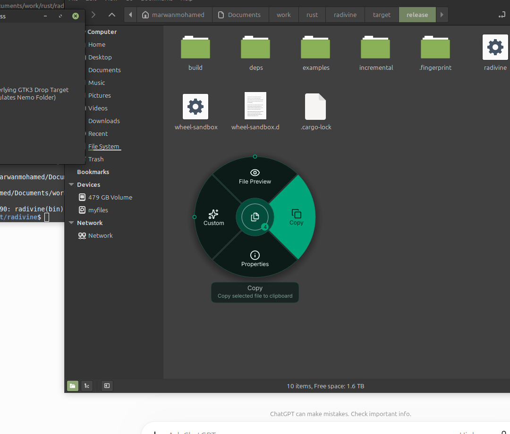
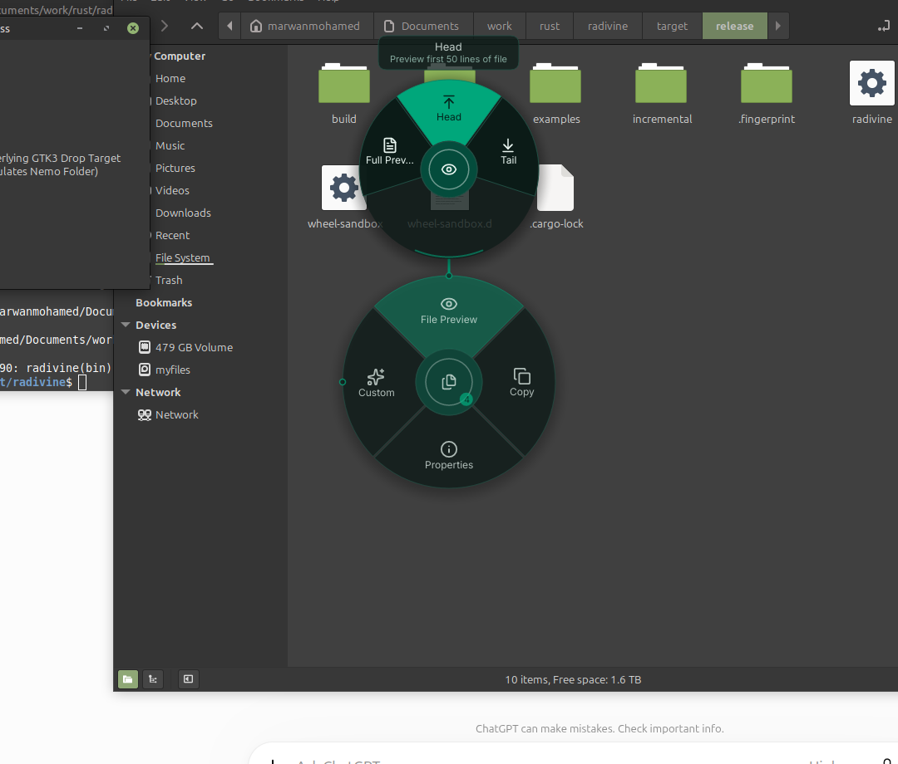
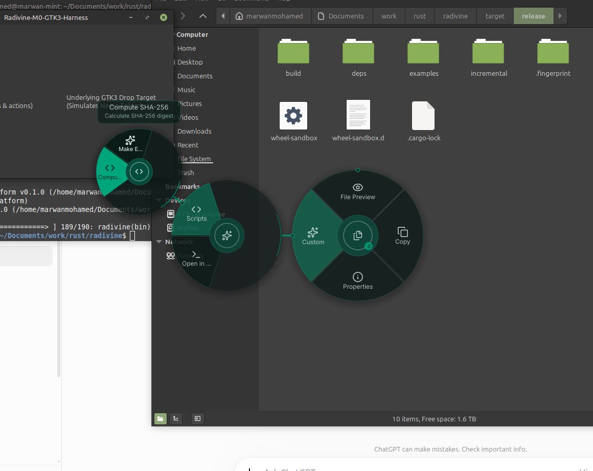
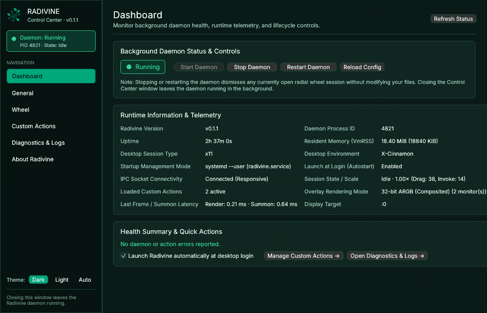
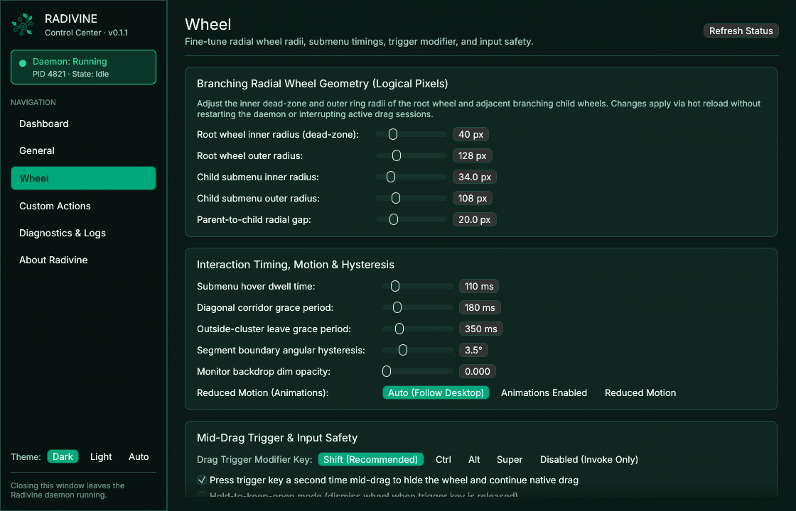
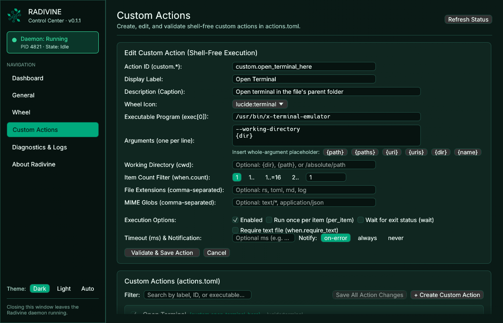
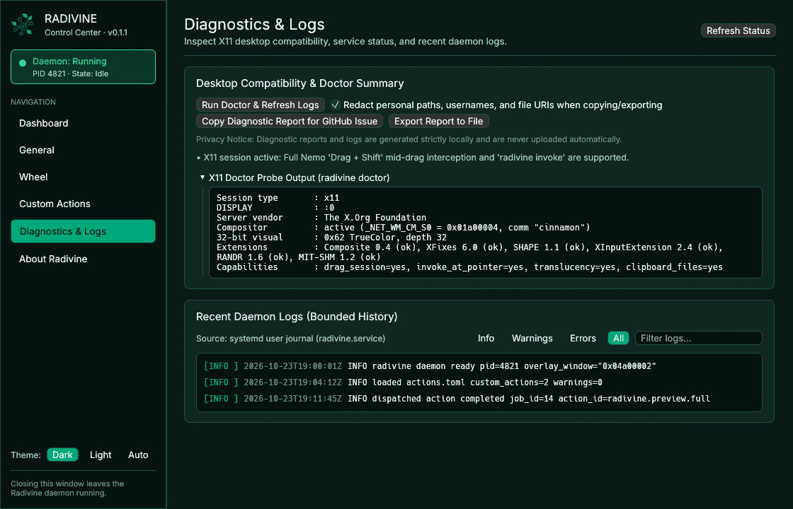
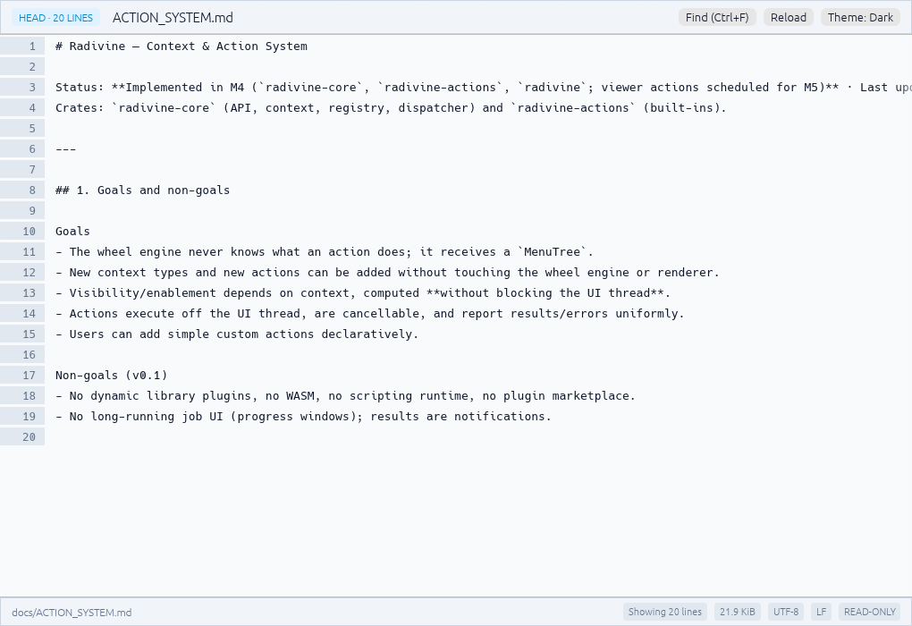
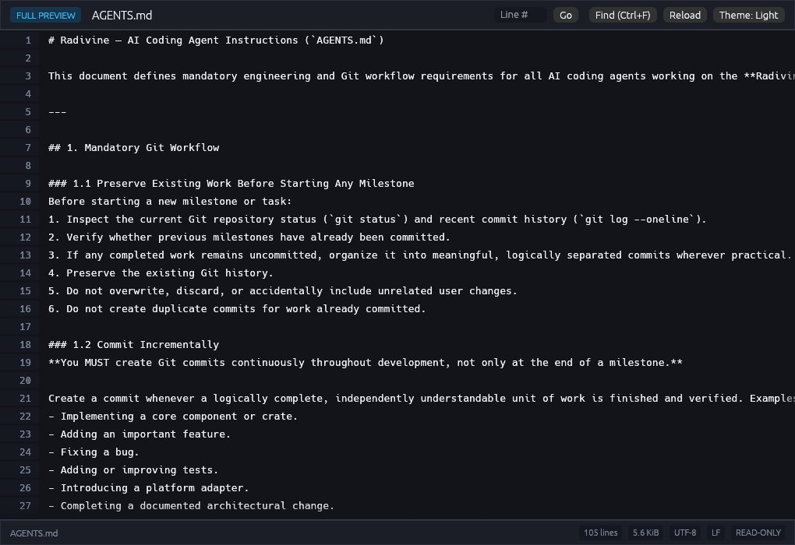

<div align="center">
  

  <h1>Radivine</h1>
  <p><strong>Branch into action.</strong></p>
  <p>A fast, extensible, context-aware radial action wheel for your Linux desktop.</p>

  <p>
    <a href="LICENSE-MIT"></a>
    
    
  </p>
</div>

---

## Overview

**Radivine** brings fluid, hierarchical radial interaction to Linux desktops. Instead of navigating deep linear context menus or switching windows during file operations, summon a branching radial wheel directly under your cursor:

- **Mid-Drag Activation (`Drag + Shift`):** Begin dragging one or more files in **Nemo** (or any XDND v5 source on X11) and press <kbd>Shift</kbd>. Radivine intercepts the drag in place (`< 27 ms`), displays context-aware actions around your cursor, and commits the chosen action on mouse release without moving or deleting your source files.
- **Two Selectable Radial Wheel Layouts (`Branching` & `Concentric`):** Use the classic **Branching (Child Wheels)** layout (`wheel.layout = "branching"`, default) or switch to the optional **Concentric (Nested Rings)** layout (`wheel.layout = "concentric"`), where submenus expand as outward concentric rings around a single immobile center with strict non-actionable hub/gap/corridor drop rejection and automatic fallback on small viewports (`< 668×742` logical px).
- **Invoke Mode (`radivine invoke`):** Summon the exact same radial wheel at any time via the **Nemo "Open in Radivine"** right-click action, a desktop keyboard shortcut, or the command line—with full mouse and keyboard navigation.
- **Built-In Image Conversion (`Convert ▸ Image`):** Convert single or batch images between **PNG**, **JPEG**, and **WebP** directly from the radial wheel (**Quick Convert**) or open the dedicated **Advanced Convert** dialog (`radivine-control convert`) for presets (`Web Optimized`, `Balanced`, `High Quality`, `Lossless`, `Compact Share`, plus custom presets), explicit quality/subsampling/compression controls, Lanczos3 resizing, alpha background flattening, EXIF auto-orientation, ICC color-profile preservation, and privacy-by-default EXIF stripping.
- **Durable Background Job Worker (`radivine-worker`):** Conversions run out-of-process in an on-demand worker backed by SQLite WAL (`~/.local/state/radivine/jobs.sqlite3`) with atomic `renameat2(RENAME_NOREPLACE)` no-overwrite output guarantees, cooperative cancellation, linked immutable retries, crash-recovery reconciliation, and automatic idle shutdown (`60 s`).
- **Native Control Center (`radivine-control`):** Start, stop, and monitor the background daemon without keeping a terminal open; enable **Launch Radivine at Login** (`systemd --user`); customize wheel radii, timings, and themes; configure **Conversion Settings** (`convert.toml`); monitor live conversion batches and history on the **Jobs** page; manage shell-free custom actions with live validation; and inspect desktop diagnostics and logs—with full native system clipboard (`Ctrl+C`/`Ctrl+V`/`Ctrl+X`) and Arabic/non-Latin system-font fallback.
- **High-Performance File Preview (`radivine-viewer`):** Inspect text and log files in a dedicated, read-only desktop viewer supporting **Full Preview** (virtualized scrolling + streaming search), **Head** (first $N$ lines), and **Tail** (last $N$ lines)—capable of opening `5 GiB` log files in `< 1 ms` of file I/O.
- **Context-Aware & Extensible:** Automatically inspects file types, MIME signatures, permissions, symlinks, and multi-file selections in the background, and lets you define custom shell-free actions in `~/.config/radivine/actions.toml`.

---

## Screenshots

### Branching Radial Wheel (1-Level, 2-Level & 3-Level Navigation)

| Root Wheel | 2-Level Submenu (`File Preview`) | 3-Level Submenu (`Custom -> Scripts`) |
| :---: | :---: | :---: |
|  |  |  |

### Radivine Control Center (`radivine-control`)

| Service Dashboard & Telemetry | Wheel Geometry & Timing Settings |
| :---: | :---: |
|  |  |
| **Custom Actions Manager (`actions.toml`)** | **Diagnostics, X11 Doctor & Bounded Logs** |
|  |  |

### Read-Only File Preview (`radivine-viewer`)

| Full Preview (Dark Theme) | Head Preview (Light Theme) | Streaming Search (`Ctrl+F`) |
| :---: | :---: | :---: |
|  |  |  |

---

## Supported Platforms

| Environment | Support Level | Notes |
| :--- | :--- | :--- |
| **Linux Mint 22.x (Cinnamon on X11)** | **Primary / Tier 1** | Full `Drag + Shift` mid-drag interception in Nemo + `Invoke` mode + `systemd --user` service |
| **Ubuntu / Debian X11 Desktops** (XFCE, MATE, GNOME Xorg, KDE X11) | **Supported** | Full X11 overlay + XDND v5 + `Invoke` mode |
| **Wayland Sessions** | **Invoke Mode / Experimental** | Wayland security protocols disallow global mid-drag X11 interception; use `radivine invoke` via file-manager action or shortcut (`radivine doctor` and Control Center report session details) |

---

## Installation

### Option 1: Install from the Debian Package (`.deb`)

Download `radivine_0.3.0_amd64.deb` and `SHA256SUMS.txt` from the [GitHub Releases](https://github.com/marawan6569/Radivine/releases) page:

```bash
# 1. Verify the package checksum
sha256sum -c SHA256SUMS.txt

# 2. Install the package
sudo apt install ./radivine_0.3.0_amd64.deb
```

What the `.deb` package installs:
- `/usr/bin/radivine-control` — native graphical Control Center, Conversion Settings, Jobs monitor, and standalone Advanced Convert dialog (`radivine-control convert`).
- `/usr/bin/radivine` — background radial wheel daemon, CLI client, and diagnostic tool.
- `/usr/bin/radivine-worker` — on-demand durable background conversion worker and CLI (`serve`, `status`, `list`, `show`, `cancel`, `retry`, `submit-convert`).
- `/usr/bin/radivine-viewer` — standalone read-only file preview application.
- `/usr/lib/systemd/user/radivine.service` — `systemd --user` background wheel daemon unit.
- `/usr/lib/systemd/user/radivine-worker.service` — hardened on-demand `systemd --user` conversion worker unit (`NoNewPrivileges=yes`, `PrivateNetwork=yes`, `ProtectSystem=strict`).
- `/usr/share/applications/radivine.desktop` — application menu launcher (opens **Radivine Control Center**).
- `/usr/share/nemo/actions/radivine.nemo_action` — **"Open in Radivine"** right-click action for Nemo.
- `/usr/share/doc/radivine/examples/` — opt-in autostart and example `config.toml`, `actions.toml`, and `convert.toml` files.

### Option 2: Build from Source

Prerequisites on Linux Mint 22.x / Ubuntu 24.04+:
- Rust `1.85+` (`edition = "2024"`)
- C compiler toolchain (`build-essential` / `gcc`) for compiling vendored `libwebp` (`v1.5.0`) and `SQLite`

```bash
git clone https://github.com/marawan6569/Radivine.git
cd Radivine

# Build optimized release binaries
cargo build --release

# Or build the installable Debian package at target/debian/radivine_0.3.0_amd64.deb
./scripts/build-deb.sh
```

---

## Quick Start & Usage

### 1. Open Radivine Control Center (No Terminal Required)

Launch **Radivine** from your desktop application menu (or run `radivine-control`):

1. Click **Start Daemon** on the **Dashboard** page to start the background service immediately (managed via `systemd --user` or a detached background process—closing the Control Center window leaves the daemon running).
2. Check **Launch Radivine automatically at desktop login** to have Radivine start automatically whenever you log in.
3. Customize wheel geometry, timings, themes, preview line counts, conversion defaults/presets, and shell-free custom actions from the **General**, **Wheel**, **Conversion**, and **Custom Actions** pages—changes are validated before saving and hot-reloaded without interrupting active sessions.
4. Track live batch conversions, inspect per-file outcomes, cancel in-flight jobs, or run linked retries on the **Jobs** page.

### 2. Use the Radial Wheel

- **Mid-Drag (`Drag + Shift`):**
  1. Select one or more files in **Nemo** and begin dragging with the left mouse button held.
  2. Press <kbd>Shift</kbd> once while holding the drag. The Radivine radial wheel blooms around your cursor.
  3. Hover over a segment to highlight it; dwell briefly on a parent segment (`File Preview`, `Convert`, `Custom`) to branch into a child wheel (e.g., `Convert ▸ Image ▸ PNG / JPEG / WebP / Advanced…`).
  4. Release the left mouse button on an enabled action segment to execute it—or release on the center hub (or press <kbd>Shift</kbd> / <kbd>Esc</kbd>) to cancel cleanly.
- **Invoke Mode (`radivine invoke`):**
  - Right-click any selection in Nemo and choose **Open in Radivine**, or run:
    ```bash
    radivine invoke /path/to/photo.png
    ```
  - Navigate with the mouse or keyboard (<kbd>Tab</kbd> / Arrow keys to cycle, <kbd>1</kbd>–<kbd>9</kbd> for direct segment selection, <kbd>Enter</kbd> / <kbd>Space</kbd> to activate, <kbd>Backspace</kbd> to close a submenu, <kbd>Esc</kbd> to cancel).

### 3. CLI & Service Reference

```text
# Graphical Control Center & Advanced Convert Dialog
Usage: radivine-control [--page <dashboard|general|wheel|actions|conversion|jobs|diagnostics|about>]
       radivine-control convert [--stdin] [--] [PATHS...]

# Wheel Daemon & CLI Client
Usage: radivine [--config <PATH>] [--socket <PATH>] <COMMAND>

Commands:
  daemon   Run the persistent background Radivine wheel daemon
  invoke   Summon the radial wheel at the cursor in Invoke mode (`radivine invoke [FILES...]`)
  status   Query the running daemon status (`--json` for machine-readable output)
  reload   Reload `~/.config/radivine/config.toml` and `~/.config/radivine/actions.toml`
  quit     Gracefully stop the running daemon
  doctor   Inspect X11 extensions, compositor status, monitors, and desktop environment

# Background Conversion Worker & Job CLI
Usage: radivine-worker [--socket <PATH>] [--db <PATH>] <COMMAND>

Commands:
  serve           Run the on-demand background conversion worker daemon
  status          Query worker health, queue depth, and concurrency (`--json`)
  list            List recent conversion jobs (`--limit N`, `--json`)
  show <JOB_ID>   Show detailed job summary and per-item outcomes (`--json`)
  cancel <JOB_ID> Cooperatively cancel an active or queued job
  retry <JOB_ID>  Create a linked retry job (`--mode <failed|failed-and-cancelled|all>`)
  submit-convert  Submit a conversion job directly from the CLI
```

You can also manage the background daemon directly with `systemctl --user`:

```bash
systemctl --user start radivine.service
systemctl --user enable radivine.service
systemctl --user status radivine.service
```

---

## Configuration & Custom Actions

Radivine reads configuration files from `~/.config/radivine/` (`$XDG_CONFIG_HOME/radivine/`). `config.toml`, `actions.toml`, and `convert.toml` can all be edited graphically in **Radivine Control Center** (which preserves your comments, formatting, and unknown keys via `toml_edit`) or edited by hand:

```bash
mkdir -p ~/.config/radivine
cp /usr/share/doc/radivine/examples/config.example.toml ~/.config/radivine/config.toml
cp /usr/share/doc/radivine/examples/actions.example.toml ~/.config/radivine/actions.toml
cp /usr/share/doc/radivine/examples/convert.example.toml ~/.config/radivine/convert.toml
radivine reload
```

### Custom Actions (`~/.config/radivine/actions.toml`)

Custom actions execute directly via `execve` **without a shell** (`sh -c` is rejected) to prevent command-injection vulnerabilities even on filenames containing spaces, quotes, or shell metacharacters:

```toml
[[action]]
id = "custom.sha256_notify"
label = "SHA-256 Digest"
enabled = true
icon = "lucide:code"
description = "Calculate SHA-256 checksum for selected files"
exec = ["/usr/bin/sha256sum", "{paths}"]
per_item = false
wait = true
timeout_ms = 10000
notify = "always"
when = { count = "1..=16" }
```

Supported whole-argument placeholders: `{path}`, `{paths}`, `{uri}`, `{uris}`, `{dir}`, `{name}`.

---

## Architecture Overview

Radivine is organized as a modular Rust workspace with strict safety boundaries (enforced in CI via `./scripts/check-dep-graph.sh`):

- **[`crates/radivine-wheel`](crates/radivine-wheel):** `#![forbid(unsafe_code)]`, pure, deterministic, zero-I/O hierarchical radial wheel engine (`0` heap allocations in steady-state pointer/tick/scene loops; `~420 ns` per frame).
- **[`crates/radivine-render`](crates/radivine-render):** `#![forbid(unsafe_code)]` CPU renderer (`tiny-skia`, `cosmic-text`, `resvg`) with premultiplied RGBA8 alpha, cached shadows/glyphs/icons, and incremental damage-rectangle tracking (`~212 µs` at 1080p).
- **[`crates/radivine-core`](crates/radivine-core):** Context model, RFC 2483 / RFC 8089 `text/uri-list` parser, non-blocking background `Enricher` (`1.5 s` timeout watchdog), and bounded `Dispatcher` thread pool.
- **[`crates/radivine-dbus`](crates/radivine-dbus):** `#![forbid(unsafe_code)]` zero-dependency pure-Rust D-Bus client for `org.freedesktop.Notifications` and `org.freedesktop.FileManager1`.
- **[`crates/radivine-actions`](crates/radivine-actions):** `#![forbid(unsafe_code)]` built-in actions (`File Preview`, `Convert ▸ Image`, `Copy`, `Properties`) and `actions.toml` parser/validator.
- **[`crates/radivine-convert`](crates/radivine-convert):** `#![forbid(unsafe_code)]` codec-free conversion engine, format catalog, presets, `convert.toml` schema, `O_RDONLY | O_NOFOLLOW | O_NONBLOCK` source validation, and `.rvstage-<uid>` + `renameat2(RENAME_NOREPLACE)` atomic output staging.
- **[`crates/radivine-convert-image`](crates/radivine-convert-image) & [`ffi/radivine-webp`](ffi/radivine-webp):** `#![forbid(unsafe_code)]` built-in PNG/JPEG/WebP codec backend with SIMD acceleration (`jpeg-encoder/simd`, `libwebp-sys` `sse41`+`avx2`), EXIF orientation normalization, ICC/EXIF preservation, Lanczos3 resize, and RIFF `VP8X` container muxing.
- **[`crates/radivine-jobs`](crates/radivine-jobs):** `#![forbid(unsafe_code)]` durable job contract, `WirePath` lossless path codec, `SO_PEERCRED`-verified Unix socket IPC client, and on-demand `WorkerLauncher`.
- **[`crates/radivine-platform`](crates/radivine-platform):** X11 backend (`x11rb` + POSIX MIT-SHM), `_NET_WM_WINDOW_TYPE_DND` ARGB overlay, `XShape` input/bounding regions, `XInput2` modifier arming, XDND v5 state machine (`XdndActionPrivate`), and persistent `CLIPBOARD` selection server.
- **[`apps/radivine`](apps/radivine):** Single-instance background wheel daemon, Unix domain socket IPC server, and CLI client.
- **[`apps/radivine-worker`](apps/radivine-worker):** `#![forbid(unsafe_code)]` on-demand background conversion worker with SQLite WAL persistence (`jobs.sqlite3`), crash-recovery journal reconciliation, token-bucket resource governor, and CLI.
- **[`apps/radivine-control`](apps/radivine-control):** `#![forbid(unsafe_code)]` standalone `eframe`/`egui` Control Center application (8 pages + standalone `radivine-control convert` window) with native clipboard (`arboard`) and Arabic/non-Latin system-font fallback (`fontique`/Fontconfig).
- **[`apps/radivine-viewer`](apps/radivine-viewer):** `#![forbid(unsafe_code)]` standalone `eframe`/`egui` file preview binary (`Full`, `Head`, `Tail`, and streaming `1 MiB` overlap search).

For detailed design documents and benchmarks, see:
- [`docs/ARCHITECTURE.md`](docs/ARCHITECTURE.md)
- [`docs/CONTROL_CENTER_DESIGN.md`](docs/CONTROL_CENTER_DESIGN.md)
- [`docs/WHEEL_ENGINE_DESIGN.md`](docs/WHEEL_ENGINE_DESIGN.md)
- [`docs/PLATFORM_INTEGRATION.md`](docs/PLATFORM_INTEGRATION.md)
- [`docs/ACTION_SYSTEM.md`](docs/ACTION_SYSTEM.md)
- [`docs/BENCHMARKS.md`](docs/BENCHMARKS.md)
- [`docs/DECISIONS.md`](docs/DECISIONS.md)

---

## Uninstallation

```bash
sudo apt remove radivine
```

User configuration and job-history files under `~/.config/radivine/` and `~/.local/state/radivine/` are preserved on removal.

---

## License

Licensed under either of:

- **Apache License, Version 2.0** ([`LICENSE-APACHE`](LICENSE-APACHE) or <http://www.apache.org/licenses/LICENSE-2.0>)
- **MIT License** ([`LICENSE-MIT`](LICENSE-MIT) or <https://opensource.org/licenses/MIT>)

at your option. See [`THIRD_PARTY_NOTICES.md`](THIRD_PARTY_NOTICES.md) for third-party font, icon, and crate license attributions.
