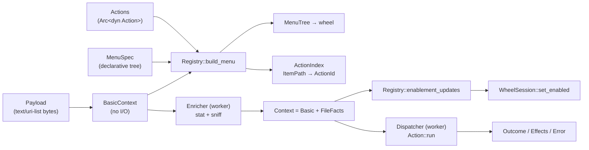

# Radivine — Context & Action System

Status: **Implemented in M4–M5 & v0.2.0 C3 (`radivine-core`, `radivine-actions`, `radivine`, `radivine-viewer`, `radivine-jobs`)** · Last updated: 2026-10-24
Crates: `radivine-core` (API, context, registry, dispatcher), `radivine-actions` (built-ins including Quick Convert), `radivine-jobs` (background worker IPC client), and `radivine-viewer` (preview application).

---

## 1. Goals and non-goals

Goals
- The wheel engine never knows what an action does; it receives a `MenuTree`.
- New context types and new actions can be added without touching the wheel engine or renderer.
- Visibility/enablement depends on context, computed **without blocking the UI thread**.
- Actions execute off the UI thread, are cancellable, and report results/errors uniformly.
- Users can add simple custom actions declaratively.

Non-goals (v0.1)
- No dynamic library plugins, no WASM, no scripting runtime, no plugin marketplace.
- No long-running job UI (progress windows); results are notifications.

## 2. Concepts



| Term | Meaning |
|------|---------|
| **Payload** | Raw data from the platform (`text/uri-list` bytes in v0.1) |
| **BasicContext** | Parsed payload + source info + cheap derived data (names, extensions, extension-based MIME). Built synchronously on the UI thread, **no filesystem access** |
| **FileFacts** | Per-item facts requiring I/O (`stat`, symlink target, readability, content sniff). Produced asynchronously by the **Enricher** |
| **Context** | `BasicContext` + `Option<Vec<FileFacts>>`, shared as `Arc<Context>` snapshots |
| **Action** | Implementation of `trait Action` with stable `ActionId` |
| **MenuSpec** | Declarative tree of action references and submenus (built-ins in code, user layer from TOML) |
| **MenuTree** | Context-filtered tree consumed by `radivine-wheel` |
| **ActionIndex** | Map from wheel `ItemPath` to `ActionId` for the current session |
| **Job** | One execution of an action on a worker thread |

## 3. The visibility / enablement rule (key design rule)

- **Visibility** (`Action::is_visible(&BasicContext)`) and **dynamic captions** (`Action::description_for(&BasicContext)`) use only the `BasicContext`. They decide the **layout** and initial caption of the wheel, so they must be known before the first frame and must perform **zero filesystem I/O**.
- **Enablement** (`Action::enablement(&Context)`) may use `FileFacts`. It returns `Enabled`, `Disabled { reason }` or `Pending`. Enablement changes **never alter layout**; the app forwards them to `WheelSession::set_enabled`.
- Until `FileFacts` arrive, items whose enablement needs them are `Pending` → shown disabled with reason `"Checking…"`. When the enricher finishes (expected to take `< 3 ms` on local disks) they flip to enabled/disabled with a reason.
- Items beyond the 64-item enrichment cap (`CAP_EXCEEDED_REASON`) or items whose enrichment timed out (`ENRICH_TIMEOUT_REASON`, default 1500 ms) satisfy `FileFacts::is_uninspected() == true`. Actions that inspect individual items (like Preview) treat uninspected items as disabled (`"Couldn't inspect the file"`), whereas batch actions delegated to `radivine-worker` (like Quick Convert) enable optimistically when uninspected candidate items remain and let the worker validate each item at execution time.

Rationale: network mounts (gvfs/sshfs/NFS/SMB) can block `stat` for seconds; the wheel must still appear instantly and must not reshuffle under the pointer.

## 4. Context model

```rust
#[non_exhaustive]
pub enum ContextKind { Files /* v0.1 */, Text /* future */, Url /* future */ }

pub enum InvocationMode { Drag, Invoke }

pub struct SourceInfo { pub app: Option<String>, pub pid: Option<u32> }   // e.g. Some("nemo"); the app copies it from the platform's SourceInfo

pub struct BasicContext {
    pub kind: ContextKind,
    pub mode: InvocationMode,
    pub source: SourceInfo,
    pub items: Vec<Item>,          // capped at 10_000
    pub truncated: bool,           // more items were dropped than the cap
}

pub struct Item {
    pub uri: String,               // as received, normalised (no trailing CR)
    pub local_path: Option<PathBuf>, // Some only for file:// with empty or "localhost" host
    pub name: String,              // last path segment, percent-decoded, lossy UTF-8 for display
    pub ext: Option<String>,       // lowercase, without dot
    pub guessed_mime: Option<&'static str>, // mime_guess from extension
}

pub struct FileFacts {
    pub kind: FileKind,
    pub size: Option<u64>,
    pub readable: bool,
    pub text: TextVerdict,
    pub sniffed_mime: Option<&'static str>, // from `infer`
    pub error: Option<String>,               // short, user-presentable
}
pub enum FileKind { Regular, Directory, Fifo, Socket, CharDevice, BlockDevice, BrokenSymlink, Missing, Other }
pub enum TextVerdict { Text(TextEncoding), Binary, Unknown }
pub enum TextEncoding { Utf8, Utf8Bom, Utf16Le, Utf16Be, Unknown8Bit }

pub struct Context {
    pub basic: BasicContext,
    pub facts: Option<Vec<FileFacts>>,      // index-aligned with basic.items; None until enriched
    pub symlink: Vec<bool>,                 // per item: was the path itself a symlink (from enrichment)
}
```

### 4.1 Building the BasicContext from a payload

1. Choose the type: if the drag offers `text/uri-list` → `Files` and request that type. (v0.1 ignores other types; if absent, the session shows "No actions for this item" and dismisses.)
2. Parse per RFC 2483: split on `\r\n` (accept bare `\n`), skip empty lines and lines starting with `#`, trim.
3. For each URI: `local_path` only for `file://` with empty host or `localhost`; percent-decode the path as **bytes** into `OsString` (filenames need not be UTF-8); reject non-absolute paths.
4. Derive `name`, `ext`, `guessed_mime`.
5. Invoke mode: CLI arguments that are plain paths are canonicalised by the CLI into `file://` URIs before sending over IPC.

### 4.2 Enrichment (worker thread)

For the first 64 items (rest stay unenriched → `Unknown`):

1. `symlink_metadata(path)` → record whether it is a symlink.
2. `metadata(path)` (follows links); `NotFound` after a symlink → `BrokenSymlink`; `NotFound` otherwise → `Missing`.
3. Only for `Regular` files: open with `O_RDONLY | O_NONBLOCK | O_CLOEXEC`, then **`fstat` the opened fd** and confirm it is still a regular file (never read FIFOs/devices/sockets — opening a FIFO without `O_NONBLOCK` blocks forever). Permission denied → `readable = false`.
4. Read up to 8 KiB and compute the text verdict:
   1. Empty file → `Text(Utf8)`.
   2. BOM: `EF BB BF` → `Utf8Bom`; `FF FE` → `Utf16Le`; `FE FF` → `Utf16Be`.
   3. `infer` recognises a binary format (image, audio, video, archive, font, ELF, PDF, …) → `Binary` (+ `sniffed_mime`).
   4. Any NUL byte → `Binary`.
   5. Valid UTF-8 (allowing an incomplete sequence at the 8 KiB boundary) → `Text(Utf8)`.
   6. More than 10 % control bytes (excluding `\t \n \r \f \x1b`) → `Binary`; else `Text(Unknown8Bit)`.
5. Overall deadline 1500 ms; per-item results are streamed back so partial facts can be applied.

The enricher result is sent through the calloop channel; the app replaces the session's `Arc<Context>` and calls `Registry::enablement_updates`.

## 5. The `Action` API

```rust
pub struct ActionId(pub Arc<str>);   // stable, namespaced: "radivine.preview.head", "custom.open-in-code"

pub struct ActionMeta {
    pub id: ActionId,
    pub label: String,               // ≤ 16 chars recommended (segment label)
    pub icon: Option<IconKey>,       // "lucide:eye", "theme:document-properties"
    pub description: Option<String>, // shown in the wheel caption
    pub kinds: &'static [ContextKind],
}

pub enum Enablement { Enabled, Disabled { reason: Cow<'static, str> }, Pending }

pub trait Action: Send + Sync + 'static {
    fn meta(&self) -> &ActionMeta;
    /// Layout decision. MUST NOT perform I/O. Called on the UI thread.
    fn is_visible(&self, ctx: &BasicContext) -> bool;
    /// Optional context-aware caption description (`E1`). MUST NOT perform I/O.
    /// Defaults to `self.meta().description.as_deref().map(Cow::Borrowed)`.
    fn description_for(&self, ctx: &BasicContext) -> Option<Cow<'_, str>> {
        let _ = ctx;
        self.meta().description.as_deref().map(Cow::Borrowed)
    }
    /// May use FileFacts. MUST NOT perform I/O. Called on the UI thread.
    fn enablement(&self, ctx: &Context) -> Enablement { let _ = ctx; Enablement::Enabled }
    /// Executed on a worker thread. May block. Should poll `job.is_cancelled()` in loops.
    fn run(&self, ctx: &Context, job: &JobHandle) -> Result<Outcome, ActionError>;
}

pub enum Outcome {
    Done,
    Message(String),                 // shown as a notification
    Effects(Vec<Effect>),            // routed by the app: SetClipboard on the UI thread, Notify to the notification worker
}
pub enum Effect {
    SetClipboard(ClipboardRequest),  // UI thread → app maps to platform ClipboardContent → Platform::set_clipboard
    Notify { summary: String, body: Option<String> },   // notification worker (never D-Bus on the UI thread)
}
pub struct ClipboardRequest { pub uris: Vec<String>, pub local_paths: Vec<PathBuf>, pub op: ClipOp }
pub enum ClipOp { Copy }   // Cut is out of scope (would imply deleting/moving source files)

#[derive(thiserror::Error, Debug)]
pub enum ActionError {
    #[error("not applicable: {0}")] NotApplicable(String),
    #[error("cancelled")] Cancelled,
    #[error("I/O error: {0}")] Io(#[from] std::io::Error),
    #[error("could not start {program}: {source}")] Spawn { program: String, source: std::io::Error },
    #[error("{0}")] Other(String),
}

pub struct JobHandle { /* cancel: Arc<AtomicBool>, id */ }
impl JobHandle {
    pub fn is_cancelled(&self) -> bool;
    pub fn id(&self) -> JobId;
}
```

Why trait objects: the registry is heterogeneous and actions run at human rates; dynamic dispatch cost is irrelevant and keeps the API simple. Actions must be `Send + Sync` because `run` happens on workers while metadata is read on the UI thread.

## 6. Registry, menu specification and menu building

### 6.1 `MenuSpec`

```rust
pub enum MenuSpec {
    Action(ActionId),
    Submenu {
        id: Arc<str>, label: String, icon: Option<IconKey>, description: Option<String>,
        children: Vec<MenuSpec>,
        default: Option<ActionId>,     // what a drop directly on the submenu item does (optional)
    },
    /// Placeholder expanded with the user's matching custom actions (from actions.toml).
    CustomActions,
}
```

Built-ins are declared in Rust (type-checked) by `radivine-actions::default_menu()`:

```rust
vec![
    MenuSpec::Submenu { id: "radivine.preview".into(), label: "File Preview".into(), icon: Some(icon("lucide:eye")),
        description: Some("Preview the file".into()),
        children: vec![
            MenuSpec::Action(id("radivine.preview.full")),
            MenuSpec::Action(id("radivine.preview.head")),
            MenuSpec::Action(id("radivine.preview.tail")),
        ],
        default: None },
    MenuSpec::Submenu { id: "radivine.convert".into(), label: "Convert".into(), icon: Some(icon("lucide:arrow-right-left")),
        description: Some("Convert files to another format".into()),
        children: vec![
            MenuSpec::Submenu { id: "radivine.convert.image".into(), label: "Image".into(), icon: Some(icon("lucide:file-image")),
                description: Some("Convert images to PNG, JPEG, or WebP".into()),
                children: vec![
                    MenuSpec::Action(id("radivine.convert.image.png")),
                    MenuSpec::Action(id("radivine.convert.image.jpeg")),
                    MenuSpec::Action(id("radivine.convert.image.webp")),
                ],
                default: None },
        ],
        default: None },
    MenuSpec::Action(id("radivine.copy")),
    MenuSpec::Action(id("radivine.properties")),
    MenuSpec::Submenu { id: "radivine.custom".into(), label: "Custom".into(), icon: Some(icon("lucide:sparkles")),
        description: Some("Your custom actions".into()), children: vec![MenuSpec::CustomActions], default: None },
    // label shown in the wheel: "Custom Actions" is too long for a segment; segment shows "Custom",
    // caption shows the description.
]
```

### 6.2 `ActionRegistry`

```rust
pub struct ActionRegistry { /* actions: HashMap<ActionId, Arc<dyn Action>>, spec: Vec<MenuSpec>, overrides: MenuOverrides */ }
impl ActionRegistry {
    pub fn new() -> Self;
    pub fn register(&mut self, action: Arc<dyn Action>) -> Result<(), RegistryError>; // duplicate id → error
    pub fn set_menu(&mut self, spec: Vec<MenuSpec>, overrides: MenuOverrides);
    pub fn build_menu(&self, ctx: &Context, limits: MenuLimits) -> Option<(MenuTree, ActionIndex)>;
    pub fn enablement_updates(&self, ctx: &Context, index: &ActionIndex) -> Vec<EnablementUpdate>;
    pub fn get(&self, id: &ActionId) -> Option<Arc<dyn Action>>;
}
pub struct EnablementUpdate { pub path: ItemPath, pub enabled: bool, pub disabled_reason: Option<Arc<str>> }
pub struct MenuLimits { pub max_items_per_wheel: u8, pub max_depth: u8 }
pub struct MenuOverrides { pub hide: Vec<ActionId>, pub order: Vec<Arc<str>> }   // from actions.toml [menu]
#[derive(thiserror::Error, Debug)] pub enum RegistryError { #[error("duplicate action id {0}")] DuplicateId(String) }
```

### 6.3 `build_menu` algorithm

1. Apply overrides: remove hidden ids; reorder top-level entries by `order` (unlisted keep relative order after listed ones).
2. Expand `CustomActions` with user actions whose `when` matches the BasicContext.
3. Depth-first: keep `Action` entries whose action exists, supports `ctx.basic.kind`, and `is_visible(&ctx.basic)`; compute enablement with the current `Context` (`Pending` → disabled + "Checking…").
4. Prune submenus with no remaining children; drop `default` if that child was pruned.
5. Enforce limits (`max_items_per_wheel`, `max_depth`): a wheel with more than `max_items_per_wheel` items keeps its first `max_items_per_wheel − 1` items and moves the rest into an automatic "More…" submenu (`radivine.more`, icon `lucide:more-horizontal`); submenus beyond depth → disabled "Too deeply nested".
6. Return `None` if the root is empty (session shows "No actions for this item").
7. Produce `MenuTree` (labels, icons and descriptions from `ActionMeta`, disabled reasons from enablement, submenu labels from spec) and `ActionIndex`.

`build_menu` is pure and allocation-light (runs once per session on the UI thread; ≤ 100 nodes).

## 7. Dispatcher

```rust
pub type JobSink = Box<dyn Fn(JobEvent) + Send + Sync>;   // supplied by the app (wraps a calloop channel sender); core has no calloop dependency
pub struct JobId(pub u64);
pub struct Dispatcher { /* sink: Arc<JobSink>, queue: VecDeque<PendingJob>, running: HashMap<JobId, Arc<AtomicBool>> */ }
impl Dispatcher {
    pub fn new(sink: JobSink, max_concurrent: usize /* 4 */) -> Self;
    pub fn dispatch(&mut self, action: Arc<dyn Action>, ctx: Arc<Context>) -> JobId;
    pub fn cancel(&mut self, job: JobId);
    pub fn cancel_all(&mut self);       // shutdown
}
pub enum JobEvent { Finished { job: JobId, action: ActionId, result: Result<Outcome, ActionError> } }
```

- One named `std::thread` per job (`radivine-job-<n>`); at most 4 concurrent, further jobs queue.
- Panics inside `run` are caught (`catch_unwind`) and reported as `ActionError::Other("internal error")`.
- The app maps results: `Done` → nothing (or a brief success notification if the action asks); `Message` → notification; `Effects` → executed on the UI thread; `Err` → error notification with `ActionError` text; details logged.
- On shutdown `cancel_all()` sets all tokens; the process exits without joining (workers are best-effort).
- Before dispatching, the app re-checks `enablement` on the latest `Context`; if it is not `Enabled`, the job is not started and the reason is shown.

## 8. Built-in actions (`radivine-actions`)

| Id | Label | Visible when (BasicContext) | Enabled when (Context) | Behaviour |
|----|-------|-----------------------------|------------------------|-----------|
| `radivine.debug.log` | (any) | always | always | **M1–M3 placeholder**: logs `id`, `ItemPath`, mode, source, item URIs at `info`; returns `Done`. Every built-in is registered as a `LogAction` with the real metadata until its real implementation lands. |
| `radivine.preview.full` | Full Preview | `Files`, exactly 1 item, `local_path` is `Some`, `guessed_mime` not a known non-text family (`image/`, `audio/`, `video/`, `font/`, archives, `application/pdf`, …) | `Regular`, `readable`, `text = Text(_)` | Spawn `radivine-viewer --mode full -- <path>` |
| `radivine.preview.head` | Head | same | same | Spawn `radivine-viewer --mode head --lines <N> -- <path>` (`N` from config, default 50) |
| `radivine.preview.tail` | Tail | same | same | Spawn `radivine-viewer --mode tail --lines <N> -- <path>` |
| `radivine.convert.image.png` | PNG | `Files`, ≥ 1 local candidate image (`png`, `jpg`/`jpeg`, `webp`), and not a single-item selection already `.png` | ≥ 1 item confirmed convertible via `FileFacts.sniffed_mime` + `CapabilityCatalog`, OR ≥ 1 candidate item uninspected (`> 64` cap or timeout) after pending items finish | Submits a durable `convert.image` job (`target = "png"`) to `radivine-worker` via `radivine-jobs::JobsClient::connect_or_launch` |
| `radivine.convert.image.jpeg` | JPEG | same (hidden when single item is already `.jpg`/`.jpeg`) | same (`target = "jpeg"`) | Submits a durable `convert.image` job (`target = "jpeg"`) to `radivine-worker` |
| `radivine.convert.image.webp` | WebP | same (hidden when single item is already `.webp`) | same (`target = "webp"`) | Submits a durable `convert.image` job (`target = "webp"`) to `radivine-worker` |
| `radivine.copy` | Copy | `Files`, ≥ 1 item | always | Returns `Effects([SetClipboard(ClipboardRequest { uris, local_paths, op: ClipOp::Copy })])` → paste works in Nemo |
| `radivine.properties` | Properties | `Files`, ≥ 1 item | always | D-Bus `org.freedesktop.FileManager1.ShowItemProperties(uris, startup_id="")` on the session bus (Nemo implements `org.freedesktop.FileManager1`; verify in M4); error → notification |
| `custom.<id>` | user | from `when` | file facts if `when.require_text = true` | See §9 |

Disabled reasons (shown in the caption): "Folders can't be previewed", "Not a text file", "No permission to read", "Broken link", "Special file", "Select a single file to preview", "Checking…".

### 8.1 Viewer process contract (`radivine-viewer`, M5)

```
radivine-viewer --mode <full|head|tail> [--lines N] [--title TITLE] -- <PATH>
exit 0 normal close · 2 usage error · 3 cannot open file (message shown in-window before exit is NOT required; print to stderr)
```

The daemon locates the viewer next to its own executable (`current_exe().parent()/radivine-viewer`), else in `PATH`. The spawn is detached (`setsid`), stdout/stderr to the log.

Viewer behaviour:
- **Head**: stream with a 64 KiB `BufReader`; stop after N lines or 8 MiB (banner "Output truncated"). Lines longer than 64 KiB are cut with "…".
- **Tail**: seek to the end; scan backwards in 64 KiB blocks counting `\n` (a final trailing newline does not start a new line) until N+1 newlines, start-of-file, or 8 MiB scanned; then decode forward from that offset. Cost proportional to the size of the last N lines, independent of file size.
- **Full**: no `mmap` (a concurrently truncated file would `SIGBUS`). Background thread builds a sparse line index (byte offset of every 1024th line, `memchr` newline scan); UI shows the first 64 KiB immediately and uses `egui::ScrollArea::show_rows` with chunked `pread`s for visible rows. Progress shown while indexing; total line count when done.
- **Search** (`Ctrl+F`): streaming `memchr::memmem` over 1 MiB chunks (overlap = pattern length − 1), case-sensitive toggle; results as line numbers via the index; `Enter`/`Shift+Enter` next/previous.
- **Encodings**: UTF-8 (lossy display), UTF-8 BOM, UTF-16 LE/BE via `encoding_rs` (chunks aligned to 2 bytes); `Unknown8Bit` displayed lossily with a banner. Legacy-encoding detection (`chardetng`) is future work.
- Read-only. Never writes to the file.

## 9. Custom actions (`actions.toml`)

```toml
[[action]]
id = "open-in-code"                 # registered as "custom.open-in-code"
label = "Open in Code"
icon = "lucide:code"                # or "theme:<icon-name>"
description = "Open with Visual Studio Code"
exec = ["code", "--", "{paths}"]    # argument vector — NO shell
cwd = "{dir}"                       # optional
per_item = false                    # true: spawn once per item
notify = "on-error"                 # never | on-error | always

[action.when]
scheme = ["file"]                   # default ["file"]
count = "1.."                       # "1", "2..5", "1.."
mime = ["text/*", "application/json"]   # globs against guessed_mime (BasicContext)
extensions = ["rs", "toml"]         # optional, OR-combined with mime
require_text = false                # true: enablement requires TextVerdict::Text
```

Placeholders must each be an **entire** argv element. Partial interpolation such as `"--file={path}"` is rejected at load time with a clear error (keeps quoting/injection issues impossible; users who need it can wrap a script).

| Placeholder | Expands to |
|-------------|-----------|
| `{path}` | the item's local path (requires `count = "1"` or `per_item = true`) |
| `{paths}` | all local paths, one argv element each |
| `{uri}` / `{uris}` | URI(s) |
| `{dir}` | parent directory of the (first) item |
| `{name}` | file name of the (first) item |

Execution: `std::process::Command` with the argv, detached; inherits the daemon's environment; the action returns once the process has been spawned (no waiting) unless `wait = true` is set (then exit status ≠ 0 → error notification).

Security: no shell unless the user writes `["sh", "-c", "…"]` themselves (documented as their responsibility); placeholders never splice into strings; config files are only read from the user's own config directory.

## 10. Menu overrides (`actions.toml`)

```toml
[menu]
hide  = ["radivine.properties"]
order = ["radivine.preview", "radivine.copy", "radivine.custom", "radivine.properties"]
```

Preview line counts (`[preview] head_lines`, `tail_lines`) are behaviour settings and live in `config.toml` (ARCHITECTURE.md §7.4), not here.

## 11. Static vs. dynamic menus (evaluation)

| Approach | Pros | Cons | Decision |
|----------|------|------|----------|
| Static, code-declared built-ins + declarative TOML user layer | Type-checked, predictable layout, trivial to test, enough for v0.1 | Cannot list e.g. installed apps | **v0.1** |
| Fully declarative (TOML) built-ins | Users can restructure everything | Loses type checking; config errors break the default experience | Rejected for built-ins |
| Dynamic providers (`trait MenuProvider { fn entries(&self, ctx: &BasicContext) -> Vec<DynamicEntry> }`) | "Open With ▸ apps", recent destinations | Needs caching (MIME → apps lookup does I/O), layout stability rules | **Future** (post-v0.1): providers must return cached data synchronously; refresh happens in workers between sessions |
| Lazy children (computed when a submenu opens) | Cheap initial build | Layout changes mid-interaction; complicates the engine | Rejected (engine stays simple; trees are complete at build time) |

## 12. Extension path

1. **Now**: built-in actions are ordinary `impl Action` types in `radivine-actions`; adding one = implement the trait + register + add a `MenuSpec` entry + tests.
2. **Next**: third-party Rust crates depending on `radivine-core` can provide actions compiled into custom builds (feature flags in the app).
3. **Later (only if demanded)**: an out-of-process action protocol (JSON over stdin/stdout, like LSP) — keeps memory safety and crash isolation; no binary plugin ABI.

## 13. Testing hooks

- `radivine-core` ships `test_util::{fake_context(...), FakeAction}` for unit tests.
- `build_menu`, `enablement_updates`, URI parsing, text verdict, custom-action matching and placeholder expansion are pure functions with table-driven tests.
- See [TESTING_STRATEGY.md](TESTING_STRATEGY.md).
