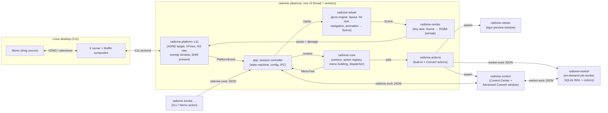
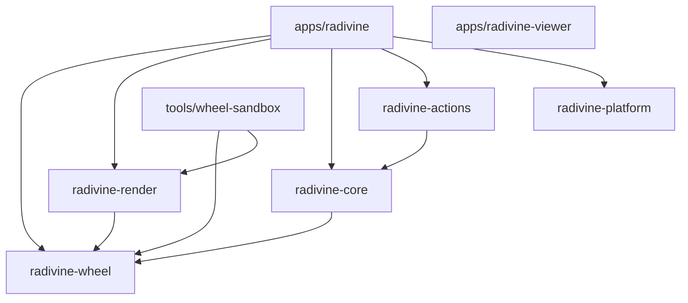
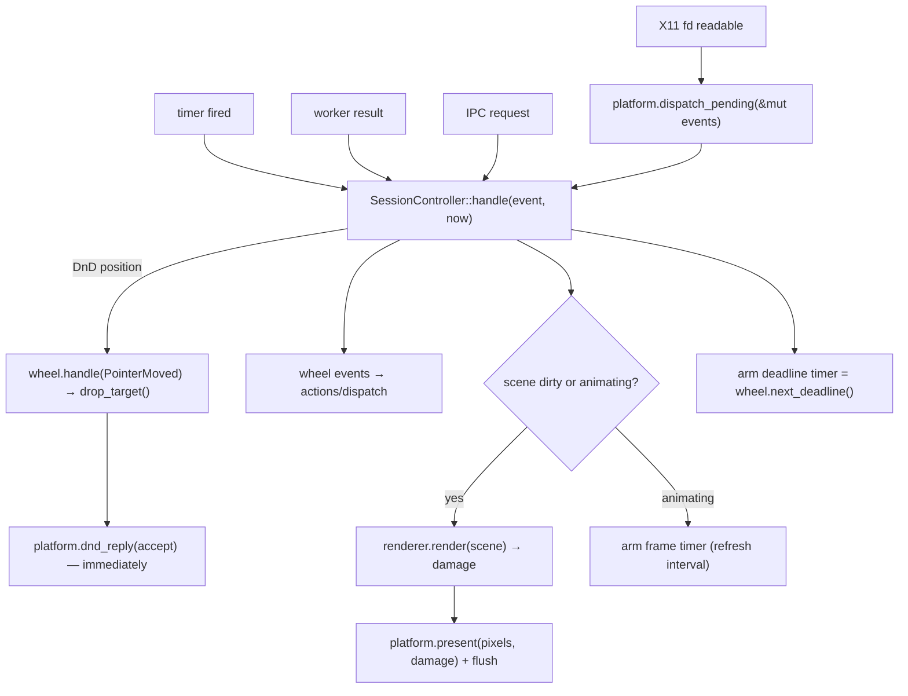

# Radivine — Architecture

Status: **Production architecture (`v0.2.0` Release Candidate, verified across M0–M6 and C1–C5)** · Last updated: 2026-10-25
Related: [WHEEL_ENGINE_DESIGN.md](WHEEL_ENGINE_DESIGN.md) · [PLATFORM_INTEGRATION.md](PLATFORM_INTEGRATION.md) · [ACTION_SYSTEM.md](ACTION_SYSTEM.md) · [CONTROL_CENTER_DESIGN.md](CONTROL_CENTER_DESIGN.md) · [DECISIONS.md](DECISIONS.md)

---

## 1. System overview

Radivine comprises four cooperating desktop binaries (`radivine` daemon/CLI, `radivine-control` Control Center & Advanced Convert window, `radivine-viewer` read-only file preview window, and `radivine-worker` on-demand background conversion & job worker):



Design rules:

1. **The wheel engine knows nothing** about files, X11, rendering libraries, or actions. It consumes a `MenuTree` + pointer/keyboard inputs + a clock, and produces a `Scene` + `WheelEvent`s.
2. **The renderer knows nothing** about platforms or actions. It turns a `Scene` into premultiplied RGBA pixels + damage rectangles.
3. **The platform layer knows nothing** about wheels or actions. It reports `PlatformEvent`s and presents pixels.
4. **Core knows nothing** about wheels' geometry or platforms. It turns contexts into `MenuTree`s and runs actions.
5. **The app crate is the only place that wires them together** (session state machine, configuration, IPC, lifecycle).

## 2. Workspace layout

```text
radivine/
├── Cargo.toml                    # [workspace], shared [workspace.package]/[workspace.dependencies], lints
├── deny.toml                     # cargo-deny (licences, advisories)
├── ffi/
│   └── radivine-webp/            # Minimal 2-function safe encode-only FFI wrapper over bundled libwebp 1.6.0
├── crates/
│   ├── radivine-wheel/           # PURE wheel engine (#![forbid(unsafe_code)], std + smallvec only)
│   ├── radivine-render/          # tiny-skia + cosmic-text + resvg renderer (#![forbid(unsafe_code)])
│   ├── radivine-core/            # context model, Action trait, registry, menu builder, dispatcher
│   ├── radivine-dbus/            # standalone D-Bus Notification & FileManager1 client (#![forbid(unsafe_code)])
│   ├── radivine-convert/         # codec-free conversion core, presets, convert.toml, 2-rung atomic commit (#![forbid(unsafe_code)])
│   ├── radivine-convert-image/   # built-in PNG/JPEG/WebP image conversion backend (#![forbid(unsafe_code)])
│   ├── radivine-jobs/            # durable job wire protocol, WirePath, JobsClient, WorkerLauncher (#![forbid(unsafe_code)])
│   ├── radivine-actions/         # built-in actions (preview, copy, properties, custom, Convert Quick/Advanced)
│   └── radivine-platform/        # Platform trait + `x11` module (+ future wayland/windows/macos modules)
├── apps/
│   ├── radivine/                 # daemon + CLI binary `radivine`
│   ├── radivine-viewer/          # egui preview window binary (`Full`, `Head`, `Tail`)
│   ├── radivine-control/         # egui Control Center (`8` pages) + `radivine-control convert` window
│   └── radivine-worker/          # on-demand background conversion worker (`SQLite WAL`, `C0a`–`C6` recovery)
├── tools/
│   ├── wheel-sandbox/            # dev tool: wheel engine + renderer in an opaque winit/softbuffer window
│   ├── convert-cli/              # standalone conversion benchmark and corpus CLI (`bench`, `gen-corpus`)
│   └── convert-corpus/           # deterministic synthetic PNG/JPEG/WebP/EXIF/ICC test corpus generator
├── fuzz/                         # 8 coverage-guided libFuzzer targets (`cargo-fuzz`)
├── packaging/                    # Debian packaging (`control`, `changelog`, `copyright`, systemd units, Nemo action)
├── scripts/                      # `build-deb.sh`, `check-dep-graph.sh`, and `scripts/dev/*` helpers
├── assets/
│   ├── branding/                 # PROTECTED — do not modify
│   ├── icons/                    # PROTECTED — do not modify
│   ├── wheel-icons/              # Lucide SVG subset (ISC)
│   ├── fonts/                    # Inter Variable (OFL-1.1)
│   └── third_party/              # licence texts for bundled fonts/icons
└── docs/
```

### 2.1 Evaluation of the originally proposed layout

| Proposed | Decision | Rationale |
|----------|----------|-----------|
| `radivine-core` + `radivine-context` + `radivine-actions` | **Merge context into core**; keep `radivine-actions` separate | Context and the action API are tightly coupled (actions filter on context); two crates would churn together. Built-in actions carry heavier deps (zbus, MIME sniffing) and serve as the template for third-party action crates, so they stay separate from the API crate. |
| `radivine-wheel` | **Keep, make it pure** and split rendering out into `radivine-render` | The engine must be unit-testable without fonts/rasterisers and portable to any presentation backend; renderer dependencies (cosmic-text, resvg) are large. |
| `radivine-platform` | **Keep as one crate with per-OS modules** (`x11`, later `wayland`, `windows`, `macos`) behind `cfg`/features | One trait, several backends; split into separate crates only if a backend's dependencies become heavy. |
| `apps/radivine-desktop` | Rename to **`apps/radivine`** (binary `radivine`) + add `apps/radivine-viewer` | The binary name users type; viewer isolated in its own process. |
| `examples/` | Replaced by `tools/wheel-sandbox` + per-crate `examples/` where useful | The sandbox is a real dev tool with its own deps (winit/softbuffer) that must not leak into libraries. |

### 2.2 Crate dependency graph (allowed edges only)



- `radivine-core → radivine-wheel` exists **only** for the `MenuTree`/`MenuNode` data types (core builds the tree the wheel consumes). If this edge becomes uncomfortable, move `MenuTree` into a tiny `radivine-menu` crate — do not invert the edge.
- `radivine-platform` depends on **no** other Radivine crate (it exchanges plain pixel buffers, rectangles and events).
- `radivine-viewer` depends on **no** Radivine crate initially (it is a standalone file viewer with a CLI); shared types can be added later if needed.
- CI enforces the graph with a simple `cargo metadata` check script (see [TESTING_STRATEGY.md](TESTING_STRATEGY.md)).

## 3. Component responsibilities and ownership

| Component | Owns | Must not |
|-----------|------|----------|
| `radivine-wheel` | Wheel hierarchy state (the open chain), layout & placement, polar hit-testing, hover intent/timers, hysteresis, keyboard navigation, animation values, `Scene` generation, input-region shapes, drop-target query | Do I/O, read clocks (time is injected), allocate per frame in steady state, depend on fonts/rasterisers |
| `radivine-render` | Theme, font system, label/icon raster caches, drawing primitives, damage computation, the session pixmap | Know about X11/Wayland, actions, or context |
| `radivine-core` | `Context` model (Basic + enriched facts), URI parsing, `Action` trait, `ActionRegistry`, `MenuSpec` → `MenuTree` building, `ActionIndex` (ItemPath → ActionId), `Dispatcher` (worker jobs, cancellation, results), config schema types for actions | Draw anything, talk to X11 |
| `radivine-actions` | Built-in actions: preview launchers (Full/Head/Tail via `radivine-viewer`), Copy (returns an `Effect::SetClipboard` that the app executes through the platform), Properties (D-Bus FileManager1), Custom command actions (TOML) | Block the UI thread (all `run()` calls happen on workers) |
| `radivine-platform` | X11 connection, atoms, extensions, overlay window lifecycle, SHM buffers, XDND target protocol, XFixes arming, XI2 raw trigger detection, invoke-mode grabs, monitors & scale, clipboard ownership service | Make product decisions (what to show, when to accept) — it reports and executes |
| `apps/radivine` | Daemon lifecycle, calloop loop, **session state machine** (§5), config loading, IPC server, CLI, wiring, logging setup, single-instance lock | Contain geometry, rendering, or protocol code |
| `apps/radivine-viewer` | Full/Head/Tail text viewing, search, large-file strategy | Depend on the daemon at runtime |
| `apps/radivine-control` | Native graphical Control Center (`Dashboard`, `General`, `Wheel`, `Actions`, `Conversion`, `Jobs`, `Diagnostics`, `About`) + standalone `radivine-control convert` window, background `systemd --user` / fallback service controller, format-preserving `toml_edit` configuration persistence | Block the UI thread on subprocess/IPC operations, link conversion codecs or SQLite directly, or stop the daemon on window close |
| `crates/radivine-dbus` | Pure-Rust `freedesktop` D-Bus `Notifications` and `FileManager1` client (`#![forbid(unsafe_code)]`) | Depend on any other Radivine crate |
| `crates/radivine-convert` | Codec-free conversion core (`FormatId`, magic-byte `sniff_format`, `CapabilityCatalog`, `ConversionOptions`, `ConvertSettings`, two-rung `PendingOutput` / `commit_no_replace`, `#![forbid(unsafe_code)]`) | Link image codecs, SQLite, or GUI/X11 crates |
| `crates/radivine-convert-image` | Built-in `builtin.image` backend (`PNG`, `JPEG`, `WebP` decode/encode, EXIF orientation 1..8, ICC `iCCP`/`APP2`/`ICCP`, Lanczos3 resize, `#![forbid(unsafe_code)]`) | Perform direct filesystem writes outside `OutputSink` |
| `ffi/radivine-webp` | Audited 2-function encode-only wrapper (`encode_webp_lossy_rgba`, `encode_webp_lossy_rgb`) over vendored `libwebp 1.6.0` | Decode untrusted image files or expose raw C pointers |
| `crates/radivine-jobs` | Durable job wire protocol (`WorkerRequest`, `WorkerResponse`, `JobUpdate`), lossless `WirePath`, `JobsClient`, `WorkerLauncher`, `JobsSettings` (`#![forbid(unsafe_code)]`) | Link `rusqlite`, image codecs, or GUI crates |
| `apps/radivine-worker` | On-demand single-instance background job worker (`worker.lock` + `worker.sock`), SQLite WAL `JobStore`, `C0a`–`C6` startup crash recovery, round-robin scheduler, watchdog commit fence, `ResourceGovernor`, 60s idle exit | Link GUI (`eframe`/`egui`/`winit`), X11 (`x11rb`), or wheel crates |

## 4. Runtime architecture

### 4.1 Threads

| Thread | Work | Blocking allowed? |
|--------|------|-------------------|
| **UI thread** (main) | calloop loop: X11 fd, timers (animation frames, hover-intent deadlines, grace timers, watchdogs), IPC socket, worker-result channel; wheel engine; rendering; presentation | **No.** Never touches the filesystem, D-Bus, or spawns blocking work. |
| Enrichment worker(s) | `stat`, symlink resolution, content sniffing for the session's items (bounded: first 8 KiB, regular files only) | Yes (with timeout; results may arrive late and are then ignored) |
| Action workers | `Action::run()` | Yes; cooperative cancellation via `CancelToken` |
| Notification worker | Desktop notifications (`org.freedesktop.Notifications` via zbus) for `Effect::Notify`, `Outcome::Message` and action errors; fed by a `std::sync::mpsc` channel | Yes |

Workers are spawned per job with `std::thread::Builder` (named threads). No general thread pool: the `Dispatcher` (in `radivine-core`) owns a FIFO queue and caps concurrently running action jobs at 4 (expected rate is far below one job per second — an estimate, not a measurement). Results return through a sink closure supplied by the app (wrapping a `calloop::channel::Sender`), which wakes the loop. The long-lived notification worker owns the zbus connection (zbus's blocking API runs its own internal executor thread; that is accepted and confined to this worker).

### 4.2 Event flow on the UI thread



Ordering rule: on `XdndPosition`, **reply `XdndStatus` before rendering** to keep the drag source responsive.

Frame pacing: render on demand only. While any animation runs, a calloop timer fires at the monitor refresh interval (from RandR mode info; default 60 Hz). With the compositor in place, tearing is not a concern; Present-extension synchronisation is a possible later refinement.

## 5. Session state machine (app level)

This is the **session-level** state machine owned by `apps/radivine::session`. The per-wheel/per-item states live inside the wheel engine ([WHEEL_ENGINE_DESIGN.md §8](WHEEL_ENGINE_DESIGN.md)).

```mermaid
stateDiagram-v2
    [*] --> Idle
    Idle --> Armed: DragArmed (XdndSelection owned by other client + button held)
    Armed --> Idle: DragDisarmed (owner None / button released 200 ms watchdog / 120 s timeout)
    Armed --> Summoning: Trigger (fresh trigger-key press)
    Idle --> Summoning: IPC invoke (Invoke mode)
    Armed --> Summoning: IPC invoke (Invoke mode; drag triggers ignored while it runs)

    Summoning --> Active: menu ready (payload parsed, MenuTree built) or provisional menu shown
    Summoning --> Dismissing: payload error / no applicable actions / drag ended

    Active --> Active: DndPosition / pointer motion → hit-test, status reply, animate
    Active --> LeftGrace: DndLeave { drag_ended: false } (pointer left wheel input region)
    Active --> Dismissing: DndLeave { drag_ended: true } (release on reject zone, Esc) — immediately
    LeftGrace --> Active: DndEnter again
    LeftGrace --> Dismissing: grace timeout / drag ended (DragDisarmed, button released)
    Active --> Committing: DndDrop with commit_drop() = Some / click or Enter on item (Invoke)
    Active --> Dismissing: DndDrop with commit_drop() = None → dnd_finish(false)
    Active --> Dismissing: drag ended (source gone) / trigger toggled off / Cancel (Invoke: Esc, click outside)

    Committing --> Dispatched: payload in hand → XdndFinished(success) → Dispatcher::dispatch
    Committing --> Dismissing: payload fetch failed → XdndFinished(fail) + error notification
    Dispatched --> Dismissing: commit animation started
    Dismissing --> Armed: animation done, overlay unmapped, drag still in progress
    Dismissing --> Idle: animation done, overlay unmapped
```

Rules that apply in **every** state while the overlay is mapped (so the drag source never stalls — GTK waits for a status reply before sending the next position):
- Every `DndPosition` is answered with `dnd_reply(accept)`; `accept` is `true` only in `Active` when `drop_target()` is `Accept`. In `Summoning`, `LeftGrace`, `Committing`, `Dismissing`: reject.
- A `DndDrop` arriving in any state other than `Active` is answered with `dnd_finish(false)`.
- When entering `Dismissing`, the app sets an **empty input region** immediately (the source retargets to the window below on the next motion) and starts the dismiss animation; unmapping follows when `WheelSession::is_finished()`.
- After every `tick`/`set_enabled`, if `drop_target()` changed while a source is entered, the app sends an unsolicited `dnd_reply` (**empirically verified in Spike [`S-1`](file:///home/marwanmohamed/Documents/work/rust/radivine/docs/spikes/S-1.md):** GTK 3.24 `gdkdnd-x11.c` honors unsolicited `XdndStatus` immediately with zero pointer movement; the drop-time re-check in `commit_drop()` remains as defense-in-depth).

`DndLeave { drag_ended }`: the X11 backend sets `drag_ended = true` when, at the time of the `XdndLeave`, no pointer button is held (`QueryPointer`) or the `XdndSelection` owner is gone — this distinguishes "release on a reject zone"/Esc from "pointer left the wheel's input region".

Watchdogs:

| Watchdog | State | Timeout | Action |
|----------|-------|---------|--------|
| Button released, no drop/leave arrived | `Active`/`LeftGrace` (drag mode) | 1 s after raw button release | Dismiss (`DragEnded`) |
| Button released, selection still owned, no session | `Armed` | 200 ms | Disarm |
| Max session duration | any session state | `session.max_duration_s` (120 s) | Dismiss (`Timeout`) |
| Invoke inactivity | `Active` (Invoke mode) | 60 s without input | Cancel |
| Force unmap | `Dismissing` | 500 ms | Unmap regardless of animation state |
| Payload | `Summoning`/`Committing` | 2 s (backend) | `PayloadError::Timeout` |

Concurrency: **one session at a time.** An IPC `invoke` while a session is active is rejected (`{"error":"busy"}`). A trigger while an Invoke session runs is ignored. A trigger arriving during `Dismissing` is queued and processed when dismissal finishes (≤ 250 ms) if the drag is still armed.

Notes:
- `Summoning` lasts until the payload is parsed and the menu is built (normally a few ms when prefetch works — estimate). Order of operations: `prepare_overlay(at)` → create `WheelSession` with the returned viewport/scale → set the input region from `input_region()` → `map_overlay()` → render and `present()` (the backend defers presentation until the window is viewable). The **appear animation starts immediately**, with a hub-only placeholder if the menu is not ready yet; segments animate in when the menu arrives (no layout jump because nothing was laid out before).
- If the payload cannot be prefetched (S-3 fails), the menu is built on the first `DndPosition` (spec-sanctioned conversion).
- Context **enrichment** (stat/sniff) may complete after `Active` begins; it only updates **enabled** flags and disabled reasons (never the layout) via `WheelSession::set_enabled` — see [ACTION_SYSTEM.md §3](ACTION_SYSTEM.md).

## 6. Key interfaces (summary)

Full definitions are in the design documents; signatures here are normative for naming.

```rust
// radivine-wheel (WHEEL_ENGINE_DESIGN.md §9)
pub struct MenuTree { pub root: MenuNode }
pub struct WheelSession { /* … */ }
impl WheelSession {
    pub fn new(menu: Option<MenuTree>, anchor: Point, viewport: Viewport,
               mode: InputMode, cfg: &WheelConfig, now: Millis) -> Self;
    pub fn set_menu(&mut self, menu: MenuTree, now: Millis);
    pub fn handle(&mut self, input: WheelInput, now: Millis, out: &mut Vec<WheelEvent>);
    pub fn tick(&mut self, now: Millis, out: &mut Vec<WheelEvent>);
    pub fn drop_target(&self) -> DropTarget;
    pub fn commit_drop(&mut self, now: Millis) -> Option<ItemPath>;
    pub fn set_enabled(&mut self, path: &ItemPath, enabled: bool, disabled_reason: Option<Arc<str>>);
    pub fn dismiss(&mut self, reason: DismissReason, now: Millis);
    pub fn scene(&self) -> &Scene;
    pub fn input_region(&self) -> &[Shape];
    pub fn next_deadline(&self) -> Option<Millis>;
    pub fn is_animating(&self) -> bool;
    pub fn is_finished(&self) -> bool;
}

// radivine-render (WHEEL_ENGINE_DESIGN.md §13) — RectPx/FrameRef/SizePx are defined in radivine-render
impl Renderer {
    pub fn new(theme: Theme, assets: AssetSource) -> Result<Self, RenderError>;
    pub fn begin_session(&mut self, size_px: SizePx, scale: f32);
    pub fn render(&mut self, scene: &Scene) -> &[RectPx];  // damage
    pub fn frame(&self) -> FrameRef<'_>;                     // premultiplied RGBA8, stride
    pub fn end_session(&mut self);
}

// radivine-core (ACTION_SYSTEM.md)
pub trait Action: Send + Sync + 'static {
    fn meta(&self) -> &ActionMeta;
    fn is_visible(&self, ctx: &BasicContext) -> bool;
    fn description_for(&self, _ctx: &BasicContext) -> Option<Arc<str>> { None }
    fn enablement(&self, ctx: &Context) -> Enablement { Enablement::Enabled }
    fn run(&self, ctx: &Context, job: &JobHandle) -> Result<Outcome, ActionError>;
}

// radivine-platform (PLATFORM_INTEGRATION.md §7) — has its own RectPx/FrameRef/ShapePx/SourceInfo
pub trait Platform {
    fn capabilities(&self) -> &Capabilities;
    fn dispatch_pending(&mut self, out: &mut Vec<PlatformEvent>) -> Result<(), PlatformError>;
    fn prepare_overlay(&mut self, at: PhysPoint) -> Result<OverlayInfo, PlatformError>; // configure, not mapped
    fn map_overlay(&mut self) -> Result<(), PlatformError>;
    fn present(&mut self, frame: FrameRef<'_>, damage: &[RectPx]) -> Result<(), PlatformError>;
    fn set_input_region(&mut self, shapes: Option<&[ShapePx]>) -> Result<(), PlatformError>; // None = whole overlay
    fn hide_overlay(&mut self);
    fn dnd_reply(&mut self, accept: bool);
    fn request_payload(&mut self, mime: &str);
    fn dnd_finish(&mut self, success: bool);
    /* … see PLATFORM_INTEGRATION.md */
}
```

**Type ownership rule:** crates that must not depend on each other define their own small value types, and **the app converts** between them (all conversions are trivial field copies or a multiplication by `scale`):

| Concept | `radivine-wheel` | `radivine-render` | `radivine-core` | `radivine-platform` |
|---------|------------------|-------------------|-----------------|---------------------|
| Interaction shapes | `Shape` (logical px) | — | — | `ShapePx` (physical px) |
| Pixels / damage | — | `FrameRef`, `RectPx`, `SizePx` | — | `FrameRef`, `RectPx` |
| Drag source | — | — | `SourceInfo` | `SourceInfo` |
| Clipboard | — | — | `ClipboardRequest` | `ClipboardContent` |

Dispatch style:
- **Static dispatch everywhere in hot paths** (wheel engine, renderer).
- **`Box<dyn Platform>`** at the app boundary: the backend is chosen at runtime (X11 vs. future Wayland) and is called at most a few hundred times per second.
- **`Arc<dyn Action>`** in the registry: heterogeneous, rarely invoked.

## 7. Configuration, IPC, CLI

### 7.1 Files (XDG)

| File | Purpose |
|------|---------|
| `$XDG_CONFIG_HOME/radivine/config.toml` | Behaviour: trigger, wheel geometry/timings, leave grace, invoke, appearance, preview line counts, notifications, `[jobs]` concurrency & retention (`max_parallel`, `retention_max_jobs`, `retention_days`) |
| `$XDG_CONFIG_HOME/radivine/actions.toml` | User custom actions + menu overrides (hide/reorder) ([ACTION_SYSTEM.md §9–§10](ACTION_SYSTEM.md)) |
| `$XDG_CONFIG_HOME/radivine/convert.toml` | Conversion defaults, metadata policy (`auto_orient`, `icc`, `exif = "strip"`), output placement/naming/collision policy, resource limits, and user conversion presets |
| `$XDG_RUNTIME_DIR/radivine/radivine.sock` | Wheel daemon IPC socket (mode `0600`) |
| `$XDG_RUNTIME_DIR/radivine/control.sock` | Control Center single-instance activation socket (mode `0600`) |
| `$XDG_RUNTIME_DIR/radivine/worker.sock` | Background job worker IPC socket (mode `0600`, `SO_PEERCRED` UID verified) |
| `$XDG_RUNTIME_DIR/radivine/worker.lock` | Background job worker single-instance `flock(LOCK_EX)` file (mode `0600`) |
| `$XDG_STATE_HOME/radivine/jobs.sqlite3` | Durable SQLite WAL job & item store with crash-recovery journals (mode `0600`, parent dir `0700`) |
| `$XDG_STATE_HOME/radivine/daemon.log` | Daemon log file when launched in detached fallback mode |
| `$XDG_STATE_HOME/radivine/worker.log` | Background worker log file when launched in detached fallback mode |

Missing/invalid config → log a warning, fall back to defaults; never fail to start because of config. Config is reloaded on `radivine reload` (IPC); file watching is a later polish item.

### 7.2 IPC

JSON-lines over the Unix socket; one request per connection is sufficient.

```json
{"cmd":"invoke","uris":["file:///home/u/a.txt"],"at":"pointer"}
{"cmd":"status"}            // → {"state":"Idle","version":"0.1.0","backend":"x11","capabilities":{…}}
{"cmd":"reload"}
{"cmd":"dismiss"}           // emergency: dismiss any session, ungrab, unmap
{"cmd":"quit"}
```

### 7.3 CLI (`radivine`)

| Command | Effect |
|---------|--------|
| `radivine` / `radivine daemon` | Start the daemon (refuses if one is running; single-instance via socket bind) |
| `radivine invoke [--at pointer] <uri-or-path>…` | Ask the daemon to open the wheel in Invoke mode (used by `radivine.nemo_action`) |
| `radivine status` / `reload` / `dismiss` / `quit` | IPC commands |
| `radivine doctor` | Prints capability report (session type, extensions, compositor, XI version, SHM) — used in bug reports |

CLI parsing: `clap` 4 (derive).

### 7.4 Complete configuration schema

Every key, its file, and its default. All keys are optional. Unknown keys → warning. Out-of-range values are clamped with a warning.

**`config.toml`**

```toml
[trigger]
key = "shift"                 # shift | ctrl | alt | super
toggle_off_on_repress = true  # second press hides the wheel; drag continues
dismiss_on_release = false    # true = "hold to show"

[wheel]                       # → WheelConfig (WHEEL_ENGINE_DESIGN.md §10)
max_items_per_wheel = 8
max_depth = 4
activation_slop = 6.0
hit_margin = 12.0
segment_gap = 2.5
child_gap = 10.0
bridge_angle_deg = 70.0
hysteresis_deg = 4.0
radius_root  = [38.0, 116.0]
radius_child = [30.0, 96.0]
radius_deep  = [26.0, 84.0]
radius_min_outer = 64.0

[wheel.intent]
submenu_open = "dwell+band"   # dwell | band | dwell+band | click
dwell_ms = 140
band = 0.65
grace_ms = 300
hub_close_ms = 150

[wheel.leave]                 # drag mode only
grace_ms = 350
passthrough = false           # false = capture-all safe default (ADR-016); true = shaped pass-through

[invoke]
select = "click"              # click | release
inactivity_timeout_s = 60

[appearance]
theme = "dark"                # dark | light | auto
scale = "auto"                # "auto" or a number
reduced_motion = "auto"       # auto | on | off

[preview]
head_lines = 50
tail_lines = 50

[session]
max_duration_s = 120

[overlay]
release_after_s = 30          # free the SHM buffer this long after the last session

[platform.x11]
trigger_detection = "raw"     # raw (XI2, verified 371-547µs in S-2) | poll (QueryPointer while armed, 411µs)
window_type = "dnd"           # dnd (verified 169µs map, zero Muffin animations/shadows in S-5) | popup_menu | notification | utility
pointer_nudge = true          # Mandatory 0-px WarpPointer(NONE, NONE, 0, 0, 0, 0, 0, 0) after map/unmap (verified in S-1/S-6)

[log]
file = false                  # also log to $XDG_STATE_HOME/radivine/radivine.log
```

**`actions.toml`** — `[[action]]` custom actions and `[menu]` overrides only (ACTION_SYSTEM.md §9–§10).

## 8. Lifecycle

**Startup** (target < 150 ms to ready): parse CLI → init `tracing` → load config → bind IPC socket (single instance) → connect platform (`x11rb::connect`), query extensions, create atoms, pre-create the overlay window (unmapped), select XFixes `XdndSelection` notifications, read monitors/scale → build `ActionRegistry` → create `Renderer` (load bundled font + icons lazily) → enter loop.

**Shutdown** (`SIGINT`/`SIGTERM` via calloop signal source, IPC `quit`): dismiss any session (send `XdndFinished(0)` if mid-drop), ungrab if in Invoke mode, unmap/destroy overlay, detach SHM, flush, remove socket, exit. Worker threads are detached; their results are dropped.

**Crash safety**: the X server destroys all windows and releases all grabs of a disconnected client. In drag mode Radivine holds no grabs at all. In Invoke mode grabs are bound to the overlay window and released on unmap. A panic hook logs and attempts `hide_overlay()` before abort.

**Autostart**: `~/.config/autostart/radivine.desktop` (XDG autostart; Cinnamon honours it, `DISPLAY` is set). A systemd user unit is an alternative documented later.

## 9. Performance targets

These are **engineering targets, not measurements**. Nothing has been benchmarked yet. Each target has a measurement method; results go into `docs/BENCHMARKS.md` when produced.

| Metric | Target | Measurement |
|--------|--------|-------------|
| Idle CPU | ≈ 0 % (no periodic wakeups; blocked in `poll`) | `pidstat -p <pid> 1 60`; count wakeups with `perf trace -s` |
| Idle RSS | < 25 MB (session buffers released after `overlay.release_after_s`) | `/proc/<pid>/status` VmRSS |
| Startup to ready | < 150 ms | `tracing` span `startup` |
| Trigger → first frame presented | p95 < 50 ms (goal < 25 ms) | span from raw key event timestamp to `present()` return |
| `XdndPosition` → `XdndStatus` sent | p95 < 2 ms | span in X11 backend |
| Frame (render + upload) for 3-level cluster @1× | p95 < 4 ms; @2× p95 < 8 ms | criterion bench + runtime span |
| Dropped frames during animations | 0 at 60 Hz on reference machine | frame-interval histogram in debug overlay |
| Per-frame heap allocations in steady state | 0 (wheel engine + renderer) | allocation-counting global allocator in a test build |
| Drop → action dispatched | p95 < 30 ms (payload cached) | span |

## 10. Security and privacy

- No network access, no telemetry, no update checks.
- **Input observation minimisation**: XI2 raw key events are selected **only while a drag is armed**, only keycodes mapped to the configured trigger modifier are interpreted, no key data is logged. When idle, Radivine observes only `XdndSelection` ownership changes.
- IPC socket in `$XDG_RUNTIME_DIR` with mode 0600; only the same user can invoke.
- Custom command actions execute with **argument vectors, never through a shell** unless the user explicitly writes `sh -c` in their own config; placeholders are substituted as whole arguments (no string interpolation into shell code).
- File access: regular files only for sniffing (never open FIFOs/devices/sockets — opening a FIFO blocks); respect permissions; never modify user files in built-in actions (Copy uses the clipboard; Properties delegates to the file manager).
- XDND: always answer `XdndActionPrivate`; never request the `DELETE` target (no path to moving/deleting the source file).

## 11. Error-handling strategy

- Libraries return typed errors (`thiserror`); the app logs them and degrades gracefully.
- Platform protocol errors (e.g. `BadWindow` when a source dies) are expected events: handled, logged at `debug`, session dismissed.
- Action errors are shown to the user via a desktop notification (`org.freedesktop.Notifications`, sent by the notification worker — never from the UI thread) with a short message; details in the log.
- Renderer errors (font/icon load) fall back to text-only/placeholder glyphs; never block a session.
- A failure to present (SHM issue) falls back to core `PutImage` once, then to dismissing with a log entry.

## 12. Logging & diagnostics

- `tracing` spans for: `startup`, `arm`, `trigger`, `summon`, `payload`, `menu_build`, `frame`, `dnd_status`, `commit`, `dispatch`, `dismiss`.
- `RADIVINE_LOG=radivine=debug` enables verbose logs; `RADIVINE_DEBUG_OVERLAY=1` draws hit regions, input shape, and frame timings in the overlay (developer aid).
- `radivine doctor` capability report.
