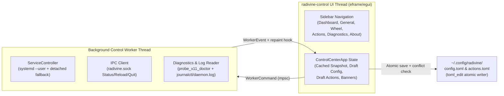

# Radivine v0.1.1 — Control Center, Service Lifecycle & Settings Design

Status: **Accepted (v0.1.1)** · Last updated: 2026-10-23
Related: [`ARCHITECTURE.md`](ARCHITECTURE.md) · [`DECISIONS.md`](DECISIONS.md) · [`ACTION_SYSTEM.md`](ACTION_SYSTEM.md) · [`PLATFORM_INTEGRATION.md`](PLATFORM_INTEGRATION.md)

---

## 1. Objectives & Scope

Radivine `v0.1.0` delivered the core radial wheel engine, X11 mid-drag interception (`Drag + Shift` in Nemo), `radivine invoke`, context-aware actions, and the standalone `radivine-viewer` preview window. However, starting the background daemon required running `radivine daemon` in a terminal or manually copying example service files.

**Radivine `v0.1.1`** eliminates terminal dependency and introduces a native graphical **Radivine Control Center (`radivine-control`)** while preserving 100% of the approved radial wheel geometry, navigation, visual styling, and `v0.1.0` CLI/configuration contracts.

---

## 2. Control Center Architecture (`apps/radivine-control`)

### 2.1 Standalone Process & Crate Reuse

`radivine-control` is a standalone desktop binary at `apps/radivine-control` (`#![forbid(unsafe_code)]`) built with `eframe` / `egui` `0.37` (the same UI toolkit used by `radivine-viewer`).

To prevent duplicate schemas or competing protocol implementations, `radivine-control` reuses the existing workspace crates directly:
- **`radivine::config`:** [`AppConfig`](../apps/radivine/src/config.rs), `ScaleSetting`, `ReducedMotionSetting`, and section structs (`TriggerSection`, `WheelSection`, `AppearanceSection`, `PreviewSection`, `InputSection`, `X11Section`).
- **`radivine::ipc`:** [`IpcRequest`](../apps/radivine/src/ipc.rs), `IpcResponse`, `DaemonStatus`, `default_socket_path`, and `send_request`.
- **`radivine-actions`:** [`parse_actions_toml`](../crates/radivine-actions/src/custom.rs), `load_actions_file`, `ActionsConfig`, `CustomAction`, `NotifyPolicy`, `CountRange`, `ArgToken`, `ArgPlaceholder`, and `WhenRule`.
- **`radivine-platform`:** [`probe_x11_doctor`](../crates/radivine-platform/src/x11/doctor.rs) and `DoctorReport`.

### 2.2 Process Independence & Single-Instance Window Activation

- **Decoupled Lifecycle:** Closing `radivine-control` never stops the background `radivine` daemon, and stopping or restarting the daemon never crashes or closes `radivine-control`.
- **Single-Instance Guard (`$XDG_RUNTIME_DIR/radivine/control.sock`):**
  - On startup, `radivine-control` attempts to bind a non-blocking Unix domain socket at `$XDG_RUNTIME_DIR/radivine/control.sock` (`0600` permissions).
  - If another `radivine-control` instance is already listening on `control.sock`, the new process sends a `"focus\n"` command over the socket and exits cleanly (`ExitCode::SUCCESS`).
  - The running `radivine-control` window polls its non-blocking listener, unminimizes/focuses its viewport (`ViewportCommand::Focus`), and optionally switches to a requested page (`--page <dashboard|general|wheel|actions|diagnostics|about>`).
  - Stale sockets from terminated processes are detected and replaced automatically.

### 2.3 Non-Blocking Background Worker Architecture

The `egui` rendering thread never blocks on subprocesses (`systemctl`, `journalctl`), Unix socket IPC (`send_request`), or X11 diagnostic probes:



### 2.4 Visual Identity & Navigation Layout

- **Brand Palette & Typography:** Uses Radivine's bundled `Inter-Variable.ttf` font, official horizontal/icon logos from `assets/branding/` and `assets/icons/` (loaded read-only), and the established vine/leaf green palette (`#044C3C` vine green, `#00A87C` leaf green, `#0A1A16` dark canvas, `#F4FBF8` light canvas).
- **Six-Page Sidebar Navigation:**
  1. **Dashboard:** Unified daemon health badge (`Running`, `Stopped`, `Starting`, `Stopping`, `Failed`, `Degraded / Unreachable`), `Start` / `Stop` / `Restart` controls with transition verification, runtime telemetry (`PID`, version, uptime, session type, desktop environment, IPC latency, RSS/CPU, startup mode, autostart state), and recent activity/error cards.
  2. **General:** Launch at Login toggle, startup method & conflict resolver, Appearance (`Dark`, `Light`, `Follow System` + UI Scale), Notifications, File Preview defaults (`head_lines`, `tail_lines`), and configuration file management (`Open Config Folder`, `Reload Daemon`, `Restore Defaults`).
  3. **Wheel:** Approved branching radial wheel parameters (`root_inner_radius`, `root_outer_radius`, `child_inner_radius`, `child_outer_radius`, `child_offset_gap`, `hover_dwell_ms`, `submenu_grace_ms`, `leave_grace_ms`, `angular_hysteresis_deg`, `backdrop_dim`, `reduced_motion`, `drag_modifier`, `toggle_off_on_repress`, `hold_to_keep_open`, `min_drag_distance_px`, `passthrough`).
  4. **Actions:** Graphical Custom Actions Manager for `~/.config/radivine/actions.toml` (searchable action list, Create/Edit form with separated executable and argv tokens, whole-element placeholder chips `{path}`, `{paths}`, `{uri}`, `{uris}`, `{dir}`, `{name}`, `when` filters, `per_item`, `wait`, `timeout_ms`, `notify`, enable/disable toggle, menu order/hide overrides, and delete confirmation).
  5. **Diagnostics:** Structured `radivine doctor` report (desktop session, X11 extensions, compositor, RandR monitors, DPI scale, IPC & service manager status, autostart audit), bounded log viewer (`journalctl --user -u radivine.service` + `~/.local/state/radivine/daemon.log`), and privacy-redacted diagnostic report exporter (`$HOME` → `~`, username/hostname/file-URI redaction).
  6. **About:** Application version (`v0.1.1`), tagline (*"Branch into action."*), dual license (`MIT OR Apache-2.0`), component overview, and third-party notices summary.

---

## 3. Reliable Background Daemon Lifecycle & Autostart Strategy

### 3.1 Systemd User Service (`radivine.service`) & Cinnamon Compatibility

Empirical inspection of Linux Mint 22.x (Cinnamon `X-Cinnamon` on X11) revealed two critical facts:
1. `/etc/X11/Xsession.d/20dbus_xdg-runtime` and `95dbus_update-activation-env` run `dbus-update-activation-environment --systemd --all`, importing `DISPLAY`, `XAUTHORITY`, `DBUS_SESSION_BUS_ADDRESS`, `XDG_CURRENT_DESKTOP`, and `XDG_SESSION_TYPE` into the `systemd --user` environment.
2. However, `cinnamon-session` **does not activate `graphical-session.target`** (`systemctl --user list-units --type=target` shows only `default.target`, `basic.target`, `paths.target`, `sockets.target`, `timers.target`). Consequently, a unit with only `WantedBy=graphical-session.target` never starts at login on Cinnamon, XFCE, or MATE.

To work reliably across Cinnamon, XFCE, MATE, GNOME, and KDE:
- The Debian package installs the canonical user service unit at `/usr/lib/systemd/user/radivine.service` (without auto-enabling it during `apt install`).
- `[Unit]` orders `After=default.target graphical-session-pre.target dbus.socket` with `StartLimitIntervalSec=0` (preventing systemd burst start-limit lockout when LightDM briefly holds `:0` across user logout/login transitions) and omits `PartOf=graphical-session.target` so inactive targets do not block startup.
- `[Service]` sets `Environment=RADIVINE_SYSTEMD_SERVICE=1`, `ExecStart=/usr/bin/radivine daemon`, `ExecReload=/usr/bin/radivine reload`, `ExecStop=/usr/bin/radivine quit`, `Restart=on-failure`, `RestartSec=2`, and `SuccessExitStatus=0 143`.
- `[Install]` specifies `WantedBy=default.target` so `systemctl --user enable radivine.service` activates on login in Cinnamon as well as standard systemd user sessions.
- Before `ServiceController` executes `systemctl --user start` or `restart` from an interactive desktop session, it runs:
  ```text
  systemctl --user import-environment DISPLAY XAUTHORITY WAYLAND_DISPLAY XDG_SESSION_TYPE XDG_CURRENT_DESKTOP DBUS_SESSION_BUS_ADDRESS
  ```
  ensuring the daemon receives the live graphical display environment without hardcoding `DISPLAY` or `XAUTHORITY`.

### 3.1.1 Login Autostart Graphical Readiness & Dynamic Compositor Synchronization (`ADR-026`)

During Linux Mint Cinnamon login, `/etc/X11/Xsession.d/95dbus_update-activation-env` imports `DISPLAY` and `XAUTHORITY` into `systemd --user` ~700 ms before `cinnamon --replace` (Muffin, the window manager and X11 compositor) claims `_NET_WM_CM_S0` and ~140–870 ms before `csd-xsettings` and `csd-xrandr` finish applying DPI/theme/monitor properties. To guarantee identical rendering whether `radivine` starts during early login or via an interactive restart:
1. **Bounded Initial Compositor Wait & Login Retry:** When launched by `systemd --user` (`RADIVINE_SYSTEMD_SERVICE=1` or parent `comm == "systemd"`), `radivine` retries transient X11 connection errors during display-manager handover and performs a bounded wait (up to `2500 ms` default, `25 ms` poll) for `_NET_WM_CM_S0` ownership before finalizing its initial capability probe.
2. **Dynamic Runtime `_NET_WM_CM_S0`, `_XSETTINGS_S0`, and `RandR` Tracking:** `X11Platform` subscribes `overlay.helper_window` to `XfixesSelectionNotify` for both `_NET_WM_CM_S0` and `_XSETTINGS_S0` (plus `PROPERTY_CHANGE` on the `_XSETTINGS_S0` owner window) and re-verifies compositor ownership, monitor geometry, `Xft.dpi`, and reduced-motion settings inside `prepare_overlay()` before every wheel summon and in `sync_graphical_state()` on status queries.
3. **Seamless Transition to 32-Bit ARGB Translucency:** Whenever `_NET_WM_CM_S0` becomes owned, `X11Platform` immediately resets any XShape `ShapeBounding` clip to unclipped (`reset_bounding_region`), re-asserts `_NET_WM_BYPASS_COMPOSITOR = 2`, clears the X11 overlay window to transparent (`0x00000000`) on map, and switches `OverlayInfo::translucent` to `true` (`Renderer::set_opaque_fallback(false)`).
4. **Visual-Only `ShapeBounding` in True Uncomposited Sessions:** When no compositor is active (`!translucent`), `SessionController::sync_input_region()` clips `ShapeBounding` strictly to visible `scene.wheels` disks and `scene.caption` (never to invisible pointer hit-slop corridors) and updates `ShapeBounding` on `HoverChanged` / `SubmenuOpened` / `SubmenuClosed`.
5. **Graphical Readiness Telemetry:** `DaemonStatus` exposes `graphical_ready`, `compositor_active`, `translucent_overlay`, and `monitor_count`, which the Control Center surfaces in the Dashboard (`Overlay Rendering Mode`) and Diagnostics pages.

### 3.2 Differentiating Service State from Daemon IPC Health

`ServiceController` queries both `systemctl --user show radivine.service` (`ActiveState`, `SubState`, `MainPID`, `Result`, `UnitFileState`) **and** the Unix domain socket (`IpcRequest::Status` on `$XDG_RUNTIME_DIR/radivine/radivine.sock`):

| `systemd --user` State | IPC Socket (`radivine.sock`) | Effective Dashboard Status |
| :--- | :--- | :--- |
| `activating` / transition in progress | Not yet ready | **Starting** |
| `deactivating` / stop in progress | Closing | **Stopping** |
| `active (running)` | Responsive (`IpcResponse::Ok`) | **Running** (Managed by systemd) |
| `inactive` / unavailable | Responsive (`IpcResponse::Ok`) | **Running** (Standalone / CLI process) |
| `active (running)` | Unreachable after startup grace (`> 3 s`) | **Unreachable / Degraded** (Unit active but IPC unresponsive) |
| `failed` | Unreachable | **Failed** (Displays exit code / journal error) |
| `inactive (dead)` | Unreachable | **Stopped** |

Every `Start`, `Stop`, and `Restart` action verifies the resulting state by polling IPC responsiveness and process liveness (up to `5 s` with `100 ms` intervals) before reporting completion.

### 3.3 Non-Systemd Fallback Lifecycle

When `systemd --user` is unavailable (e.g., non-systemd distributions or isolated test environments):
- **Start:** `ServiceController` spawns `radivine daemon` in a detached process group (`CommandExt::process_group(0)`), redirecting `stdin` to `/dev/null` and `stdout`/`stderr` to `~/.local/state/radivine/daemon.log` (rotated at `2 MiB`). The daemon has zero terminal dependency and survives closing `radivine-control`.
- **Stop:** Sends `IpcRequest::Quit` over `radivine.sock` and verifies socket closure.
- **Restart:** Stops via `IpcRequest::Quit`, waits for socket closure, and spawns a fresh detached daemon.

### 3.4 Coherent Autostart Strategy & Conflict Resolution

- **Primary Method:** `systemd --user` (`systemctl --user enable radivine.service` / `disable radivine.service`).
- **Fallback Method (only when `systemd --user` is unavailable):** XDG Autostart (`~/.config/autostart/radivine-daemon.desktop` with `X-GNOME-Autostart-enabled=true|false`).
- **Conflict & Legacy Detection:**
  1. **Duplicate Autostart Conflict:** If both `radivine.service` is enabled in `systemd --user` **and** an active XDG autostart `.desktop` file (`radivine-daemon.desktop` or `radivine.desktop`) exists in `~/.config/autostart/`, the Control Center displays a clear warning banner and offers a one-click **"Resolve Conflict (Keep systemd, disable duplicate XDG entry)"** action that backs up the XDG file (`.bak`) and sets `X-GNOME-Autostart-enabled=false` without deleting user files.
  2. **Legacy v0.1.0 User Unit Override:** If `~/.config/systemd/user/radivine.service` exists and contains `WantedBy=graphical-session.target` without `default.target`, the Control Center warns that Cinnamon does not activate `graphical-session.target` and offers a one-click **"Upgrade User Service File (Back up to .bak)"** action.

---

## 4. Safe, Format-Preserving Configuration Persistence

### 4.1 `toml_edit` Format Preservation & Validation

Both `~/.config/radivine/config.toml` and `~/.config/radivine/actions.toml` are managed through a dedicated persistence layer (`apps/radivine-control/src/persistence.rs`) using `toml_edit::DocumentMut`:
1. **Preserve Comments & Unknown Keys:** If the file exists on disk, it is parsed into a `toml_edit::DocumentMut` and only the managed keys/tables are updated in-place, preserving user comments, whitespace, and unknown keys.
2. **Pre-Write Full Validation:** Before touching the filesystem, the candidate TOML string is validated through `AppConfig::validate_strict` or `parse_actions_toml` (requiring zero parse errors and zero entry validation warnings).
3. **External Modification Conflict Detection:** When a file is loaded into the Control Center, its modification timestamp and SHA-256/FNV content digest are recorded. If the file on disk has changed externally when the user clicks **Save**, the write is halted with a conflict prompt (`Reload from Disk` or `Back Up to .bak & Overwrite`).
4. **Same-Filesystem Atomic Replacement:** Writes create a sibling temporary file (`.config.toml.tmp.<pid>`) in `~/.config/radivine/`, copy existing file permissions (or `0644`), flush with `File::sync_all()`, and atomically replace the target via `std::fs::rename()`.
5. **Non-Disruptive Hot Reload:** If the daemon is running, `IpcRequest::Reload` is sent after saving. In `SessionController::reload_config`, if a radial wheel session is currently active (`!matches!(state, Idle | Armed)`), visual/scale updates are staged and applied as soon as the session returns to `Idle`, guaranteeing an active drag-and-drop is never interrupted.

---

## 5. System Tray Evaluation (Section 9)

We evaluated adding a StatusNotifierItem / AppIndicator tray icon on Linux Mint Cinnamon:
- Crate options such as `tray-icon` or `libappindicator` link against `gtk3` and `libayatana-appindicator3`, which require initializing a GTK main loop (`gtk::init`) on the process and introduce native shared-library dependencies (`libayatana-appindicator3-1`) not required by `eframe`/`winit`. Running both a `glib::MainLoop` and `winit`'s X11/Wayland event loop in the same process is a well-known source of deadlocks and focus bugs on Linux.
- Implementing a custom bilateral `org.kde.StatusNotifierItem` + `com.canonical.dbusmenu` object server over raw D-Bus sockets without `zbus` would add substantial protocol surface area for a secondary feature.
- **Decision (`ADR-025`):** Defer system tray integration in `v0.1.1` per Section 9. Instead, provide explicit, unambiguous lifecycle controls in the Control Center header and Dashboard (`"Close Window (Radivine keeps running in background)"` vs `"Stop Daemon"`).
