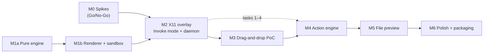

# Radivine — Implementation Plan

Status: **M0 Complete (GO) — Ready for M1a/M1b/M2** · Last updated: 2026-10-22
Order of work: **M0 (Done) → M1 → M2 → M3 → M4 → M5 → M6** (M1 may start in parallel with M0 because it is platform-independent).

---

## 0. Changes relative to the brief's starting milestones

| Change | Why |
|--------|-----|
| **M0 is executable spikes**, not only reading | Source reading established high confidence; only running code against the real Nemo/Muffin can close Q1–Q7 (FEASIBILITY_STUDY §8.3). |
| **M1 split into M1a (pure engine) and M1b (renderer + sandbox)** | The engine can be finished and exhaustively tested before any rendering decisions; the sandbox needs both. |
| **M1 may run in parallel with M0** | M1 has no platform dependency; M2+ must wait for the M0 Go decision. |
| **M2 uses Invoke mode** (`radivine invoke`) to integrate with the real desktop before drag-and-drop | Validates overlay, translucency, positioning, presentation, grabs and the daemon loop in isolation from XDND complexity. Invoke mode is also the permanent fallback/accessibility path, so nothing is throw-away. |
| **A minimal `radivine-core` (context from URIs, static registry of logging actions) is introduced in M2**, the full action engine in M4 | The PoC must dispatch "the selected action with the original file context" (brief §12) before real actions exist. |

Relative sizes (rough, for sequencing only — not estimates of calendar time): M0 S · M1a M · M1b M · M2 L · M3 L · M4 M · M5 M · M6 M.

## 1. Global Definition of Done (applies to every milestone)

- `cargo fmt --all --check`, `cargo clippy --workspace --all-targets -- -D warnings`, `cargo test --workspace` pass locally and in CI.
- New public items have rustdoc comments; module-level docs explain responsibilities.
- No `unwrap()`/`expect()` on fallible runtime paths outside tests (startup invariants may `expect` with a message).
- No new dependency without a line in [TECH_STACK.md](TECH_STACK.md); no architectural change without an ADR in [DECISIONS.md](DECISIONS.md).
- Crate dependency graph matches [ARCHITECTURE.md §2.2](ARCHITECTURE.md) (CI check).
- Manual test checklist for the milestone executed and recorded in `docs/test-reports/Mx.md`.

---

## M0 — Research & Feasibility Spikes

**Scope:** Convert the feasibility analysis into empirical facts on the dev machine (Mint 22.3 / Cinnamon / X11 / Nemo 6.6.3). Throw-away code only.

**Dependencies:** Owner authorisation to write spike code (the planning phase forbids implementation code).

**Tasks**
1. Owner runs zero-code checks Q-1, Q-2, Q-3 (FEASIBILITY_STUDY §9.1) and records output.
2. Create `spikes/xdnd-overlay/` (standalone Cargo project, not a workspace member, `x11rb` only).
3. Implement S-1 (mid-drag overlay targeting) with timestamped logging.
4. Extend for S-2 (trigger detection: XI2 raw vs. `QueryPointer` polling; fresh-press logic).
5. S-3 (payload prefetch with XFixes timestamp / `CurrentTime`; 1, 500 files; non-ASCII; sftp).
6. S-4 (input-shape pass-through incl. mid-drag shape change).
7. S-5 (window type effects, monitor-sized ARGB side effects, SHM upload timing, byte order on NVIDIA).
8. S-6 (reject/cancel/crash semantics, Shift-toggle-off then drop on Nemo folder).
9. Optional S-7 (other sources).
10. Write `docs/spikes/S-1.md` … `S-7.md` (procedure, raw numbers, verdict) and update FEASIBILITY_STUDY §0/§8.3 and RISKS.

**Deliverables:** spike sources, `docs/spikes/*.md`, updated feasibility verdict, Go/No-Go record in DECISIONS.md (ADR-021).

**Acceptance criteria**
- AC-0.1 S-1: 100 % retargeting on the next motion in Nemo icon view, list view and desktop (20 trials each); URIs correct; accept → no snap-back; reject → snap-back.
- AC-0.2 S-2: fresh Shift detected 100 %; pre-held Shift never triggers; no duplicates.
- AC-0.3 S-6: every case in FEASIBILITY_STUDY §6.7 behaves as specified; desktop fully usable afterwards.
- AC-0.4 Source file checksum/mtime/location unchanged in all spike runs.
- AC-0.5 S-3/S-4/S-5 results recorded (pass or fail, with chosen fallback).

**Testing requirements:** manual, scripted where possible (`xdotool` for post-run input checks). Record latency numbers (trigger→map, map→first `XdndEnter`, position rate).

**Completion definition:** Go/No-Go decision recorded (**COMPLETED 2026-10-22: GO** — see [`docs/spikes/S-1.md`](file:///home/marwanmohamed/Documents/work/rust/radivine/docs/spikes/S-1.md)–[`S-6.md`](file:///home/marwanmohamed/Documents/work/rust/radivine/docs/spikes/S-6.md) and `ADR-021`). GO ⇒ M1a/M1b/M2 may start.

---

## M1a — Pure Wheel Engine (`radivine-wheel`)

**Scope:** Everything in [WHEEL_ENGINE_DESIGN.md](WHEEL_ENGINE_DESIGN.md) §2–§12 except rendering: menu model, geometry, root/child placement, stems, captions placement, hit-testing with hysteresis, corridors, input region, intent rules, keyboard navigation, drop target, tweens, engine state machines, `Scene` generation. **No Nemo, no X11, no files.**

**Dependencies:** none.

**Tasks**
1. Create the workspace skeleton: root `Cargo.toml` (`[workspace]`, `resolver = "3"`, `[workspace.package]` edition 2024, licence, `[workspace.lints]` with `clippy::all` warn, `unsafe_code = "forbid"` for pure crates), `deny.toml`, CI workflow (fmt/clippy/test), `.gitignore`. Only the crates needed now (`radivine-wheel`).
2. `geometry.rs`: `Point`, `Rect`, angle normalisation, annular-sector math, segment spans (root and child formulas), gap insets, corridor polygon, point-in-polygon, tangent points.
3. `menu.rs`: `MenuTree`, `MenuNode`, `NodeKind`, `ItemPath`, `IconKey`; validation/clamping.
4. `layout.rs`: root placement, child placement search (§5.2), shrink & fallback, caption placement.
5. `hit.rs`: zones, priority, hysteresis, drop target.
6. `nav.rs`: hover state, dwell/band opening, intent triangle + grace, hub close, chain truncation, activation slop, keyboard navigation.
7. `anim.rs`: `Tween`, `Ease`, timing table, reduced motion.
8. `session.rs`: `WheelSession` public API (§9), engine state machine, event emission, `next_deadline`, `is_animating`.
9. `scene.rs`: `Scene` structs, in-place rebuild.
10. `config.rs`: `WheelConfig` with defaults + `validate()`.
11. Test DSL (`tests/support/script.rs`) and test suites (see Testing).

**Deliverables:** `crates/radivine-wheel` with ≥ 90 % line coverage on `geometry`, `hit`, `layout`, `nav` (measured with `cargo llvm-cov`, informational).

**Acceptance criteria**
- AC-1a.1 Hit-testing: every point in a ring maps to exactly one item or bridge/empty; boundaries respect hysteresis (property tests).
- AC-1a.2 Placement: for a grid of anchors covering a 1920×1080 viewport (step 40 lp) and every segment of a 6-item root with a 3-item child, the child is fully inside the viewport and does not overlap the root (or the documented fallback is used and flagged); results deterministic.
- AC-1a.3 Navigation scenarios pass: open by dwell; open by outer band; diagonal travel to child keeps it open; wrong-segment dwell closes it after grace; hub closes children after `hub_close_ms`; outside keeps the chain; ancestor item switch truncates.
- AC-1a.4 Drop target equals the highlighted item in all scenario tests; nothing droppable before activation slop.
- AC-1a.5 Keyboard navigation scenarios pass (next/prev/activate/back/digit/cancel).
- AC-1a.6 Zero heap allocations inside `handle`/`tick`/`scene` after warm-up (test with a counting allocator).
- AC-1a.7 `radivine-wheel` depends only on `std` + `smallvec`.

**Testing requirements:** unit + property tests (`proptest`), scenario tests with the script DSL, allocation test, `criterion` bench for `handle(PointerMoved)` and `scene()`.

**Completion definition:** all ACs green in CI; API reviewed against WHEEL_ENGINE_DESIGN §9 (any deviation documented via ADR).

---

## M1b — Renderer and Wheel Sandbox

**Scope:** `radivine-render` (tiny-skia + cosmic-text + resvg) and `tools/wheel-sandbox` (winit 0.30 + softbuffer, opaque dark window) that simulates drag mode with the mouse: *hold left button = dragging, press Shift = trigger, release = drop*; plus Pointer mode.

**Dependencies:** M1a.

**Tasks**
1. Add bundled assets: Inter (OFL) under `assets/fonts/`, Lucide subset under `assets/wheel-icons/`, licence texts under `assets/third_party/`. **Do not touch `assets/branding` or `assets/icons`.**
2. `theme.rs`: tokens from WHEEL_ENGINE_DESIGN §13.4 (dark + light).
3. `text.rs`: cosmic-text font system with the bundled font only; lazy system fallback; label rasterisation cache.
4. `icons.rs`: resvg rasterisation cache keyed by `(IconKey, px)`; missing icon → placeholder dot.
5. `draw.rs`: ring, segments with constant-width gaps, highlight, pop, submenu node, hub, stems (trim), caption pill, shadow sprite cache.
6. `damage.rs`: per-element bbox+hash tracking, ≤ 4 merged rects, clipping.
7. `Renderer` API (`begin_session`, `render`, `frame`, `end_session`).
8. Sandbox: synthetic menus (built-in demo tree with 3 levels, plus `--menu <file.toml>`), FPS/frame-time overlay, toggles for reduced motion/theme/scale (1×, 1.5×, 2×), logs commits.
9. Snapshot tests (PNG) for representative scenes; `criterion` render benches.

**Deliverables:** renderer crate, sandbox tool, snapshot baselines, bench results in `docs/BENCHMARKS.md` (first entries, clearly labelled with machine and date).

**Acceptance criteria**
- AC-1b.1 Sandbox shows root wheel at the cursor on Shift-while-holding, nested child wheel adjacent with stem, parent dimmed and visible; three levels work.
- AC-1b.2 Animations match the timing table; reduced-motion mode disables scale/stem animations.
- AC-1b.3 Render+damage for a 3-level cluster at 1×: p95 < 4 ms; at 2×: p95 < 8 ms (criterion, reference machine). If missed → ADR and optimisation before M2.
- AC-1b.4 Snapshot tests stable across runs (bundled font, fixed scale).
- AC-1b.5 Owner UX review of the sandbox ("feel" sign-off on timings/sizes); adjustments recorded in config defaults.

**Testing requirements:** snapshot tests (`insta` with PNG comparison tolerance), benches, manual sandbox checklist (edges, rapid toggling, many items with overflow "More…").

**Completion definition:** owner sign-off on the sandbox interaction feel; benches recorded.

---

## M2 — X11 Desktop Integration (Invoke mode)

**Scope:** The real overlay on the real desktop, driven by `radivine invoke`: platform X11 backend (overlay, SHM presentation, input region, monitors/scale, grabs), the daemon (calloop loop, session controller for Invoke mode, IPC, CLI, config, logging), and a **minimal core** (BasicContext from URIs, static registry of `LogAction`s with real metadata, `build_menu` without enrichment).

**Dependencies:** M0 GO, M1b.

**Tasks**
1. `radivine-platform`: `Platform` trait + types; `x11` modules `atoms`, `overlay`, `shm` (**must use damage-rectangle clipped RGBA→BGRA swizzling and `shm::PutImage` per S-5 benchmark**), `shape`, `monitors`, `invoke`, `doctor` (PLATFORM_INTEGRATION §3).
2. `radivine-core` (minimal): `ContextKind`, `BasicContext`, `Item`, URI parsing (RFC 2483), `Action` trait, `ActionMeta`, `ActionRegistry` (`register`, `set_menu`, `build_menu` for visibility only), `MenuSpec`, `ActionIndex`, `Dispatcher` (threads + channel), `LogAction`.
3. `radivine-actions` (minimal): `default_menu()` + registration of all built-ins as `LogAction`s.
4. `apps/radivine`: CLI (`daemon`, `invoke`, `status`, `dismiss`, `quit`, `doctor`), single-instance socket, JSON-lines IPC, config loading (`[wheel]`, `[trigger]`, `[invoke]`, `[appearance]`), `tracing` setup, calloop loop (X fd, timers, IPC, job channel, signals), session controller (Invoke path of ARCHITECTURE §5), frame scheduling, panic hook.
5. Debug overlay (`RADIVINE_DEBUG_OVERLAY=1`).
6. `assets/desktop/radivine.desktop` (autostart) — not installed automatically yet.

**Deliverables:** running daemon; `radivine invoke ~/file.txt` opens the wheel at the pointer on Cinnamon.

**Acceptance criteria**
- AC-2.1 `radivine invoke <file>` shows a translucent wheel centred at the pointer within 50 ms (p95, 20 runs, traced) — no window decoration, no taskbar entry, no focus change visible in Cinnamon.
- AC-2.2 Click navigation and nested wheels behave as in the sandbox; keyboard navigation works (keyboard grab acquired).
- AC-2.3 Commit logs `id`, `ItemPath`, and the exact URIs passed on the CLI (incl. spaces/non-ASCII).
- AC-2.4 Esc / click outside / root-hub click cancel; overlay unmapped afterwards (`xwininfo -id <overlay>` → `IsUnMapped`).
- AC-2.5 No stuck grabs: after 50 scripted invoke/cancel cycles, `xdotool` keyboard and mouse input reach a test window; killing the daemon (`SIGKILL`) mid-session leaves the desktop usable.
- AC-2.6 Screen edges/corners: root displaced inward, children rotate/shrink, nothing off-screen (manual at all 4 corners + 4 edges on 3840×1080).
- AC-2.7 Scale: with `appearance.scale = 2` geometry doubles and stays crisp; `Xft.dpi` auto-detection verified by changing Cinnamon scaling (or temporarily setting `Xft.dpi` via `xrdb`).
- AC-2.8 Idle: daemon idle CPU ≈ 0 % over 60 s; RSS recorded.
- AC-2.9 `radivine doctor` prints extensions, compositor, XI version, SHM availability.

**Testing requirements:** platform unit tests for pure parts (byte-order shuffle, region conversion); integration tests under Xvfb (overlay creation, SHM present round-trip via `GetImage`, input region set, invoke grab/ungrab); manual checklist M2.

**Completion definition:** ACs pass on the dev machine; test report recorded.

---

## M3 — Real Drag-and-Drop Integration (the Proof of Concept)

**Scope:** Drag mode end-to-end with Nemo: arming (XFixes), trigger (XI2 raw, fresh-press logic, toggle-off), XDND target protocol, payload prefetch/drop retrieval incl. INCR, input-region pass-through (or capture-all per S-4), leave grace, drag-mode session controller, source identification. Actions are still `LogAction`s.

**Dependencies:** M2.

**Tasks**
1. `x11/arming.rs`, `x11/xdnd.rs` (pure state machine + unit tests), `x11/selection.rs` (convert, INCR, timeouts), `x11/source.rs`.
2. Session controller drag path (ARCHITECTURE §5): `Armed`, `Summoning` (overlay + prefetch + provisional hub), `Active` (status replies before render), `LeftGrace`, `Committing` (finish), `Dismissing`, watchdogs (button-release-without-drop 1 s, max duration 120 s).
3. Input region updates on `InputRegionChanged`.
4. Context from payload → `build_menu`; source app recorded.
5. E2E harness `tests/e2e-x11/` (see TESTING_STRATEGY §5): Xvfb + a Python/GTK3 drag source + `xdotool` script; asserts logged commits.
6. Mandatory (from S-1/S-6 results): 0-pixel `WarpPointer(NONE, NONE, 0, 0, 0, 0, 0, 0)` nudge (`pointer_nudge = true` by default) immediately after `MapWindow` (and after `UnmapWindow` on mid-drag toggle-off) so GTK3 retargets in `1.2–2.8 ms` without requiring user pointer motion.

**Deliverables:** the PoC; E2E harness; test report.

**Acceptance criteria (Proof of Concept — brief §12)**

| ID | Criterion | Observable check |
|----|-----------|------------------|
| AC-3.1 Activation | Dragging a Nemo file and pressing a **fresh** Shift shows the root wheel at the pointer; p95 trigger→first frame < 50 ms over 20 trials. Shift held *before* the drag does not activate; Shift+drag text selection in a text editor never activates. | Trace log; manual |
| AC-3.2 Positioning | Wheel fully inside the pointer's monitor, ≥ 8 lp from edges; displaced inward near edges/corners; children stay on-screen. | Manual at corners/edges; debug overlay |
| AC-3.3 Hierarchy | Hovering **File Preview** opens a child wheel beside it (stem visible, gap 10 lp); parent stays visible (dimmed); child shows **Full Preview / Head / Tail**; a 3-level debug menu also works. | Manual + screen recording |
| AC-3.4 Pointer navigation | Natural diagonal movement from **File Preview** into the child never collapses it (20/20); entering a different parent segment closes the child after ≤ grace; no highlight flicker at boundaries. | Manual with debug overlay; E2E scripted paths |
| AC-3.5 File context | Logged context contains exactly the dragged URI(s): 1 file, 3 files, spaces, non-ASCII names, a symlink; `source.app == "nemo"`. | Log inspection |
| AC-3.6 Action selection | Drop on Head → `radivine.preview.head`, path `[0,1]`; Tail → `[0,2]`; Full → `[0,0]`; Copy/Properties/Custom paths correct. | Log inspection; E2E |
| AC-3.7 Event routing | While the wheel is under the pointer Nemo receives no drop (folder contents unchanged); outside the wheel cluster (when `passthrough = true`) Nemo folders highlight and accept drops normally *(note: release `Shift` before dropping onto a Nemo folder if testing non-destructive `Copy`, or use a dedicated disposable file outside the `AC-3.12` immutable set, because holding `Shift` during a same-filesystem Nemo drop executes a native `Move`)*. | Manual; `ls` before/after |
| AC-3.8 Cancellation | Release over hub/gap/disabled (including with **zero pointer movement** after pressing `Shift`, via 0-px `WarpPointer` nudge) → no action, drag snaps back, wheel gone ≤ 150 ms. Esc → drag cancelled, wheel gone. Second Shift → wheel hidden; drop onto a Nemo folder (using a disposable copy outside `AC-3.12`) then performs Nemo's normal action. Leaving the cluster > grace → wheel gone, drag continues. | Manual |
| AC-3.9 Clean dismissal | Overlay unmapped after every session; no residual pixels. | `xwininfo`; visual |
| AC-3.10 No stuck grabs | Radivine issues no `GrabPointer`/`GrabKeyboard` in drag mode (code review + log assertion); after 50 mixed drag sessions mouse/keyboard work normally; `SIGKILL` of the daemon mid-drag leaves Nemo's drag functional. | Scripted `xdotool` checks |
| AC-3.11 No interference | Idle CPU ≈ 0 %; normal Nemo drags without Shift unaffected; Shift-drag (pre-held) still moves files in Nemo (tested on a disposable copy outside `AC-3.12`); clipboard untouched. | Manual + `pidstat` |
| AC-3.12 Data safety | Dragged files in the protected test corpus have identical SHA-256 checksum, size, mtime, inode, and location before and after every Radivine drop, reject, cancel, and crash scenario. *(Tests that intentionally complete a native Nemo `Move` into a folder in `AC-3.7`/`AC-3.8`/`AC-3.11` must use a separate disposable file.)* | `sha256sum`/`stat` script |
| AC-3.13 Robustness | 20 drag sessions in 30 s with toggles/cancels: no crash, RSS growth < 2 MB. | Script + `/proc` |

**Testing requirements:** `xdnd.rs`/`arming.rs` unit tests; E2E harness in CI (allowed to be marked flaky-retry once); full manual Nemo matrix (icon/list/compact view, desktop icons, sidebar bookmarks drag, multiple windows).

**Completion definition:** all PoC ACs pass on the dev machine; demo screen recording attached to the test report; FEASIBILITY_STUDY verdict updated to "demonstrated".

---

## M4 — Action Engine

**Scope:** Full [ACTION_SYSTEM.md](ACTION_SYSTEM.md): enrichment worker, enablement + live updates, overrides, overflow "More…", dispatcher cancellation/limits/panic catching, notifications, effects; real **Copy** (clipboard service), **Properties** (D-Bus FileManager1), **Custom actions** (`actions.toml`).

**Dependencies:** M3 (M4 tasks 1–4 can start after M2).

**Tasks**
1. Enricher (§4.2) with safe file handling, deadlines, streamed results.
2. `enablement_updates` + app wiring to `WheelSession::set_enabled`; "Checking…" state.
3. Overrides (`hide`, `order`), limits/overflow, `CustomActions` expansion.
4. Dispatcher hardening (queue ≤ 4 concurrent, `catch_unwind`, cancel on shutdown, pre-dispatch enablement re-check).
5. Notifications (zbus, `org.freedesktop.Notifications`) in a worker.
6. Platform clipboard service (PLATFORM_INTEGRATION §3.12) + `Effect::SetClipboard`.
7. Properties via `org.freedesktop.FileManager1.ShowItemProperties` (verify Nemo exposes it; fallback: error notification "File manager doesn't support properties").
8. Custom actions: TOML schema, validation errors with line info, placeholder expansion, spawn (detached), `notify` policy.
9. Config reload (`radivine reload`).

**Deliverables:** real Copy/Properties/Custom actions; preview actions still `LogAction` until M5.

**Acceptance criteria**
- AC-4.1 Text file: preview items enabled; PNG: preview items hidden; folder: preview disabled with "Folders can't be previewed"; unreadable file: "No permission to read"; broken symlink: "Broken link"; FIFO: "Special file" and **no hang**.
- AC-4.2 Wheel appears with identical layout on a hung network mount (simulate with a FUSE sleep fs or `sshfs` to an unreachable host); items show "Checking…" then "Couldn't inspect the file" after 1.5 s; UI never blocks (frame timing log).
- AC-4.3 Copy then paste in Nemo produces copies of the dragged files.
- AC-4.4 Properties opens Nemo's properties dialog for the item(s).
- AC-4.5 A custom action from `actions.toml` appears only for matching files and runs with correct argv (verified with a script that dumps argv).
- AC-4.6 Invalid `actions.toml` → clear log/notification, default menu still works.
- AC-4.7 A panicking test action produces an error notification, daemon keeps running.

**Testing requirements:** unit tests for enrichment (temp dirs with files of each kind, permission bits, symlinks, FIFOs), text verdict corpus, `build_menu` table tests, custom-action parsing/expansion tests, clipboard integration test under Xvfb (own CLIPBOARD, read back with `xclip`), D-Bus mock for Properties.

**Completion definition:** ACs pass; ACTION_SYSTEM.md updated to match final code.

---

## M5 — File Preview Actions

**Scope:** `apps/radivine-viewer` (eframe/egui) and real preview actions (Full, Head, Tail) per ACTION_SYSTEM §8.1.

**Dependencies:** M4.

**Tasks**
1. Viewer CLI + window (title, line numbers, monospace font, dark/light following config).
2. Head and Tail algorithms (pure functions with tests), limits and banners.
3. Full preview: sparse line index thread, chunked `pread`, `show_rows` virtualisation, progress.
4. Search (`Ctrl+F`), next/prev, case toggle.
5. Encodings (UTF-8, BOM, UTF-16 LE/BE, lossy fallback banner).
6. Preview actions spawn the viewer (detached), with `head_lines`/`tail_lines` config.

**Acceptance criteria**
- AC-5.1 Head/Tail of a 5 GB log file open in < 300 ms (tail cost independent of file size); output exactly matches `head -n 50` / `tail -n 50` (byte-for-byte for UTF-8 files) across a test corpus (with/without trailing newline, CRLF, empty file, single line, file shorter than N).
- AC-5.2 Full preview of a 2 GB file: first screen < 300 ms, smooth scrolling while indexing, search finds all matches (verified against `grep -c`).
- AC-5.3 UTF-16 files display correctly; invalid UTF-8 displays with replacement characters and a banner; binary files are never offered (M4 rules).
- AC-5.4 File truncated while the viewer is open → no crash (no mmap); error banner.
- AC-5.5 Daemon RSS unchanged by viewer usage (separate process).

**Testing requirements:** unit tests for head/tail/index/search on generated corpora; property test comparing tail implementation to a naive reference on random files; manual viewer checklist.

**Completion definition:** ACs pass; viewer documented in README/user docs.

---

## M6 — Polish and Stabilisation

**Scope:** Quality, performance proof, packaging, documentation.

**Dependencies:** M5 (some items can be done earlier).

**Tasks**
1. Animation/UX tuning session with the owner (timings, radii, colours); update defaults.
2. Performance: implement `tracing` timing spans, measure every target in ARCHITECTURE §9, publish `docs/BENCHMARKS.md` (machine, date, method, numbers).
3. Reliability: fuzz URI-list parser and XDND message parser (`cargo fuzz`), 1-hour soak test (scripted drags under Xvfb), RSS/CPU monitoring.
4. No-compositor fallback (shaped opaque window); XSETTINGS reduced-motion detection; light theme.
5. Accessibility review (keyboard completeness in Invoke mode, contrast verification, reduced motion).
6. Packaging: `cargo-deb` package (binaries, assets, `/etc/xdg/autostart/radivine.desktop` or user-level install script, `radivine.nemo_action`, icons from **existing** `assets/icons` copied — not modified), `radivine.desktop` launcher, man page via `clap_mangen` (optional).
7. User documentation: README (install, usage, privacy statement, capability matrix, troubleshooting with `radivine doctor`), CONTRIBUTING.md, CODE_OF_CONDUCT.md, LICENSE (pending owner choice, see DECISIONS ADR-022).
8. Wayland first-run notification + doctor output (no Wayland backend yet).

**Acceptance criteria**
- AC-6.1 All ARCHITECTURE §9 targets measured; misses have an ADR with a plan.
- AC-6.2 Soak test: 1 h, ≥ 2000 sessions, no crash, RSS drift < 5 MB.
- AC-6.3 `.deb` installs on a clean Mint 22.x VM, autostarts at login, drag mode works, uninstall leaves no processes.
- AC-6.4 Fuzzers run 10 min each without findings.
- AC-6.5 README lets a new user install and use Radivine without reading `docs/`.

**Completion definition:** v0.1.0 tag candidate.

---

## 2. Dependency overview

## 3. Scope guardrails

- No file conversion, no file-manager features, no settings GUI, no plugin ABI in M0–M6.
- Any feature not listed above requires an owner decision and an ADR.
- If a milestone threatens the wheel's quality (latency, smoothness, predictability), the wheel wins; peripheral features are cut.
