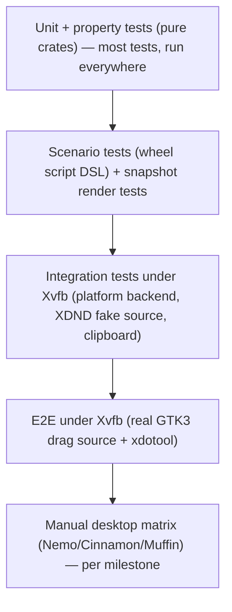

# Radivine — Testing Strategy

Status: **Accepted & Implemented (v0.1.0 – v0.2.0 Milestone C5)** · Last updated: 2026-10-25

---

## 1. Principles

1. **Push logic into pure code, test it exhaustively.** The wheel engine, XDND state machine, trigger edge logic, URI parsing, menu building, text verdicts and head/tail algorithms are pure and get the bulk of the tests.
2. **Integration tests run against a real X server (Xvfb)**, not mocks of X11.
3. **Real-desktop behaviour (Nemo, Muffin, NVIDIA) is verified manually** with written checklists and recorded reports — CI cannot reproduce a Cinnamon session faithfully.
4. **Time is injected** everywhere it matters (wheel engine, watchdog logic) so timing behaviour is tested deterministically.
5. **Never claim performance without a measurement**: benchmarks and runtime spans produce numbers that are recorded with machine and date.



## 2. Unit tests

| Crate / module | What | Examples |
|----------------|------|----------|
| `radivine-wheel::geometry` | Angle normalisation, segment spans (root/child formulas), gap insets, corridor polygons, point-in-polygon, tangent points | `n = 1..=12`; bridge sector correctness for `β` in all quadrants; wrap-around at 0/2π |
| `::hit` | Zones, priority deepest-first, hysteresis widen, hub hysteresis | Point exactly on boundary; hovered item keeps ownership within ε |
| `::layout` | Root clamp, child rotation order, shrink, fallback, caption sides | Anchor at each corner; child of item pointing into an edge rotates toward centre |
| `::nav` | Dwell, outer band, intent triangle + grace, hub close, chain truncation, slop, keyboard | See scenario list §3 |
| `::anim` | Tween values, retarget continuity, reduced motion | `value(start) == from`, `value(start+dur) == to`, retarget mid-way has no jump |
| `::menu` | Validation/clamping (items > 12, depth > 6) | |
| `radivine-render::damage` | Bbox tracking, merge ≤ 4 rects | Moving highlight produces damage only around old+new segment |
| `radivine-core::uri` | RFC 2483 parsing | CRLF/LF, comments, `file://localhost/`, percent-encoded non-UTF-8 bytes, non-file schemes, relative paths rejected |
| `::menu_build` | Visibility filter, pruning, overrides, overflow, defaults, limits | Table-driven with `FakeAction`s |
| `::enablement` | Pending → Enabled/Disabled transitions | |
| `::enrich` | File kinds, permissions, symlinks, FIFOs (no hang — test with timeout), text verdict corpus | Generated in `tempdir` |
| `radivine-actions::custom` | TOML parsing, `when` matching, placeholder rules and expansion | Partial placeholder rejected with error |
| `radivine-platform::x11::xdnd` | Pure XDND target state machine | Enter with >3 types, stale source ignored, status/finished field layout bit-exact |
| `::arming` | Trigger edge logic | Pre-held Shift ignored until released; repeats deduped; L/R Shift |
| `::shm` (pure part) | Byte-order shuffle derived from masks | LSB/MSB servers |
| `radivine-viewer::{head,tail,index,search}` | Algorithms | Compare against reference implementations |
| `radivine-convert::{format,options,settings,output,engine}` | Magic-byte sniffing, preset resolution (`QuickDefault`, `Named`), `convert.toml` parsing/validation, `O_RDONLY \| O_NOFOLLOW \| O_NONBLOCK` + `fstat` source validation, `.rvstage-<uid>` staging, `renameat2(RENAME_NOREPLACE)` / `linkat` atomic commit, cooperative cancellation cleanup | 9 conversion pairs, non-UTF-8 `OsStr` filenames, symlink races, decompression bomb rejection, read-only directory refusal |
| `radivine-convert-image` | PNG/JPEG/WebP header inspection, 8-bit/16-bit/grayscale/CMYK decode, EXIF auto-orient + tag-`0x0112` reset, ICC & EXIF preservation/stripping (`gps_privacy_preserved`), alpha flattening, Lanczos3 resize, WebP RIFF `VP8X`/`ICCP`/`EXIF` muxer | Synthetic reference corpus (`tools/convert-corpus`) + adversarial malformed/polyglot/bomb inputs |
| `radivine-jobs` | `JobState`/`ItemState` state machines, `WirePath` (`utf8:`/`hex:`) lossless codec, newline-delimited JSON-RPC framing (`MAX_FRAME_BYTES = 1 MiB`), `JobsSettings` validation, `SO_PEERCRED` UID verification | Proptest arbitrary byte round-trips for `WirePath` |
| `radivine-worker` | SQLite WAL persistence (`jobs`, `job_items`, `active_stages`), crash recovery (`reconcile_on_startup`), bounded item worker pool, token-bucket `ResourceGovernor`, linked immutable retry (`FailedOnly`, `FailedAndCancelled`, `AllItems`), `ReloadSettings`, `InspectStaging` / `CleanupStaging`, D-Bus batch summary notifications | SIGKILL mid-item crash recovery, concurrent multi-client IPC, schema-version forward-compatibility guard |
| `radivine-control` | 8-page UI state machine (`Dashboard`, `General`, `Wheel`, `Actions`, `Conversion`, `Jobs`, `Diagnostics`, `About`), standalone `radivine-control convert` dialog (`--stdin` / positional args), `toml_edit` format-preserving persistence (`config.toml`, `actions.toml`, `convert.toml`), native clipboard & Arabic/non-Latin system-font fallback | Headless `egui::Context::run_ui` harness + `--export-screenshots` regression suite |

## 3. Wheel scenario tests (script DSL)

A small test-only DSL drives `WheelSession` with simulated time and positions:

```rust
// demo_menu(): root = [File Preview ▸ (Full, Head, Tail), Copy, Properties, Custom ▸ …]
// Geometry (defaults): root centre (500,400), r_in 38, r_out 116, hit_radius 128; item 0 ("File Preview")
// spans 225°–315° (top). Its child is placed straight up at d = 116+10+96 = 222 → centre (500,178),
// r_in 30, r_out 96; bridge faces down (β = 90°); 3 items × 72° centred on 270°:
// Full 162°–234°, Head 234°–306° (top), Tail 306°–18°. Band threshold on the root = 38 + 0.65·78 = 88.7.
script(demo_menu())
    .summon_at(500.0, 400.0, t(0))
    .move_to(500.0, 330.0, t(20))           // d = 70 < 88.7 → hover item 0, dwell needed
    .expect_hover(Some(&[0]))
    .wait_until(t(170)).expect_open(&[0])   // dwell 140 ms → child open
    .move_to(500.0, 270.0, t(190))          // outside root hit disc; child d = 92, angle 90° → Bridge(child)
    .expect_open(&[0]).expect_hover(Some(&[0]))
    .move_to(500.0, 200.0, t(210))          // child hub (d = 22 < 30) → child stays open
    .move_to(500.0, 122.0, t(230))          // child d = 56, angle 270° → "Head"
    .expect_hover(Some(&[0, 1]))
    .expect_drop_target(Accept(&[0, 1]));
```

Scenarios involving rotated children or intent triangles must not hard-code coordinates: use the test helpers `geom.item_center(&path)`, `geom.wheel(&path)`, and `geom.point_in(Zone::Item { .. }).toward(point)` that read positions from the session's computed layout (e.g. summon near the top edge so the child of item 0 rotates, then cross item 1 while heading to the child).

Required scenarios (each a named test):
1. Dwell opens; band opens immediately; `submenu_open = "click"` never auto-opens.
2. Diagonal travel through a neighbouring segment keeps the child (intent triangle); dwelling on the neighbour closes it after `grace_ms`.
3. Hub entry closes children after `hub_close_ms`; quick pass-through hub does not.
4. Outside keeps the chain; re-entry restores hover.
5. Ancestor item switch truncates deeper wheels.
6. Activation slop: no hover/drop before 6 lp of motion.
7. Drop target always equals hover; disabled → Reject; submenu with `default_child` → Accept(default).
8. `set_enabled` during hover updates drop target without layout change.
9. Keyboard: next/prev wrap, activate leaf → `Commit`, activate submenu → focus first child, back, digit, cancel.
10. Dismiss during child emerge animation finishes cleanly (`Finished` emitted once).
11. Placement near all corners for 2-level and 3-level menus.

**Property tests** (`proptest`):
- For random `n`, radii and points in the annulus: exactly one of {Item, Bridge, Empty} is returned.
- For random anchors in a viewport ≥ 800×600 and random menus (≤ 8 items, depth ≤ 3): every placed wheel is inside the viewport or flagged as fallback; no two non-parent wheels overlap unless flagged.
- Random input sequences never panic, never produce `Commit` for disabled items, and `next_deadline() ≥ now`.

**Allocation test**: a counting global allocator (test binary) asserts zero allocations in `handle`, `tick`, `scene` after a warm-up session.

## 4. Integration tests (Xvfb)

Run with `xvfb-run -s "-screen 0 1920x1080x24 +extension COMPOSITE +extension RANDR"` (Composite enables a depth-32 visual) **plus a minimal compositing manager** (`xcompmgr`, installed in CI) so `_NET_WM_CM_S0` is owned and the production ARGB path is exercised. If no compositor is available locally, set `RADIVINE_FORCE_ARGB=1` (test/debug only) to force the ARGB path. Gated behind the `x11-integration` Cargo feature / test name prefix so `cargo test` on machines without X stays green.

| Test | Verifies |
|------|----------|
| `overlay_create_map_unmap` | ARGB visual found, properties set (`XdndAware=5`, window type), map/unmap |
| `shm_present_roundtrip` | Present a known pattern via SHM, read back with `GetImage`, byte order correct |
| `input_region_mask` | `set_input_region` produces the expected input shape (`shape::GetRectangles`) |
| `invoke_grab_ungrab` | Grabs acquired/released; retry path when another client holds a grab |
| `xdnd_fake_source` | A **test-only Rust XDND source** (x11rb) owns `XdndSelection`, sends Enter/Position/Drop to the overlay, serves `text/uri-list` (incl. an `INCR` case); asserts status replies (accept/reject per position, `XdndActionPrivate`, empty rect, bit 1) and `XdndFinished` |
| `arming_xfixes` | Fake source owning/releasing `XdndSelection` produces `DragArmed`/`DragDisarmed` |
| `trigger_raw_keys` | `xdotool keydown/keyup shift` (XTEST, test-only) while armed produces exactly one `Trigger` |
| `clipboard_owner` | Copy effect → `xclip -o -selection CLIPBOARD -t x-special/gnome-copied-files` returns expected content |

XTEST/xdotool are used **only by tests** to simulate a user; the product never uses XTEST.

## 5. End-to-end tests (Xvfb + real GTK3 drag source)

`tests/e2e-x11/` contains:
- `drag_source.py` — a minimal **python3-gi GTK 3** window with a draggable icon offering `text/uri-list` for a temp file (uses the same `gtk_drag_begin` code path as Nemo).
- `run_e2e.sh` — starts Xvfb, a lightweight compositor if available (optional), the Radivine daemon with `RADIVINE_LOG=info` and a test config (shorter dwell for speed), the drag source; then uses `xdotool` to: press button 1 on the icon, move past the drag threshold, `keydown shift`, move to the "File Preview" segment, wait for dwell, move to "Head", release; finally asserts the daemon log contains `commit id=radivine.preview.head path=[0,1] uris=[file:///tmp/…]` and that the temp file is unchanged.
- Variants: reject-drop (release on hub → no commit, source reports drag failed), Escape, toggle-off then drop onto a second GTK drop-target window (receives the drop).

E2E runs in CI as a separate job; one automatic retry allowed; failures produce the daemon log and an `xwd` screenshot as artifacts.

Nemo itself in Xvfb (`dbus-run-session nemo --no-desktop`) is optional/experimental; the authoritative Nemo verification is manual (§6).

## 6. Manual desktop test matrix (per milestone, on Mint Cinnamon X11)

Recorded in `docs/test-reports/Mx.md` with date, versions (`radivine doctor` output), pass/fail, notes, and screen recordings for UX items.

| Area | Cases |
|------|-------|
| Nemo drag sources | Icon view, list view, compact view, desktop icons (nemo-desktop), multiple selected files, drag from search results, from a gvfs location (sftp), from Trash |
| Modifier activation | Fresh Shift after drag start (L and R); Shift held before drag (must not activate); Shift toggle off/on; trigger = Ctrl/Alt via config; Caps/Num Lock on; non-US layout |
| Navigation feel | Diagonal travel to child, sweeping across segments, boundary jitter, 3-level menu, returning to parent, hub behaviour |
| Multiple monitors | Use `xrandr --setmonitor` to split the 3840×1080 display into two virtual 1920×1080 monitors (RandR 1.5 monitors) and verify the wheel stays on the pointer's monitor; also on real dual-monitor hardware when available |
| DPI scaling | Cinnamon scaling 1× and 2× (Xft.dpi 96/192), and `appearance.scale = 1.5` |
| Screen boundaries | All 4 corners and 4 edges; child rotation/shrink; caption placement |
| Fullscreen apps | Video player/browser fullscreen on the same monitor while dragging from a Nemo window on top (overlay must still appear above) |
| Escape / cancellation | Esc mid-drag, release on hub, gap, disabled item, outside after grace |
| Rapid repeated activation | 20 sessions in 30 s; toggling Shift quickly; starting a new drag during dismiss animation |
| Errors | Unreadable file, broken symlink, FIFO, folder, deleted-while-dragging file, file on unreachable network mount |
| Large files | 5 GB log Head/Tail, 2 GB Full Preview with search |
| Non-interference | Normal Nemo DnD without Shift; Shift-drag move; typing during idle; clipboard untouched; CPU idle |
| Safety | Checksums/mtimes of dragged files unchanged across all cases |
| Crash recovery | `kill -9` daemon mid-drag and mid-invoke; desktop usable; restart works |

## 7. Performance, Fuzzing & Reliability Testing

| Kind | Tool | Targets (`ARCHITECTURE.md` §9 & `BENCHMARKS.md`) |
|------|------|---------------------------|
| Micro-benchmarks | `criterion` in `radivine-wheel` (`handle`, `scene`, placement) and `radivine-render` (frame for 1/2/3-level clusters at 1×/2×) | Frame p95 < 4 ms @1×, < 8 ms @2× |
| Conversion codec benchmarks | `convert-cli bench` (`tools/convert-cli`) | PNG→JPEG, PNG→WebP, JPEG→WebP across 1 MP / 12 MP / 24 MP + 20-item & 100-item batches |
| System conversion & UI benchmarks | `c5_benchmarks` (`apps/radivine-control/tests/c5_benchmarks.rs`) | Quick Convert dispatch p95 ≤ 12 ms, worker cold-start p95 ≤ 80 ms, cancel ack p95 ≤ 25 ms, drain p95 ≤ 300 ms, Advanced Convert ready p95 ≤ 180 ms, Jobs 1,000-row frame p95 ≤ 4 ms |
| Coverage-guided fuzzing | `tools/convert-fuzz` (8 `libfuzzer-sys` SanitizerCoverage targets) | `sniff_format`, `inspect`, `convert_small`, `exif_orientation_reset`, `webp_riff_mux`, `convert_toml_parse`, `worker_protocol_parse`, `wirepath_roundtrip` (`≥ 1 h` per target in C5) |
| Reliability soak | `c5_soak_test` (`apps/radivine-control/tests/c5_soak_test.rs`) | `≥ 3600 s` continuous Quick Convert, Advanced Convert, mixed/invalid batches, cancellation, linked retry, SIGTERM/SIGKILL recovery, idle exit, collisions, settings reload; 0 source mutations, 0 overwrites, 0 residual `.rvstage-*`/`.part` |
| Idle | `pidstat`, `/proc/<pid>/status`, `perf trace -s` for wakeups | ≈ 0 % CPU, daemon RSS ≤ 25 MiB, worker RSS recovery within +8 MiB |
| Allocation | Counting allocator test | 0 allocations per frame in steady state |

Results go to [`docs/BENCHMARKS.md`](BENCHMARKS.md) and [`docs/test-reports/C5.md`](test-reports/C5.md) with machine, OS, versions, date, command lines, and raw numbers.

## 8. Quality tools and CI

### 8.1 Local commands

```bash
cargo fmt --all --check
./scripts/check-dep-graph.sh
cargo clippy --workspace --all-targets -- -D warnings
cargo test --workspace -- --test-threads=1
cargo test --workspace --features x11-integration      # needs DISPLAY or xvfb-run
cargo bench -p radivine-wheel -p radivine-render
cargo run --release -p convert-cli -- bench --warmup 5 --runs 30
cargo deny check
cargo audit
./tests/e2e-x11/run_e2e.sh                              # needs Xvfb, python3-gi, xdotool
```

### 8.2 GitHub Actions

| Workflow | Trigger | Jobs |
|----------|---------|------|
| `ci.yml` | push, PR | `fmt`; `clippy` (`-D warnings`); `test` (ubuntu-24.04, stable); `msrv` (`cargo +<msrv> check`); `docs` (`cargo doc --no-deps` with `-D warnings`); `deny` (licences/advisories/bans); `graph` (script asserting the crate dependency graph from ARCHITECTURE §2.2 via `cargo metadata`) |
| `x11.yml` | push, PR | Install `xvfb`, `xcompmgr`, `xdotool`, `xclip`, `python3-gi`, `gir1.2-gtk-3.0`; run `x11-integration` tests and `run_e2e.sh`; upload logs/screenshots on failure |
| `nightly.yml` | schedule | `cargo fuzz` (URI parser, XDND message parser) 10 min each; `cargo llvm-cov` report; benches (informational, noisy on shared runners) |
| `release.yml` | tag `v*` | Build release binaries, `cargo-deb` package, checksums, GitHub release draft |

Caching: `Swatinem/rust-cache`. Benchmarks in CI are informational only; authoritative numbers come from the reference machine.

### 8.3 Automated vs. manual separation

| Automated (CI) | Manual (desktop) |
|----------------|------------------|
| Unit, property, scenario, snapshot, allocation tests | Nemo drag matrix, Cinnamon/Muffin visual behaviour, NVIDIA presentation |
| Xvfb integration (overlay, SHM, shapes, grabs, XDND with fake source, clipboard) | Multi-monitor and DPI on real hardware |
| E2E with GTK3 python drag source | UX feel sign-off (timings, sizes, colours) |
| Fuzzing, coverage, benches (informational) | Authoritative performance measurements |

## 9. Test data

- Generated at test time (never commit large files): text corpora (LF/CRLF/no trailing newline/empty/single line/huge lines), UTF-16 samples, binary samples (PNG/ZIP headers), 5 GB sparse-ish log via a generator script for manual M5 tests.
- Special files created in `tempdir` (FIFO via `mkfifo`, broken symlinks, permission-denied files via `chmod 000`).

## 10. Bug reports

Issue template requires: `radivine doctor` output, `radivine --version`, desktop/session type, file manager and version, steps, and `RADIVINE_LOG=debug` excerpt.
