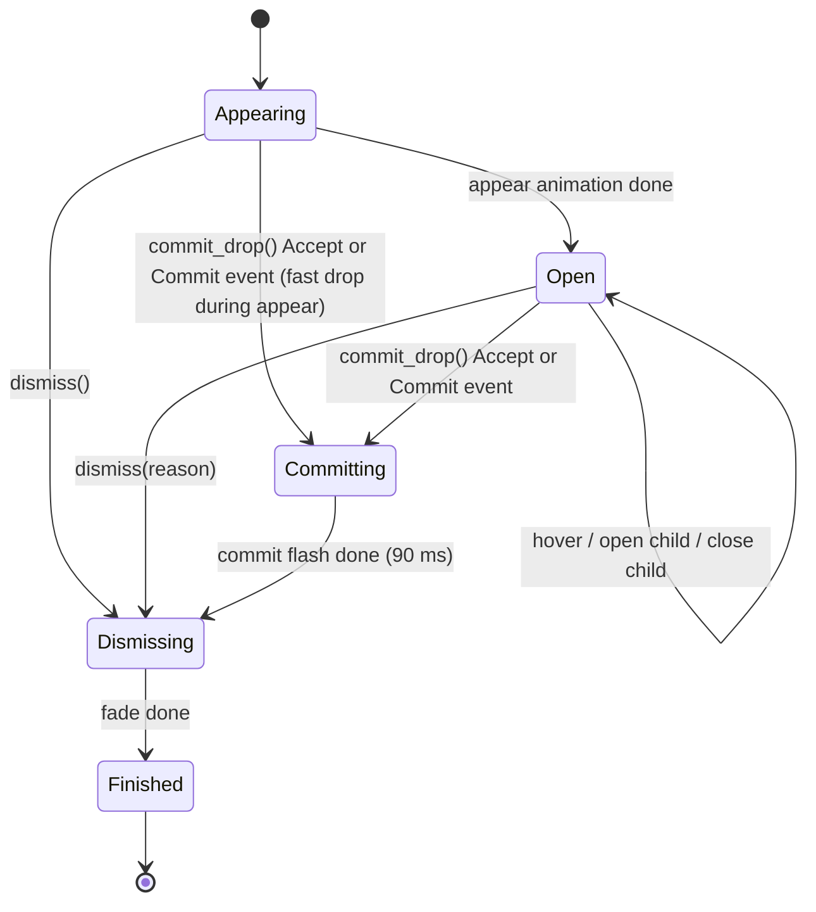
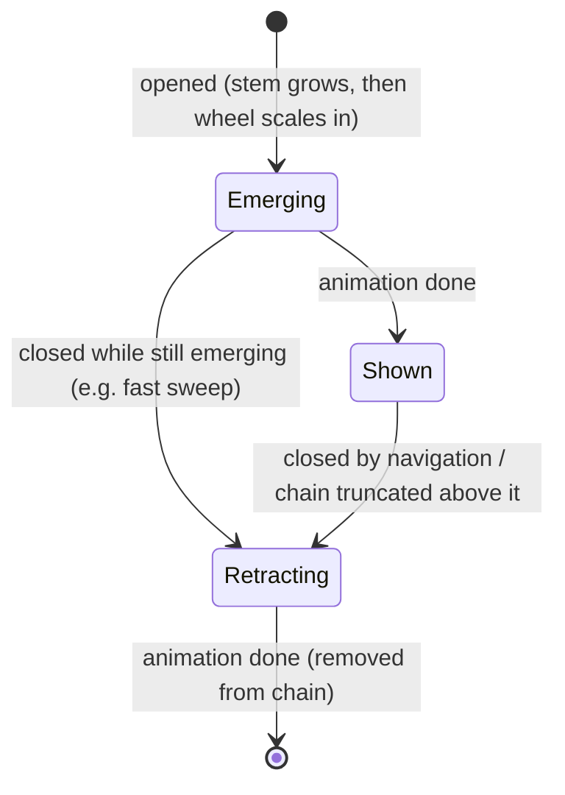

# Radivine — Wheel Engine Design

Status: **Proposed — normative for M1** · Last updated: 2026-10-22
Crates: `radivine-wheel` (pure engine) and `radivine-render` (renderer). This is the most important design document after the feasibility study: **the wheel is the product.**

---

## 1. Principles

1. **Pure and deterministic.** `radivine-wheel` performs no I/O, reads no clock (time is injected as `Millis`), and depends only on `std` + `smallvec`. Same inputs ⇒ same outputs ⇒ exhaustive unit tests.
2. **One engine, two input modes.** *Drag mode* (positions from XDND; selection = drop) and *Pointer mode* (Invoke mode; real pointer/keyboard events; selection = click/release/keyboard).
3. **Predictable over clever.** Wheels never move after they appear; children appear in a computable place; navigation rules are explicit and configurable.
4. **Forgiving.** A child wheel must not collapse while the user travels toward it.
5. **Cheap.** No heap allocation per input/frame in steady state; all per-session storage pre-sized.

## 2. Coordinates and units

| Concept | Definition |
|---------|-----------|
| Logical px (`lp`) | Device-independent unit. `physical = logical × scale`. All engine math uses `f32` logical px. |
| Overlay-local space | Origin = top-left of the overlay window = top-left of the monitor the overlay covers. +x right, +y **down**. |
| `Viewport` | `{ bounds: Rect /* logical, normally (0,0,w/scale,h/scale) */, scale: f32 }` |
| Angles | `θ = atan2(dy, dx)` normalised to `[0, 2π)`. Because +y is down, angles increase **clockwise**. "Top" is `3π/2` (= −π/2). |
| Time | `Millis = u64`, monotonic, supplied by the caller. |

## 3. Menu model (input to the engine)

```rust
pub struct MenuTree { pub root: MenuNode }          // root.kind must be Submenu

pub struct MenuNode {
    pub id: Arc<str>,                // stable id: action id for leaves, submenu id for submenus
    pub label: Arc<str>,             // short display label
    pub icon: Option<IconKey>,       // opaque; resolved by the renderer
    pub description: Option<Arc<str>>,     // shown in the caption; never changed during a session
    pub disabled_reason: Option<Arc<str>>, // shown in the caption when disabled; updated by set_enabled
    pub enabled: bool,
    pub kind: NodeKind,
}
pub enum NodeKind {
    Leaf,
    Submenu { children: Vec<MenuNode>, default_child: Option<usize> },
}
pub struct IconKey(pub Arc<str>);    // e.g. "lucide:eye", "theme:document-properties"
pub struct ItemPath(pub SmallVec<[u8; 6]>);   // child indices from the root wheel
```

Constraints (validated by `radivine-core` when building, re-checked by the engine with `debug_assert!` + graceful clamping). *Depth* counts wheels: the root wheel is depth 1 (= "level 0" in §4.1).

| Rule | Default | Hard limit | Behaviour when exceeded |
|------|---------|-----------|------------------------|
| Items per wheel | ≤ 8 | 12 | Builder keeps the first 7 items and moves items 7.. into an automatic **"More…"** submenu (7 + More = 8) |
| Depth (root = 1) | ≤ 4 | 6 | Submenus at the limit are rendered disabled with reason "Too deeply nested" |
| Empty submenu | — | — | Pruned by the builder |
| Root with 0 items | — | — | Session not shown; app reports "No actions for this item" |

Rationale for breadth/depth defaults: marking-menu research (Kurtenbach & Buxton, *CHI '93*) found selection accuracy holds well up to 8 items per level and degrades with depth > 2 at breadth 8; Radivine's practical menus are 3–6 items and 2–3 levels.

## 4. Wheel anatomy and geometry

```text
                 item 0 (top)
              .-~~~~~~~~~~~-.
          .-~   \   icon  /   ~-.        r_out ─ outer radius of ring
        /  item  \ label /  item  \      r_in  ─ hub radius (dead zone)
       |    5     \     /    1     |     gap   ─ constant linear gap between segments
       |-----------( HUB )---------|     node  ─ hollow circle at outer edge = "has children"
       |    4     /     \    2     |
        \        /       \        /
          '-.__ /  item 3 \ __.-'
               '-~~~~~~~~~-'
```

### 4.1 Radii per level (defaults, logical px)

| Level | `r_in` (hub) | `r_out` | Icon | Label |
|-------|-------------|---------|------|-------|
| 0 (root) | 38 | 116 | 22 | 12 |
| 1 | 30 | 96 | 20 | 12 |
| ≥ 2 | 26 | 84 | 20 | 11 |
| Shrink floor | — | 64 | 18 | 11 |

`hit_radius = r_out + hit_margin` (default `hit_margin = 12`). The input region and hit-tests use `hit_radius`; drawing uses `r_out`.

### 4.2 Segment angles

**Root wheel** (`n` items): `Δ = 2π / n`. Item `k` centre angle `φ_k = 3π/2 + k·Δ` (item 0 at top, clockwise). Span `[φ_k − Δ/2, φ_k + Δ/2)`.

**Child wheel** (`n` items), opened from a parent segment:
- `β` = direction from the child centre **toward the parent centre**.
- **Bridge sector** of width `w_b` (default 70°) centred on `β`: no items; it is where the pointer arrives from the parent.
- Per-item angle `Δ = min((2π − w_b) / n, Δ_max)` with `Δ_max = 72°`.
- Items occupy an arc of `n·Δ` centred on `β + π` (facing away from the parent): `φ_k = β + π − n·Δ/2 + (k + ½)·Δ`.
- Ring area not covered by items or bridge is **empty** (neutral, drawn as plain ring).

**Visual gap**: each segment is inset by `gap/2` on both sides as a *linear* distance, i.e. angular inset `δ(r) = (gap/2) / r` evaluated at `r_in` and `r_out` separately (constant-width gaps, default `gap = 2.5 lp`). Hit-testing ignores gaps (no dead slivers between segments).

### 4.3 Content placement within a segment

Each segment carries a **content block**: icon stacked above the label (gap 3 lp), both horizontally centred, text always horizontal.

- Block centre at the segment centroid radius `r_c = r_in + 0.55·(r_out − r_in)`, angle `φ_k`.
- Label max width `w_max = 0.82 × min(chord(r_c, Δ − 2δ), r_out − r_in)` — the `min` keeps horizontal labels inside the ring for side segments too; ellipsised by the renderer.
- Submenu node indicator: hollow circle (radius 3.5, stroke 1.5) centred **on the rim** (`r_out`) at angle `φ_k` — half inside the ring, like the logo's branch-end nodes; it never collides with the content block (checked for all levels incl. the 64 lp floor).
- The **caption** (§4.5) shows the full label, description and disabled reason, so in-segment labels may be truncated safely.

### 4.4 Hub

- Root hub: context glyph (e.g. MIME-category icon) + count badge (`3`) when more than one item.
- Child hub: the parent item's icon.
- The hub is never a drop target. In Pointer mode clicking the root hub cancels; clicking a child hub closes that child ("back").

### 4.5 Caption

A rounded pill showing `title` (hovered item label, 13 lp semibold) and optional `detail` (the item's `disabled_reason` when disabled, otherwise its `description`; 11 lp). One caption exists at a time, attached to the **active wheel**. Its reserved box is `240 × 44 lp`; placement candidates in order: below, above, right, left of the active wheel at distance `r_out + 10`; the first candidate that lies inside the viewport and does not intersect any visible wheel's `hit_radius` disc or stem wins (else "below", clamped). The engine reserves the box; the renderer sizes the pill to the text within it. Caption placement is recomputed only when the active wheel changes (no jitter).

## 5. Layout and placement

### 5.1 Root placement

```
c_root = clamp(anchor, viewport.bounds.inset(r_out_root + edge_margin))   // edge_margin = 8 lp
```
If `|c_root − anchor| > 0.5`, the root is *displaced* (pointer near an edge). Wheels never move after appearing. The input region always includes an **anchor disc** (radius 24 lp around the summon point) and, when displaced, a corridor (convex hull of the anchor disc and the root's `hit_radius` disc tangents) so the drag source retargets to the overlay even before the pointer reaches the root.

### 5.2 Child placement (deterministic)

Inputs: parent `(c_p, r_p)`, the opened segment's centre angle `φ`, nominal child radius `r_c`, visible chain discs, viewport.

```text
radii = [r_c, 0.9·r_c, 0.8·r_c, …while > r_min] followed by exactly r_min (64)
for r in radii:
    d = r_p + child_gap + r                          // child_gap = 10 lp → drawn discs never touch
    for (k, s) in [(0,+), (1,s0), (1,−s0), (2,s0), (2,−s0), … (6,±)]:   // 12° steps, up to ±72°
        θ = φ + s·k·12°
        c = c_p + d·(cos θ, sin θ)
        if disc(c, r + edge_margin) ⊂ viewport
           and ∀ visible wheel w ≠ parent: |c − c_w| ≥ r + r_w + min_sep (6 lp):
            return Placement { center: c, r_out: r, attach_angle: θ, fallback: false }
fallback: the candidate minimising (10·area_outside_viewport + overlap_area), centre clamped into viewport,
          returned with fallback: true (tests assert on this flag)
```

(The caption is ignored during child placement and re-placed afterwards, §4.5.)

Note: because `child_gap` (10) < 2 × `hit_margin` (12), parent and child **hit** discs overlap slightly near the stem. This is intentional; deepest-first hit-testing (§6.2) gives the child priority. Do not "fix" it by enlarging the gap.

- `s0` (which rotation direction is tried first) = the sign that moves `c` closer to the viewport centre — deterministic and pushes children away from edges.
- The **bridge angle** of the child is recomputed from the final centre (`β = angle(c → c_p)`).
- Hub radius scales with `r` (`r_in = r · r_in_nominal / r_out_nominal`).

### 5.3 Stems (the "vine")

Each child is connected to its parent by a stem from `P0 = c_p + r_p·u(φ)` (outer midpoint of the opened segment) to `P1 = c_c + r_c·u(β)` (centre of the child's bridge arc). If `θ = φ` the stem is a straight line of length `child_gap`; otherwise a quadratic Bézier with control point `c_p + (r_p + child_gap)·u(φ)`. Stroke 3 lp. Drawn below wheels.

### 5.4 Multi-monitor and DPI

- The overlay covers exactly one monitor (the one containing the pointer at summon time). Wheels never span monitors.
- `scale` comes from the platform (X11: `Xft.dpi / 96`, overridable). Scale is fixed for the session.
- Monitor configuration change during a session ⇒ the app dismisses the session.

### 5.5 Collision policy summary

| Situation | Policy |
|-----------|--------|
| Child would leave the viewport | Rotate up to ±72°, then shrink to `r_min`, then clamp |
| Child would overlap an ancestor | Same as above (rotation usually resolves it) |
| Unavoidable overlap (tiny screen) | Child drawn on top; ancestors dimmed; hit-test prefers deeper wheel |
| Caption collides | Next candidate side; else below and clamped |

Depth trade-off: each level extends the cluster by ≈ `2·r + child_gap` (≈ 180–200 lp). Three levels fit comfortably around a central pointer on 1080p; four levels near an edge rely on rotation/shrink. Computation cost is negligible (≤ 6 wheels × ≤ 13 candidates × ≤ 4 radii).

## 6. Hit-testing

### 6.1 Zones

```rust
pub enum Zone {
    Hub    { wheel: u8 },
    Item   { wheel: u8, index: u8 },
    Bridge { wheel: u8 },            // child wheels only
    Empty  { wheel: u8 },            // ring area without an item (child wheels)
    Corridor { child: u8 },          // region between a parent segment and its child
    Outside,
}
```

### 6.2 Algorithm (priority: deepest wheel first)

```text
for w in chain (deepest → root):
    v = p − c_w ; d = |v|
    if hovered is Hub(w) then r_hub = r_in(w) + 3 else r_hub = r_in(w)     // radial hysteresis
    if d < r_hub: return Hub(w)
    // Prevent a child wheel's outer hit_margin (r_out(w) < d ≤ hit_radius(w), which extends
    // 12 lp across the 10 lp child_gap) from preempting its parent's drawn ring (d_parent ≤ r_out(parent))
    // when a submenu opens while the pointer is near the outer edge of the parent segment:
    if w is a child and d > r_out(w) and |p − c_parent(w)| ≤ r_out(parent(w)):
        continue
    if d ≤ hit_radius(w):
        θ = angle(v)
        if w is a child and θ ∈ bridge(w): return Bridge(w)
        if hovered is Item(w, h) and θ ∈ span(h) widened by ε (4°): return Item(w, h)   // angular hysteresis
        if θ ∈ span(k) for some k: return Item(w, k)
        return Empty(w)
for each child wheel w (deepest → shallowest):
    if p ∈ corridor(w): return Corridor(w)
return Outside
```

**Corridor(w)**: the **convex hull** of four points — the parent segment's outer arc endpoints (at `r_p`, angles `φ ± (Δ_p/2 − δ)`) and the two points on the child's `hit_radius` circle perpendicular to the centre line. Using the convex hull keeps the polygon valid (non-self-intersecting) for any rotation up to ±72°. It guarantees a continuous region from the parent segment to the child.

### 6.3 Input region (for platform pass-through)

`input_region()` returns the union of: the anchor disc (+ displacement corridor, §5.1), every visible wheel's `hit_radius` disc, and every corridor polygon. The caption box is **excluded** (captions are not interactive). Shapes are `Shape::Circle { c, r }` and `Shape::Polygon(SmallVec<[Point; 6]>)` in logical px. The engine emits `WheelEvent::InputRegionChanged` whenever a wheel opens/closes (not during animation frames); after `dismiss()` it returns an empty region. **The app** converts `Shape` (logical, overlay-local) into the platform's `ShapePx` (physical px) by multiplying by `scale`.

### 6.4 Drop target (Drag mode)

```text
if !moved_past_slop: Reject
match hovered:
    Item(w,k) leaf, enabled                         → Accept(path)
    Item(w,k) submenu with enabled default_child    → Accept(path + default_child)
    _                                                → Reject   // hub, bridge, empty, corridor, outside, disabled, submenu w/o default
```

During intent protection (§7.3) the *protected* item remains the hovered item, so the drop target always equals what is highlighted.

The drop target can also change **without pointer motion** (dwell/grace/hub-close deadlines in `tick()`, or `set_enabled`). The app therefore (a) compares `drop_target()` after every `tick`/`set_enabled` and sends an unsolicited status update when it changed (**empirically verified in Spike [`S-1`](file:///home/marwanmohamed/Documents/work/rust/radivine/docs/spikes/S-1.md):** `gdkdnd-x11.c` `xdnd_status_filter` updates `context->action` and emits `GDK_DRAG_STATUS` unconditionally on unsolicited `XdndStatus` messages with zero pointer movement, both for `Reject → Accept` and `Accept → Reject`), and (b) **always re-evaluates `drop_target()` when the drop arrives** (`commit_drop()` does this) and finishes the drop as failed if it is now `Reject`.

## 7. Navigation and interaction rules

### 7.1 Activation slop

Nothing is hovered, opened, or droppable until the pointer has moved `activation_slop` (default 6 lp) from its position at summon time. Prevents instant accidental hover when the root is displaced and absorbs jitter at trigger time.

### 7.2 Opening a submenu

A child for `Item(w,k)` (submenu, enabled) opens when any enabled rule fires (config `intent.submenu_open`, default `"dwell+band"`):

| Rule | Condition | Purpose |
|------|-----------|---------|
| Dwell | hovered unchanged for `dwell_ms` (default 140) | Deliberate hover |
| Outer band | `d ≥ r_in + band·(r_out − r_in)` (default `band = 0.65`) **and** the last move had outward radial component | Fast "push outward" toward where the child will appear |
| Click | Pointer mode press/release on the item | Explicit |
| Keyboard | `Enter`/`Space` on the focused submenu item | Accessibility |

Opening a child of `w` first closes any other open child of `w` (with retract animation).

### 7.3 Keeping a child open (intent protection)

Let `C` be the open child of wheel `w`, opened from item `k`. When the pointer moves from `Item(w,k)` into another zone:

| New zone | Rule |
|----------|------|
| Inside `C`, `Bridge(C)`, `Corridor(C)` | Keep `C`; `k` stays highlighted as *on-path* |
| `Item(w, j)`, `j ≠ k` | **Intent triangle**: apex = last pointer position inside `Item(w,k)` (`p_exit`), base = the two tangent points from `p_exit` to `C`'s `hit_radius` circle. If the pointer is inside the triangle **and** `now − t_exit < grace_ms` (default 300) **and** the distance to `c_C` has decreased since `p_exit` → keep `C`, keep `k` hovered, do not hover `j`. Otherwise close `C`, hover `j` (and `j` may open its own child via §7.2). Re-evaluated on every move and at the grace deadline. |
| `Hub(w)` | Close `C` after `hub_close_ms` (default 150) if still in the hub |
| `Empty(w)` / `Outside` | Keep the chain unchanged (no collapse while wandering) |
| An ancestor `a` of `w`, item `j` | If `j` is the item that opened the chain below `a`: keep. Else truncate the chain below `a` (intent protection applies only to `a`'s immediate child) |

Trade-offs (why these defaults):
- **Short `dwell_ms`** feels fast but flickers children open while sweeping across segments; 120–160 ms is the usual sweet spot for hover menus. The outer-band rule keeps expert motion fast without lowering dwell.
- **Intent triangle** (as popularised by Amazon's mega-menu) solves diagonal travel; the **grace timeout** bounds how long a wrong child can linger.
- **Angular hysteresis (ε = 4°)** prevents highlight flicker on segment boundaries; larger values make boundaries feel "sticky".
- **Never collapsing on Outside** makes returning to the cluster predictable; the session-level leave grace (app) handles real abandonment in drag mode.

### 7.4 Going back

- Moving into the parent's other segments/hub per §7.3 closes the child (animated retract).
- Pointer mode: clicking a child hub closes that child; `Backspace` closes the active child.
- Drag mode: back navigation is pointer-only.

### 7.5 Selection / commit

| Mode | Commit gesture | Result |
|------|----------------|--------|
| Drag | Drop (`XdndDrop`) while `drop_target() == Accept(path)` | App calls `commit_drop()` → commit animation, returns `path` |
| Pointer, `invoke.select = "click"` (default) | Press + release on the same enabled leaf; or release on an enabled leaf after pressing on the hub (marking-menu style) | `WheelEvent::Commit(path)` |
| Pointer, `"release"` | Release over an enabled leaf (press anywhere) | `Commit(path)` |
| Keyboard | `Enter`/`Space` on an enabled leaf; digit `1`–`9` | `Commit(path)` |

Clicking a disabled item does nothing (caption shows the reason). Clicking outside all wheels, the root hub, or pressing `Esc` → `WheelEvent::CancelRequested`.

### 7.6 Keyboard navigation (Pointer/Invoke mode only)

| Key | Action |
|-----|--------|
| `→` `↓` `Tab` | Next item clockwise in the active wheel (skips nothing; disabled items are focusable so their reason is readable) |
| `←` `↑` `Shift+Tab` | Previous item |
| `Enter` / `Space` | Leaf: commit · Submenu: open and focus its first item |
| `Backspace` | Close active child; focus returns to its parent item |
| `1`–`9` | Activate item n of the active wheel |
| `Esc` | Cancel the session |

Keyboard focus and pointer hover are the same state; real pointer motion beyond `activation_slop` takes over from keyboard focus.

## 8. State machines

### 8.1 Engine session



Input is accepted in `Appearing` and `Open` (hover may start during the appear animation once slop is exceeded). In `Committing`/`Dismissing` inputs are ignored, `drop_target()` returns `Reject`, and `input_region()` is empty.

### 8.2 Per wheel (each element of the chain)

Lifecycle and role are independent. **Lifecycle:**



**Role** (attribute, recomputed whenever the chain changes): the deepest wheel in the chain is `Active`; all others are `Ancestor` (dimmed). A retracting wheel keeps its last role for drawing but is excluded from hit-testing and the input region.

### 8.3 Per item hover (within a wheel)

`Idle → Hovered(since) → [submenu] Opening(deadline) → Open → (Protected(until)) → Idle`. Only one item per wheel can be `Hovered/Open/Protected`.

## 9. Engine public API (normative)

```rust
pub type Millis = u64;
#[derive(Clone, Copy, Debug, PartialEq)] pub struct Point { pub x: f32, pub y: f32 }
#[derive(Clone, Copy, Debug, PartialEq)] pub struct Rect { pub x: f32, pub y: f32, pub w: f32, pub h: f32 }
pub struct Viewport { pub bounds: Rect, pub scale: f32 }
pub enum InputMode { Drag, Pointer }

pub enum WheelInput {
    PointerMoved(Point),   // overlay-local logical px
    PointerLeft,           // left the input region (Drag: XdndLeave)
    PointerEntered,
    Press,                 // Pointer mode, primary button
    Release,
    Nav(NavKey),
}
pub enum NavKey { Next, Prev, Activate, Back, Cancel, Digit(u8) }

pub enum WheelEvent {
    HoverChanged(Option<ItemPath>),
    SubmenuOpened(ItemPath),
    SubmenuClosed(ItemPath),
    Commit(ItemPath),      // Pointer/keyboard commit
    CancelRequested,       // Pointer mode cancel gestures
    InputRegionChanged,
    Finished,              // dismiss animation complete; app may unmap
}
pub enum DropTarget { Accept(ItemPath), Reject }
pub enum DismissReason { Committed, Cancelled, DragEnded, Toggled, Timeout, Error }

pub struct WheelSession { /* private */ }
impl WheelSession {
    /// `menu = None` shows a hub-only placeholder until `set_menu` is called.
    pub fn new(menu: Option<MenuTree>, anchor: Point, viewport: Viewport,
               mode: InputMode, cfg: &WheelConfig, now: Millis) -> Self;
    pub fn set_menu(&mut self, menu: MenuTree, now: Millis);       // only allowed once, before any hover
    pub fn handle(&mut self, input: WheelInput, now: Millis, out: &mut Vec<WheelEvent>);
    pub fn tick(&mut self, now: Millis, out: &mut Vec<WheelEvent>); // timers + animations
    pub fn drop_target(&self) -> DropTarget;
    pub fn commit_drop(&mut self, now: Millis) -> Option<ItemPath>;  // re-evaluates drop_target(); None = reject
    pub fn set_enabled(&mut self, path: &ItemPath, enabled: bool, disabled_reason: Option<Arc<str>>);
    pub fn dismiss(&mut self, reason: DismissReason, now: Millis);
    pub fn scene(&self) -> &Scene;                 // rebuilt lazily when state changed
    pub fn input_region(&self) -> &[Shape];
    pub fn next_deadline(&self) -> Option<Millis>; // earliest timer (dwell/grace/hub-close)
    pub fn is_animating(&self) -> bool;
    pub fn is_finished(&self) -> bool;
}

// Supporting types
pub enum Shape { Circle { c: Point, r: f32 }, Polygon(SmallVec<[Point; 6]>) }   // logical px, overlay-local
pub enum WheelRole { Active, Ancestor }
pub enum CaptionAlign { Below, Above, Right, Left }   // side of the active wheel the caption box sits on
pub struct Placement { pub center: Point, pub r_out: f32, pub attach_angle: f32, pub fallback: bool }
pub struct WheelConfig {            // mirrors §10 one-to-one (field names = TOML keys); Default = §10 values
    pub max_items_per_wheel: u8, pub max_depth: u8, pub activation_slop: f32, pub hit_margin: f32,
    pub segment_gap: f32, pub child_gap: f32, pub bridge_angle_deg: f32, pub hysteresis_deg: f32,
    pub radius_root: [f32; 2], pub radius_child: [f32; 2], pub radius_deep: [f32; 2], pub radius_min_outer: f32,
    pub submenu_open: SubmenuOpen /* Dwell | Band | DwellAndBand | Click */, pub dwell_ms: u16, pub band: f32,
    pub grace_ms: u16, pub hub_close_ms: u16, pub invoke_select: InvokeSelect /* Click | Release */,
    pub reduced_motion: bool,
}
// DebugState (test-api feature only) is implementer-defined: chain, hovered zone, pending timers.
```

Rules:
- `handle`/`tick` push zero or more events into the caller-provided `out` (reused `Vec`, no allocation).
- All indices in `ItemPath` refer to the `MenuTree` passed in (stable for the session).
- `set_enabled` may be called any time; it never changes layout and never touches `description`.

## 10. Configuration (`[wheel]`, `[trigger]`, `[invoke]`, `[appearance]` in `config.toml`)

```toml
[trigger]
key = "shift"                 # shift | ctrl | alt | super
toggle_off_on_repress = true  # second press hides the wheel; drag continues
dismiss_on_release = false    # true = "hold to show" behaviour

[wheel]
max_items_per_wheel = 8
max_depth = 4
activation_slop = 6.0
hit_margin = 12.0
segment_gap = 2.5
child_gap = 10.0
bridge_angle_deg = 70.0
hysteresis_deg = 4.0
radius_root  = [38.0, 116.0]  # [r_in, r_out]
radius_child = [30.0, 96.0]
radius_deep  = [26.0, 84.0]
radius_min_outer = 64.0

[wheel.intent]
submenu_open = "dwell+band"   # dwell | band | dwell+band | click
dwell_ms = 140
band = 0.65
grace_ms = 300
hub_close_ms = 150

[wheel.leave]                 # drag mode: pointer left the wheel input region
grace_ms = 350
passthrough = false           # false = capture-all safe default (per S-4); true = shaped pass-through

[invoke]
select = "click"              # click | release

[appearance]
theme = "dark"                # dark | light | auto
scale = "auto"                # "auto" or a number
reduced_motion = "auto"       # auto (XSETTINGS Net/EnableAnimations) | on | off
```

`WheelConfig` mirrors `[wheel]`, `[wheel.intent]`, `invoke.select` and the resolved `appearance.reduced_motion` (with `Default`), validated/clamped on load (e.g. `dwell_ms ∈ [0, 1000]`, `bridge_angle_deg ∈ [40, 100]`). `[trigger]`, `[wheel.leave]` and `[appearance]` theme/scale are consumed by the app/renderer, not the engine. The complete configuration schema (all files, all keys) is in [ARCHITECTURE.md §7.4](ARCHITECTURE.md).

## 11. Animation

### 11.1 Model

```rust
pub struct Tween { from: f32, to: f32, start: Millis, dur: u16, ease: Ease }
impl Tween {
    fn value(&self, now: Millis) -> f32;
    fn retarget(&mut self, to: f32, now: Millis, dur: u16);  // from = current value → interruptible
    fn done(&self, now: Millis) -> bool;
}
pub enum Ease { Linear, OutCubic, InOutCubic }
```

No springs, no physics: tweens are deterministic, trivially testable, and sufficient for restrained motion.

### 11.2 Timings (defaults)

| Animation | Duration | Properties | Ease |
|-----------|----------|------------|------|
| Root appear | 140 ms (+ per-segment stagger 10 ms, max 60 ms) | scale 0.86→1, opacity 0→1, origin = anchor | OutCubic |
| Stem grow | 90 ms | trim 0→1 | OutCubic |
| Child emerge | starts +40 ms, 130 ms | scale 0.6→1, opacity 0→1, origin = bridge point | OutCubic |
| Child retract | 110 ms (stem 80 ms) | reverse | InOutCubic |
| Hover in / out | 90 ms / 120 ms | highlight 0↔1, pop +4 lp on `r_out` | OutCubic |
| Ancestor dim | 120 ms | opacity → 0.72 | OutCubic |
| Caption change | 80 ms | crossfade | Linear |
| Commit | 90 ms flash, then 120 ms | highlight 1→1.25; cluster opacity→0, scale→0.94 | OutCubic |
| Cancel dismiss | 100 ms | opacity→0, scale→0.96 | OutCubic |

**Reduced motion**: all scale/stem/pop animations disabled; opacity fades of ≤ 60 ms only.

Every individual tween is ≤ 160 ms; composed sequences (appear + stagger, stem + emerge, commit flash + fade) stay ≤ 210 ms.

### 11.3 Frame scheduling

`is_animating()` true ⇒ app schedules frames at the monitor refresh interval; otherwise renders only when inputs change the scene. `next_deadline()` drives hover-intent timers independently of frames.

## 12. Scene (engine → renderer contract)

```rust
pub struct Scene {
    pub generation: u64,                         // increments on every change
    pub stems: SmallVec<[StemVisual; 6]>,
    pub wheels: SmallVec<[WheelVisual; 6]>,      // root first → deepest last (draw order)
    pub caption: Option<CaptionVisual>,
}
pub struct WheelVisual {
    pub center: Point, pub r_in: f32, pub r_out: f32,
    pub scale: f32, pub origin: Point, pub opacity: f32,
    pub role: WheelRole,                          // Active | Ancestor
    pub bridge: Option<(f32, f32)>,               // angle span (for subtle bridge notch rendering)
    pub hub: HubVisual,
    pub segments: SmallVec<[SegmentVisual; 12]>,
}
pub struct SegmentVisual {
    pub a0: f32, pub a1: f32,                     // radians, before gap inset
    pub highlight: f32,                           // 0..=1.25 animated
    pub pop: f32,                                 // extra outer radius, lp
    pub on_path: bool,                            // item that opened a visible child
    pub enabled: bool, pub has_children: bool,
    pub label: Arc<str>, pub icon: Option<IconKey>,
}
pub struct HubVisual { pub icon: Option<IconKey>, pub badge: Option<u32> }
pub struct StemVisual { pub p0: Point, pub ctrl: Point, pub p1: Point, pub progress: f32, pub opacity: f32, pub on_path: bool }
pub struct CaptionVisual { pub box_: Rect, pub align: CaptionAlign, pub title: Arc<str>, pub detail: Option<Arc<str>>, pub disabled: bool, pub opacity: f32 }
```

## 13. Renderer specification (`radivine-render`)

### 13.1 Responsibilities

- Own a `tiny_skia::Pixmap` the size of the overlay (physical px), allocated in `begin_session`, released in `end_session` (or retained per app policy).
- Rasterise labels once per session (cosmic-text → alpha masks cached by `(text, size_px)`), icons once per size (resvg → alpha masks cached by `(IconKey, size_px)`); tint at draw time.
- Draw a `Scene`, compute damage, expose the frame as premultiplied RGBA8 + stride.

Renderer API and its own types (the renderer depends only on `radivine-wheel`; it defines its pixel types itself — the app converts them to the platform's identically shaped `RectPx`/`FrameRef`):

```rust
pub struct SizePx { pub w: u32, pub h: u32 }
pub struct RectPx { pub x: i32, pub y: i32, pub w: u32, pub h: u32 }
pub struct FrameRef<'a> { pub data: &'a [u8], pub width: u32, pub height: u32, pub stride: usize } // premultiplied RGBA8
pub enum AssetSource { Embedded, Dir(std::path::PathBuf) }   // Embedded = include_bytes! of assets/fonts + assets/wheel-icons
pub struct Theme { /* the tokens of §13.4; Theme::dark(), Theme::light() */ }
#[derive(thiserror::Error, Debug)] pub enum RenderError { #[error("font: {0}")] Font(String), #[error("icon: {0}")] Icon(String) }

impl Renderer {
    pub fn new(theme: Theme, assets: AssetSource) -> Result<Self, RenderError>;
    pub fn begin_session(&mut self, size_px: SizePx, scale: f32);
    pub fn render(&mut self, scene: &Scene) -> &[RectPx];   // damage of this frame (≤ 4 rects)
    pub fn frame(&self) -> FrameRef<'_>;
    pub fn end_session(&mut self);
}
```

Icon keys: `lucide:<name>` resolves to the bundled SVG subset; `theme:<name>` (used only by custom actions) resolves through the freedesktop icon theme (scalable SVG via resvg, PNG via tiny-skia's PNG decoder) — implemented in M4; until then and on failure, a neutral placeholder glyph is drawn.

### 13.2 Draw order

1. Clear damaged rectangles to transparent.
2. Stems.
3. For each wheel (root → deepest): soft shadow sprite (pre-blurred disc per radius, cached), ring annulus, segment highlights, separators via gaps, submenu nodes, icons, labels, hub (disc + inner ring echoing the logo's central node), hub content.
4. Caption pill.

All wheel drawing is under the wheel's transform (`scale` about `origin`) and multiplied by `opacity`.

### 13.3 Damage

For each visual element the renderer keeps last frame's bounding box (physical px) and a cheap hash of its visual parameters. Changed/added/removed elements contribute `old_bbox ∪ new_bbox`. Damage rectangles are merged into ≤ 4 rects; drawing is clipped to them. First frame of a session: damage = union of all element boxes (not the whole monitor — the window background is already transparent).

### 13.4 Visual specification (dark theme, default)

Brand colours measured from `assets/branding`: vine green `#044C3C`, leaf green `#00A87C`.

| Token | Value | Contrast (measured) |
|-------|-------|--------------------|
| `ring.fill` | `#0A1A16` @ 92 % | — |
| `ring.stroke` | `#1E4D42`, 1 lp | — |
| `segment.highlight` | `#00A87C` (leaf) | — |
| `segment.on_path` | `#0E6B52` | — |
| `hub.fill` | `#044C3C` (vine) with 1.5 lp `#E8F5F0` inner ring at 70 % radius | — |
| `text.primary` | `#E8F5F0` | 16.0:1 on `#0A1A16`; ≥ 12.9:1 over white backdrop at 92 % |
| `text.secondary` | `#9FC9BC` | 9.9:1 on `#0A1A16` |
| `text.disabled` | `#5C7A72` | 3.8:1 (disabled text is exempt, still legible) |
| `text.on_accent` | `#04241C` | 5.4:1 on `#00A87C` (white would be only 3.05:1 → not used) |
| `stem` / `stem.on_path` | `#0E6B52` / `#00A87C`, 3 lp | — |
| `shadow` | black @ 35 %, blur 18 lp, offset (0, 4) | — |
| `caption.fill` | `#0A1A16` @ 94 %, radius 10 lp | — |

Light theme: `ring.fill #F4FBF8 @ 94 %`, `text.primary #073B30` (11.9:1), `segment.highlight #2BC79A` with `text.on_accent #04241C` (7.6:1).

Typography: bundled **Inter** (Regular, Medium, SemiBold, Bold static instances — or the single variable font file if cosmic-text handles the weights correctly; decide in M1b); segment label 12 lp Medium; caption title 13 lp SemiBold, detail 11 lp Regular; badge 11 lp Bold.

Icons: bundled **Lucide** subset — `eye`, `file-text`, `arrow-up-to-line`, `arrow-down-to-line`, `copy`, `info`, `sparkles`, `terminal`, `code`, `more-horizontal`, `x`, `chevron-left`, `file`, `files`, `folder`, `image`, `link` (hub glyphs) — stroke icons tinted `text.primary` (or `text.on_accent` when highlighted, `text.disabled` when disabled).

## 14. Performance rules

- Chain storage: `SmallVec<[WheelState; 6]>`; segments `SmallVec<[_; 12]>`; event `Vec` provided by the caller; `Scene` rebuilt in place.
- Labels are `Arc<str>` clones (refcount only).
- Hit-test cost: O(visible items) ≤ 72 angle comparisons — negligible.
- Renderer: cached masks; per frame only fills + blits within damage.
- Bench targets: see [ARCHITECTURE.md §9](ARCHITECTURE.md#9-performance-targets).

## 15. Accessibility

- Keyboard-complete in Pointer/Invoke mode (§7.6); caption announces label + disabled reason visually.
- Reduced motion honoured (XSETTINGS `Net/EnableAnimations` on X11, config override).
- Contrast meets WCAG AA for all active text (§13.4).
- Screen readers: the overlay is custom-drawn; v1 does **not** expose it to AT-SPI. Future: AccessKit (`accesskit_unix`, AT-SPI) for the overlay, or an "accessible list" Invoke variant in a normal window. Recorded as known gap (R-21).
- Drag mode has no keyboard path (platform restriction, see FEASIBILITY_STUDY §8.1); Invoke mode is the accessible path for every action.

## 16. Test hooks

- `WheelSession` exposes `#[cfg(any(test, feature = "test-api"))] fn debug_state(&self) -> DebugState` (chain, hovered zone, timers).
- A tiny script DSL in tests: `at(0).summon((500,400)).at(10).move_to((560,400)).at(200).expect_open([0])…` (see [TESTING_STRATEGY.md](TESTING_STRATEGY.md)).
- `RADIVINE_DEBUG_OVERLAY=1` in the app draws zones, corridors, intent triangles and the input region.

## 17. Selectable Wheel Layouts — Branching (Default) & Concentric Radial (`v0.3.0`)

- **Default Layout (`Branching / Vine`, `wheel.layout = "branching"`):** Spawns each child submenu as an offset adjacent wheel (`d = R_p + g + R_c`) connected by a curved vine stem, with all ancestor wheels remaining visible.
- **Optional Layout (`Concentric / Nested Rings`, `wheel.layout = "concentric"`):** Selectable via `~/.config/radivine/config.toml` or **Control Center → Wheel → Wheel Layout**. Opening a submenu promotes its items onto an outer concentric annulus (`R_in(L) = 118 + 66·(L-1) lp`, `R_out(L) = R_in(L) + 60 lp`, inter-ring gap `6 lp`, central hub `R_hub = 50 lp`, root ring `50..118 lp`) centered on the single immobile root origin `C_0`.
- **Viewport Reservation & Automatic Fallback:** Concentric mode reserves 4 rings (`R_reserve(4) = 326 lp`) plus the fixed bottom caption box (`Cy + 326..388 lp`, `8 lp` screen margin), requiring a minimum monitor workarea of **`668 × 742` logical pixels** (`1366×768@1x` and `1920×1080@1.25x` supported; `1280×720@1x` and `1920×1080@1.5x` automatically fall back to `Branching` with `LayoutFallbackReason::InsufficientViewportSpace` without modifying `config.toml`).
- **Safety & Hit-Testing Invariants:** Central hub (`r < 50 lp`), inter-ring radial gaps (`6 lp`), angular separator gaps, outer ring margin (`r > R_out(D)`), displaced approach corridor, protected pending-switch siblings (`90 ms` outer-ring steering protection), and the fixed bottom caption box are strictly non-actionable (`hover_action = None`, `dnd_reply(false)`, `dnd_finish(false)` on drop).
