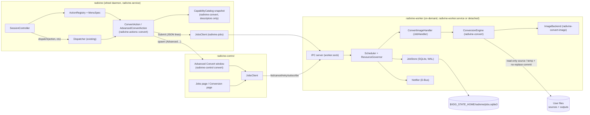
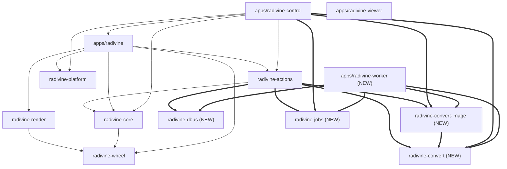
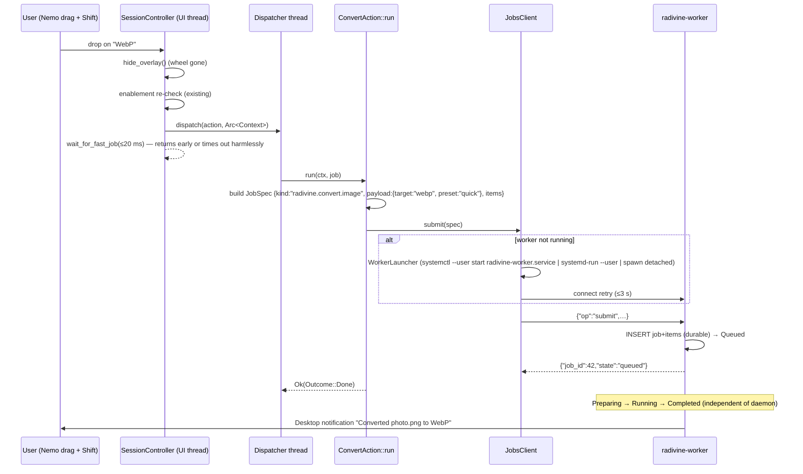

# Radivine v0.2.0 — Conversion Architecture

Status: **Proposed — pending owner review** · Prepared: 2026-10-24 · Baseline: `v0.1.1` (`872d5d4`)
Related: [README](README.md) · [JOB_SYSTEM_DESIGN](JOB_SYSTEM_DESIGN.md) · [CONVERSION_BACKENDS](CONVERSION_BACKENDS.md) · [SECURITY_AND_FILE_SAFETY](SECURITY_AND_FILE_SAFETY.md) · [ARCHITECTURE_DECISIONS](ARCHITECTURE_DECISIONS.md)

---

## 1. Current codebase assessment [EXISTING]

### 1.1 What exists and is reused unchanged

| Component | Location | Relevance to v0.2.0 |
|-----------|----------|---------------------|
| `Action` trait (`meta`, `is_visible(&BasicContext)`, `enablement(&Context)`, `run(&Context, &JobHandle)`) | `crates/radivine-core/src/action.rs:182-201` | Conversion actions implement it **unchanged**. `run()` submits a durable job and returns quickly. |
| `ActionMeta` (label ≤16 chars recommended, icon, static description, `kinds`) | `action.rs:53-64` | Short labels "Convert", "Image", "PNG", "JPEG", "WebP", "Advanced…" |
| `Enablement::{Enabled, Disabled{reason}, Pending}` | `action.rs:68-78` | Used as is. `Pending` renders "Checking…" (`registry.rs:357`) |
| `MenuSpec::{Action{id}, Submenu{id, label, icon, description, default, children}, CustomActions}` | `registry.rs:13-33` | New `radivine.convert` submenu nested in `default_menu()` (`crates/radivine-actions/src/lib.rs:31-69`) |
| `ActionRegistry::build_menu` / `enablement_updates` | `registry.rs:182-245` | Unchanged algorithm: pruning of empty submenus, "More…" overflow, depth limit |
| `MenuLimits::default()` = 8 items / depth 4 | `registry.rs:54-61` | The `Convert ▸ Image ▸ target` leaves are at depth 3, within the limit |
| `BasicContext` / `Item { ext, guessed_mime, local_path }` | `context.rs:56-127` | Visibility input (extension-based) |
| `Enricher` → `FileFacts { kind, size, readable, text, sniffed_mime, error }`, first **64** items only (`MAX_ENRICHED_ITEMS = 64`), 1500 ms deadline (`DEFAULT_ENRICH_TIMEOUT`), progressive snapshot emitted after each inspected item (`enrich.rs:205-242`) | `context.rs:167-219`, `enrich.rs:22-28` | Enablement input. `sniff_magic_mime` already recognizes PNG/JPEG/WebP/GIF/TIFF/BMP (`enrich.rs:648-669`) |
| `Dispatcher` (FIFO, ≤4 concurrent threads, `catch_unwind`, `JobSink`) | `crates/radivine-core/src/dispatch.rs` | Unchanged. It runs the *submission* (`ConvertAction::run`), not the conversion. |
| Commit path: overlay hidden **before** dispatch, enablement re-check, `wait_for_fast_job(20 ms)` | `apps/radivine/src/session.rs:1492-1592` | The wheel closes immediately (approved requirement 4.8 is already met). A slow submission just exceeds the 20 ms window harmlessly. |
| `Outcome`/`Effect` handling, error notifications via a notification worker thread | `session.rs:1742-1812` | Submission errors surface through the existing path |
| Pure-Rust D-Bus client (`call_desktop_notify`, `call_show_item_properties`) | `crates/radivine-actions/src/dbus.rs:1-492` (extracted into `crates/radivine-dbus` in C2 and re-exported by `radivine-actions::dbus`) | Extracted into a standalone zero-Radivine-dependency crate `radivine-dbus` so `radivine-worker` calls `radivine_dbus::call_desktop_notify` without depending on `radivine-actions`, `radivine-core`, or `radivine-wheel`; `radivine-control` uses `call_show_items` (`E6`). |
| IPC pattern: JSON lines over a `0600` Unix socket in `$XDG_RUNTIME_DIR/radivine/` | `apps/radivine/src/ipc.rs` | The worker protocol follows the same conventions (ADR-017) and adds a subscription stream |
| Control Center: page enum, `mpsc` worker thread + `request_repaint`, `toml_edit` atomic persistence with conflict detection | `apps/radivine-control/src/{lib,ui,persistence}.rs` | The Jobs and Conversion pages follow the same patterns |
| Custom actions (`actions.toml`, argv-only, `wait`/`timeout_ms`) | `crates/radivine-actions/src/custom.rs` | Stays on the short-lived Dispatcher path (not forced into durable jobs) |
| `image` 0.25.10 already in `Cargo.lock` (via `eframe`, `png` feature + `moxcms`) | `Cargo.lock:1423` | Lower marginal dependency cost |
| `rustix` 1.x with `fs` feature | workspace `Cargo.toml` | `renameat_with(NOREPLACE)`, `openat`, `linkat`, `fstatvfs` are available as safe APIs (verified in rustix 1.1.5 source: `src/fs/at.rs:302`, Linux and Apple) |

### 1.2 Small, backwards-compatible extensions required

| # | Extension | Where (Verified v0.1.1 Symbols & Lines) | Compatibility |
|---|-----------|----------------------------------------|---------------|
| E1 | `fn description_for(&self, _ctx: &BasicContext) -> Option<Cow<'_, str>> { self.meta().description.as_deref().map(Cow::Borrowed) }` on `Action`, called by `build_action_leaf` (`description: action.description_for(basic_ctx).map(Cow::into_owned)`) | `crates/radivine-core/src/action.rs:53-64, 182-201`, `crates/radivine-core/src/registry.rs:317-333` | Default method on `Action` (where `ActionMeta.description` is `Option<String>`), so existing implementors compile unchanged. Computed once per session (`WHEEL_ENGINE_DESIGN.md` §2 invariant preserved). |
| E2 | `pub const CAP_EXCEEDED_REASON: &str = "Too many items to inspect";`, `pub const ENRICH_TIMEOUT_REASON: &str = "Couldn't inspect the file";`, and `FileFacts::is_uninspected(&self) -> bool` (`matches!(self.kind, FileKind::Unknown) && matches!(self.error.as_deref(), Some(CAP_EXCEEDED_REASON \| ENRICH_TIMEOUT_REASON))`) | `crates/radivine-core/src/context.rs:167-219`, `crates/radivine-core/src/enrich.rs:22, 130-137, 301-308` | Additive. Uses the actual `FileFacts { kind: FileKind, error: Option<String>, .. }` fields and `MAX_ENRICHED_ITEMS = 64` constant in `v0.1.1`. |
| E3 | `register_builtins_with_options(registry, &ActionsConfig, &PreviewSettings, &ConvertMenuContext)` + `registry_from_options(&ActionsConfig, &PreviewSettings, &ConvertMenuContext)`; existing `register_builtins`, `register_builtins_with_config`, `register_builtins_with_preview`, `builtin_registry`, `registry_from_actions_config`, and `registry_from_actions_and_preview_config` keep their exact signatures and pass a default context | `crates/radivine-actions/src/lib.rs:72-91, 181-204` | Additive |
| E4 | `default_menu()` gains `MenuSpec::Submenu { id: Arc::from("radivine.convert"), label: "Convert".into(), icon: Some(IconKey::from("lucide:arrow-right-left")), description: Some("Convert files".into()), default: None, children: vec![...] }` at index 1 (after File Preview). | `crates/radivine-actions/src/lib.rs:31-69`, `crates/radivine-core/src/registry.rs:13-33` | Image drags get one extra root segment. Text drags keep their exact v0.1.1 layout (pruned automatically at `registry.rs:290-294`). |
| E5 | Three new Lucide SVGs (ISC) in `assets/wheel-icons/` (`arrow-right-left.svg`, `sliders-horizontal.svg`, `file-image.svg`) plus registration in `const EMBEDDED_ICONS: &[(&str, &str)]` | `assets/wheel-icons/`, `crates/radivine-render/src/cache.rs:47-95` | Additive. **Not** branding assets (`assets/branding/` and `assets/icons/` remain untouched). |
| E6 | Extract `crates/radivine-actions/src/dbus.rs:1-492` into `crates/radivine-dbus` (`#![forbid(unsafe_code)]`, depends only on `thiserror`), add `call_show_items(uris: &[String])` (`org.freedesktop.FileManager1.ShowItems`), and `pub use radivine_dbus as dbus;` in `radivine-actions` | `crates/radivine-dbus/src/lib.rs`, `crates/radivine-actions/src/lib.rs:8, 25-27` | 100% backwards-compatible re-export for `radivine` and `radivine-control`, while eliminating the `radivine-worker → radivine-actions → radivine-core → radivine-wheel` dependency chain. |
| E7 | Control Center: `ControlPage::{Conversion, Jobs}`, `--page jobs\|conversion`, and a standalone `convert` CLI subcommand (`radivine-control convert [--stdin] [PATHS...]`) that **bypasses `ControlInstanceLock::acquire_or_notify_existing()`** before starting eframe | `apps/radivine-control/src/lib.rs:17-31`, `apps/radivine-control/src/main.rs:58-73, 147-159`, `apps/radivine-control/src/single_instance.rs:39-42` | Additive. Existing `ControlPage` variants (`Overview`, `Activation`, `Appearance`, `Actions`, `Diagnostics`, `About`) and slugs are unchanged. |
| E8 | Lossless RFC 8089 percent-encoding in `radivine_core::local_path_to_file_uri(&Path)` (encoding `path.as_os_str().as_bytes()` instead of `to_string_lossy()`), `normalize_cli_arg_to_uri(&OsStr, &Path)`, and `Commands::Invoke { paths: Vec<OsString>, at: Option<String> }` | `crates/radivine-core/src/context.rs:334-380`, `apps/radivine/src/main.rs:58-66, 493-502` | Fixes discrepancy `X10` at the source so `radivine invoke` preserves arbitrary non-UTF-8 Unix filenames end-to-end (Milestone C3). |

**No change** to `radivine-wheel`, `radivine-render` geometry/animation, `radivine-platform`, the session state machine, the daemon IPC protocol, or `config.toml` keys read by the daemon.

### 1.3 Documentation vs. source discrepancies found

These are recorded for transparency. None of them blocks v0.2.0. Fixing the docs is a separate `docs:` task.

| # | Document claim | Actual source |
|---|----------------|---------------|
| X1 | `ARCHITECTURE.md` §7.2: IPC requests use `{"cmd":…}` | `ipc.rs` uses `#[serde(tag = "op")]` and responses `{"status":"ok"\|"error",…}` |
| X2 | `ARCHITECTURE.md` §7.4 config schema (`trigger.key`, `wheel.max_items_per_wheel`, `[wheel.intent]`, `[session]`, `[overlay]`, `[platform.x11]`, `[log]`) | `AppConfig` (`apps/radivine/src/config.rs:95-112`) has `version`, `trigger.drag_modifier`, `wheel.root_inner_radius…`, `[notifications]`, `[preview]`, `[input]`, `[x11]`. `max_items_per_wheel`/`max_depth` are **not configurable**: `build_menu` is always called with `MenuLimits::default()` (`session.rs:621,1173,1275`). |
| X3 | `ARCHITECTURE.md` §4.1/TECH_STACK: notification worker uses `zbus` | No zbus. A custom pure-Rust D-Bus client is used (`radivine-actions/src/dbus.rs`). |
| X4 | `ACTION_SYSTEM.md` §4.2: content sniffing via the `infer` crate | In-house `sniff_magic_mime` (`enrich.rs:648`) |
| X5 | `ACTION_SYSTEM.md` §8: previews visible only for exactly 1 item | `PreviewAction::is_visible` accepts any count. `enablement` disables when count ≠ 1 (`builtins.rs:290-312`). |
| X6 | `ACTION_SYSTEM.md` §8 mentions `radivine.debug.log` | The default menu ships `custom.terminal`, `custom.scripts.sha256`, `custom.scripts.chmod` as **`LogAction` placeholders** (log only) (`radivine-actions/src/lib.rs:142-173`) |
| X7 | `ARCHITECTURE.md` §2.2: the dependency graph is enforced by a CI `cargo metadata` script; `radivine-control` is absent from the graph | No such CI step (`.github/workflows/ci.yml`). `radivine-control` depends on the `radivine` app lib, `radivine-actions`, `radivine-core`, and `radivine-platform`. |
| X8 | `DECISIONS.md` index: ADR-022 "Proposed"; ADR-025/026 missing; ADR-018 "no settings GUI" | ADR-022 body says Accepted. ADR-025 (Control Center) effectively supersedes ADR-018 without a formal "Superseded" mark. |
| X9 | `ARCHITECTURE.md` §8: autostart via XDG autostart | Primary path is the `radivine.service` systemd user unit (ADR-025) |
| X10 | — | `radivine_core::local_path_to_file_uri` in v0.1.1 uses `to_string_lossy()`, which is **lossy for non-UTF-8 paths**. The new job protocol uses lossless `WirePath` (§6.3 and `JOB_SYSTEM_DESIGN` §6), and extension `E8` replaces `to_string_lossy()` in `local_path_to_file_uri` and `Commands::Invoke` with raw Unix byte percent-encoding in C3. |
| X11 | — | Workspace `eframe` uses `default-features = false` with `["default_fonts","glow","x11","wayland"]`. eframe 0.37's `clipboard` feature (default-on upstream, verified in `eframe-0.37.0/Cargo.toml`) is therefore **disabled**. This is a likely root cause of GitHub issue #1. It is **not** fixed in this roadmap; see IMPLEMENTATION_PLAN §7. |
| X12 | Status headers (`ARCHITECTURE.md` "Proposed (pending M0 spikes)", `TESTING_STRATEGY.md` "Proposed", `PRODUCT_VISION.md` "Planning") | All implemented and shipped in v0.1.0/v0.1.1 |
| X13 | `ACTION_SYSTEM.md` §1 non-goal "No long-running job UI" (v0.1) | v0.2.0 deliberately changes this (ADR-C06) |

---

## 2. Architectural principles for v0.2.0 [PROPOSED]

1. **One Action System.** Conversion is a family of ordinary `impl Action` types. There is no separate menu, registry, or interaction model.
2. **Actions decide; workers execute.** An action's `run()` only builds a job specification and submits it. Heavy work never runs in the wheel daemon.
3. **The library knows nothing about the desktop.** `radivine-convert` has no dependency on X11, Nemo, wheel geometry, egui, D-Bus, systemd, or Radivine's other crates.
4. **The source file is sacred.** The engine never opens sources for writing and never renames or unlinks any path except its own temporary files (see SECURITY_AND_FILE_SAFETY §3).
5. **Durable jobs are opt-in.** Previews, Copy, Properties, and custom commands stay on the existing short-lived `Dispatcher`. Only actions that need durability, progress, or batches submit jobs.
6. **Synchronous Rust, explicit threads.** No async runtime (consistent with ADR-007). Blocking work happens on named worker threads. Cross-process communication uses JSON lines.
7. **Honest capabilities.** Every conversion is classified as *available*, *requires an optional dependency*, or *unsupported*, and every metadata promise is backed by a verified backend capability flag.

---

## 3. System overview



### 3.1 Process responsibilities

| Process | New responsibilities | Must not |
|---------|---------------------|----------|
| `radivine` (daemon) | Register conversion actions; hold a `CapabilityCatalog` snapshot; submit jobs; spawn the Advanced window | Decode, encode, or write images; open the job database; wait for job completion |
| `radivine-worker` (**new**) | Own the job database (single writer); schedule and execute jobs; enforce resource limits; recover after crashes; send completion notifications; serve the job IPC | Depend on X11/egui; stay alive when idle (exits after `idle_exit_s`) |
| `radivine-control` | Jobs page, Conversion settings page, Advanced Convert window (`convert` mode); edit `convert.toml` and `config.toml [jobs]` | Block the egui thread; open the job database directly; convert images in-process |

---

## 4. Crate boundaries and dependency graph [PROPOSED]

### 4.1 New crates

| Crate | Kind | Responsibility | Runtime deps (new in **bold**) |
|-------|------|----------------|---------------------|
| `crates/radivine-dbus` | lib, `#![forbid(unsafe_code)]` | Pure-Rust, zero-Radivine-dependency `org.freedesktop.Notifications` and `org.freedesktop.FileManager1` D-Bus wire-protocol client (`call_desktop_notify`, `call_show_item_properties`, `call_show_items`), extracted from `crates/radivine-actions/src/dbus.rs` (`1-492`) and re-exported by `radivine-actions::dbus` | `thiserror` |
| `crates/radivine-convert` | lib, `#![forbid(unsafe_code)]` | Format catalog and sniffing; backend contract (`ConversionBackend`) and data-only `BackendDescriptor`; discovery/probing of external programs; `CapabilityCatalog` and routing; options, presets, and validation; `ConversionEngine` (plan → item execution); safe output commit (`output` module); error model | `thiserror`, `rustix` (fs), `tracing`, `serde` (optional feature `serde`) |
| `crates/radivine-convert-image` | lib, `#![forbid(unsafe_code)]` | Built-in image backend: PNG/JPEG/WebP decode (pure Rust), PNG/JPEG encode, WebP lossless (image-webp) and lossy (libwebp) encode, alpha flatten, resize, orientation, ICC/EXIF handling, header inspection | `radivine-convert`, **`image`** (`png`,`jpeg`,`webp` features, `default-features = false`), **libwebp binding** (see CONVERSION_BACKENDS §5), **`img-parts`** [VERIFY] *or* in-house RIFF muxer |
| `crates/radivine-jobs` | lib, `#![forbid(unsafe_code)]` | Durable-job **contract**: `JobId`, `JobState`, `ItemState`, transitions, `JobSpec`, summaries; wire protocol (`WorkerRequest`/`WorkerResponse`/`JobUpdate`), lossless path codec; `JobsClient` (connect, submit, subscribe); `WorkerLauncher` (systemd/spawn); `JobsSettings` schema | `serde`, `serde_json`, `thiserror`, `tracing`, `percent-encoding`, `rustix` (flock/peercred) |
| `apps/radivine-worker` | bin (`radivine-worker`) + lib for tests | IPC server, `JobStore` (SQLite), `Scheduler`, `ResourceGovernor`, `JobHandler` trait + `ConvertImageHandler`, recovery, notifier, CLI (`serve`, `status`, `list`, `show`, `cancel`, `retry`, `submit-convert`) | `radivine-jobs`, `radivine-convert`, `radivine-convert-image`, `radivine-dbus`, **`rusqlite`** (`bundled`), `clap`, `tracing-subscriber`, `anyhow` |

**Why two conversion crates.** `radivine-convert` stays small and codec-free. That way, (a) the daemon can depend on the catalog, options, and descriptors without compiling decoders into its hot path, (b) future backends (`radivine-convert-audio`, an external `vips` backend, …) are added as separate crates without bloating the core, and (c) third parties can implement `ConversionBackend` against a stable-ish, dependency-light core. This is not a plugin ABI: backends are compiled in (ADR-013 still holds).

**Why `radivine-jobs` is separate from the worker app.** The daemon (through `radivine-actions`), the Control Center, and the worker all need the same protocol types and client. A library crate must not depend on an app crate, so the contract lives in `crates/`. The store and scheduler live in the worker app because only the worker writes the database.

**Why `radivine-dbus` is extracted from `radivine-actions`.** `crates/radivine-actions/src/dbus.rs` (`1-492`) is already self-contained (`#![forbid(unsafe_code)]`, depending only on `std` and `thiserror`). If `radivine-worker` depended on `radivine-actions`, Cargo would pull in `radivine-actions → radivine-core → radivine-wheel`, violating the rule that the background worker is completely independent of the radial wheel (`radivine-wheel`) and action system (`radivine-core`). Extracting `crates/radivine-dbus` and re-exporting `pub use radivine_dbus as dbus;` in `radivine-actions` preserves 100% source compatibility while keeping `radivine-worker`'s dependency tree completely free of `radivine-actions`, `radivine-core`, and `radivine-wheel`.

### 4.2 Allowed dependency edges (new edges in bold)



Rules:
- `radivine-dbus`, `radivine-convert`, and `radivine-jobs` depend on **no** Radivine crate.
- `radivine-convert-image` depends only on `radivine-convert`.
- `radivine-actions → radivine-convert-image` exists **only** to call the data-only function `radivine_convert_image::descriptor()` (a `BackendDescriptor` value). The daemon never instantiates `ImageBackend`, so the linker discards codec code from the daemon binary. [VERIFY] the daemon binary size delta in C3 (target ≤ +300 KiB stripped). If the delta is larger, move the descriptor constant into `radivine-convert::builtin` (fallback recorded in ADR-C02).
- `radivine-worker` depends on `radivine-jobs`, `radivine-convert`, `radivine-convert-image`, and `radivine-dbus`. It has **zero** dependency on `radivine-actions`, `radivine-core`, `radivine-wheel`, `radivine-render`, or `radivine-platform`.
- No crate depends on `radivine-worker`.
- Add the graph check promised in `ARCHITECTURE.md` §2.2 (a `cargo metadata` script in CI) as part of C5 (discrepancy X7).

### 4.3 Cargo features

| Crate | Feature | Default | Effect |
|-------|---------|---------|--------|
| `radivine-convert` | `serde` | on | `Serialize/Deserialize` for options, presets, catalog, results (needed by jobs and config) |
| `radivine-convert-image` | `webp-lossy` | on | libwebp-based lossy WebP encoder. Without it, WebP targets are lossless-only and quality options are rejected with `InvalidOptions`. |
| `radivine-convert-image` | `libwebp-system` / `libwebp-vendored` | vendored (pending D2) | Linkage choice (CONVERSION_BACKENDS §5) |
| `radivine-jobs` | — | — | No optional features in v0.2.0 |

---

## 5. `radivine-convert` API (normative sketches)

Signatures are normative for naming and ownership. Bodies, private fields, and minor helpers are left to the implementer. Everything is `Send + Sync` unless noted.

### 5.1 Formats

```rust
/// Closed, extensible set of formats known to Radivine. New formats are added with code (no plugin ABI).
#[non_exhaustive]
#[derive(Clone, Copy, Debug, PartialEq, Eq, Hash, PartialOrd, Ord)]
#[cfg_attr(feature = "serde", derive(serde::Serialize, serde::Deserialize), serde(rename_all = "lowercase"))]
pub enum FormatId { Png, Jpeg, WebP }          // v0.2.0. Future: Gif, Tiff, Avif, …, Mp3, Flac, …

#[non_exhaustive]
#[derive(Clone, Copy, Debug, PartialEq, Eq, Hash)]
pub enum MediaKind { Image /* future: Audio, Video, Document */ }

#[derive(Clone, Copy, Debug)]
pub struct FormatTraits {
    pub alpha: bool,            // PNG ✓, JPEG ✗, WebP ✓
    pub lossy: bool,            // JPEG ✓, WebP ✓
    pub lossless: bool,         // PNG ✓, WebP ✓
    pub animation: bool,        // container can hold animation (APNG/WebP); v0.2.0 never writes it
    pub max_dimension: u32,     // WebP 16383, JPEG 65535, PNG 2^31-1 (we cap far lower)
    pub high_bit_depth: bool,   // PNG 16-bit ✓
    pub icc: bool, pub exif: bool,
}

pub struct FormatDescriptor {
    pub id: FormatId,
    pub kind: MediaKind,
    pub name: &'static str,              // "WebP"
    pub wheel_label: &'static str,       // ≤ 8 chars: "PNG", "JPEG", "WebP"
    pub extensions: &'static [&'static str],   // ["jpg","jpeg","jpe","jfif"]
    pub default_extension: &'static str, // "jpg" (overridable by settings)
    pub mime: &'static str,              // "image/jpeg"
    pub traits: FormatTraits,
}

pub fn formats() -> &'static [FormatDescriptor];
pub fn format(id: FormatId) -> &'static FormatDescriptor;
pub fn format_from_extension(ext_lowercase: &str) -> Option<FormatId>;   // cheap, used by visibility
pub fn format_from_mime(mime: &str) -> Option<FormatId>;                 // maps FileFacts.sniffed_mime
pub fn sniff_format(prefix: &[u8]) -> Option<FormatId>;                  // magic bytes, ≤ 32 bytes needed
```

Source format identification happens in three stages:
1. **Visibility** (daemon, no I/O): `format_from_extension(item.ext)`.
2. **Enablement** (daemon, async facts): `format_from_mime(facts.sniffed_mime)`. The facts come from the existing enricher (PNG/JPEG/WebP magic already recognized).
3. **Authoritative** (worker, per item, on the opened fd): `sniff_format(first 32 bytes)` followed by a decoder header parse. Content wins over extension. A mismatch (`photo.png` that is really a JPEG) is converted according to its real format and noted as a warning in the item result.

### 5.2 Backends, descriptors, availability, catalog

```rust
#[derive(Clone, Copy, Debug, PartialEq, Eq, Hash, PartialOrd, Ord)]
pub struct BackendId(pub &'static str);          // "builtin.image", "external.vips"

/// Bitflags-like newtype (hand-rolled; no extra crate).
#[derive(Clone, Copy, Debug, PartialEq, Eq, Default)]
pub struct FeatureSet(u32);
impl FeatureSet {
    pub const QUALITY: Self;        // numeric quality for lossy targets
    pub const LOSSLESS: Self;       // lossless mode for targets that support both
    pub const RESIZE: Self;
    pub const ALPHA_FLATTEN: Self;
    pub const AUTO_ORIENT: Self;
    pub const ICC_EMBED: Self;      // can write the source ICC profile into the output
    pub const EXIF_EMBED: Self;     // can write (orientation-normalized) EXIF into the output
    pub const PROGRESSIVE: Self;    // progressive JPEG
    pub fn contains(self, other: Self) -> bool;
}

pub struct Capability {
    pub from: FormatId,
    pub to: FormatId,
    pub features: FeatureSet,
    pub max_pixels: Option<u64>,     // backend-specific ceiling (built-in: from settings; vips: None)
}

pub enum BackendKind {
    /// Compiled into the worker. Always available when the crate is linked.
    BuiltIn,
    /// External program discovered at runtime (future; framework ships in v0.2.0).
    ExternalProgram(ProbeSpec),
}

pub struct ProbeSpec {
    pub program: &'static str,               // "vips"
    pub search_paths: &'static [&'static str], // ["/usr/bin", "/usr/local/bin"]; PATH is NOT searched by default
    pub version_args: &'static [&'static str], // ["--version"]
    pub min_version: (u32, u32, u32),
    pub package_hint: &'static str,          // "libvips-tools"
    pub timeout_ms: u32,                     // default 2000
}

pub struct BackendDescriptor {
    pub id: BackendId,
    pub display_name: &'static str,          // "Built-in image converter"
    pub kind: BackendKind,
    pub default_priority: i32,               // higher wins
    pub capabilities: Vec<Capability>,
}

#[derive(Clone, Debug, PartialEq, Eq)]
pub enum Availability {
    Available { version: Option<String> },
    MissingDependency { requirement: String, install_hint: String },  // "vips ≥ 8.12" / "sudo apt install libvips-tools"
    Disabled { reason: String },                                      // by user config
    Broken { reason: String },                                        // probe ran but failed unexpectedly
}

/// Immutable snapshot. Cheap to clone (`Arc` inside). Safe to read on the UI thread.
#[derive(Clone)]
pub struct CapabilityCatalog { /* Arc<Inner> */ }

#[derive(Clone, Debug, PartialEq, Eq)]
pub enum TargetStatus {
    Available,
    RequiresOptional { requirement: String, install_hint: String },
    Unsupported,
}

impl CapabilityCatalog {
    /// Pure: built from descriptors + probe results + backend preferences. No I/O.
    pub fn build(descriptors: &[BackendDescriptor], probes: &[(BackendId, Availability)], prefs: &BackendPrefs) -> Self;
    /// Built-in descriptors only (all `BuiltIn` → Available). Used at daemon start before probes finish.
    pub fn builtin_only(descriptors: &[BackendDescriptor], prefs: &BackendPrefs) -> Self;
    pub fn target_status(&self, from: FormatId, to: FormatId) -> TargetStatus;
    pub fn targets(&self, kind: MediaKind) -> impl Iterator<Item = FormatId> + '_;  // stable order: PNG, JPEG, WebP
    pub fn route(&self, from: FormatId, to: FormatId, required: FeatureSet, pixels: Option<u64>) -> Result<BackendId, NoRoute>;
    pub fn backend_statuses(&self) -> &[(BackendId, &'static str, Availability)];
}

/// Runs external-program probes (spawns `program --version` with a timeout). MUST NOT run on a UI thread.
pub fn probe_all(descriptors: &[BackendDescriptor], env: &ProbeEnv) -> Vec<(BackendId, Availability)>;
```

**Backend selection** (`route`) is deterministic. It runs once at planning time (format level) and once per item (pixel level, after header inspection):
1. Discard backends whose availability is not `Available`, or that the user disabled (`convert.toml [backends] disable`).
2. Keep the backends that have a `Capability{from,to}` whose `features ⊇ required`, and whose `max_pixels` (if any) is at least the item's pixel count.
3. Order by: explicit user preference (`[backends] prefer`, earlier wins), then `default_priority` (descending), then `BackendId` (lexicographic, for determinism).
4. No candidate:
   - `NoRoute::RequiresOptional` if an unavailable backend would have matched;
   - `NoRoute::OptionUnsupported(feature)` if a backend supports the format pair but not a required feature;
   - otherwise `NoRoute::Unsupported`.

`required` contains only *hard* requirements derived from options. Examples: numeric WebP quality ⇒ `QUALITY`; resize ⇒ `RESIZE`; flatten ⇒ `ALPHA_FLATTEN`. *Preferences* such as "preserve ICC if possible" are not in `required`. When the chosen backend lacks `ICC_EMBED`, the item result carries a warning (`MetadataNotPreserved::Icc`). Cost-based routing is **deferred**: with one built-in backend there is nothing to trade off, and a cost model would be speculative.

### 5.3 Options, presets, validation (backend-independent)

```rust
pub enum QualityIntent { Small, Balanced, High, Lossless }          // presets speak intents

pub enum ChromaSubsampling { Auto, Yuv420, Yuv444 }                  // Auto = backend default
pub enum WebPMode { Lossy { quality: f32 /*0..=100*/, alpha_quality: u8 /*0..=100*/ }, Lossless { effort: u8 /*0..=100*/ } }
pub enum PngCompression { Fast, Default, Best }

/// Explicit, format-specific numbers. Never compared across formats.
pub enum FormatQuality {
    Jpeg { quality: u8 /*1..=100*/, progressive: bool, chroma: ChromaSubsampling },
    WebP { mode: WebPMode, method: u8 /*0..=6*/ },
    Png  { compression: PngCompression },
}

pub enum QualitySetting { Intent(QualityIntent), Explicit(FormatQuality) }

pub enum ResizeSpec {
    Original,
    Width  { px: u32, allow_upscale: bool },          // height derived (aspect preserved)
    Height { px: u32, allow_upscale: bool },
    Fit    { max_width: u32, max_height: u32, allow_upscale: bool },   // "maximum dimensions"
}

pub struct Rgb8(pub u8, pub u8, pub u8);
pub enum AlphaPolicy { Auto { background: Rgb8 } }   // preserve when the target has alpha; flatten onto `background` otherwise

pub enum OrientationPolicy { AutoOrient /* default */, KeepTag }
pub enum IccPolicy { Preserve /* default */, Strip }
pub enum ExifPolicy { Strip /* default */, Preserve }
pub struct MetadataPolicy { pub orientation: OrientationPolicy, pub icc: IccPolicy, pub exif: ExifPolicy }
// XMP/IPTC are always dropped in v0.2.0 (documented in the product spec).

pub enum OutputLocation { BesideSource, Folder(PathBuf) }
pub struct NamingPolicy { pub suffix: String /* "" by default; e.g. "-web" */, pub jpeg_extension: JpegExt /* Jpg default */ }
pub enum CollisionPolicy { AppendNumber }            // the only policy in v0.2.0: never overwrite
pub struct OutputPolicy { pub location: OutputLocation, pub naming: NamingPolicy, pub collision: CollisionPolicy, pub preserve_mtime: bool }

/// Explicit policy for items whose source format already matches `target`.
pub enum SameFormatPolicy {
    /// Quick Convert default: skip items whose detected format already matches `target` (`AlreadyTargetFormat`).
    Skip,
    /// Advanced Convert default: re-encode/resize/strip metadata and write a new numbered output file (`stem (1).ext`).
    Convert,
}

pub struct ConversionOptions {
    pub target: FormatId,
    pub quality: QualitySetting,
    pub resize: ResizeSpec,
    pub alpha: AlphaPolicy,
    pub metadata: MetadataPolicy,
    pub output: OutputPolicy,
    pub same_format: SameFormatPolicy,
}

/// Validated, fully-resolved options: intents mapped to explicit `FormatQuality` for the target,
/// ranges checked, impossible combinations rejected. Immutable, cheap to share (`Arc`).
pub struct ValidatedOptions { /* … */ }

pub struct OptionIssue { pub field: &'static str, pub message: String, pub severity: Severity /* Error | Warning */ }

impl ConversionOptions {
    /// Backend-independent: uses only `FormatTraits` and the intent→quality table.
    pub fn validate(&self) -> Result<ValidatedOptions, Vec<OptionIssue>>;
}
```

**Preset validation stays backend-independent** because presets are expressed as intents and generic transforms. The validator checks them against `FormatTraits` only. Examples:
- `Lossless` + JPEG ⇒ `Error("JPEG has no lossless mode")`.
- `Explicit(WebP{…})` with target PNG ⇒ `Error`.
- `Fit{0,…}` ⇒ `Error`.
- Background colour when the target has alpha ⇒ ignored, no issue.

Backend support for the validated options is a separate step: `CapabilityCatalog::route(required_features)`. The UI shows option errors (form-level) separately from routing errors ("This option needs libvips-tools").

The intent → explicit mapping (provisional, calibrated in C1 with the benchmark corpus) is defined in CONVERSION_PRODUCT_SPEC §5.

Settings and presets (TOML schema in CONVERSION_PRODUCT_SPEC §9):

```rust
pub struct Preset { pub id: String, pub label: String, pub quality: QualityIntent,
                    pub overrides: PresetOverrides /* optional explicit per-format numbers */,
                    pub resize: ResizeSpec, pub builtin: bool }
pub struct ConvertSettings { pub version: u32, pub defaults: DefaultsSection, pub quick: QuickSection,
                             pub presets: Vec<Preset>, pub backends: BackendPrefs, pub limits: LimitsSection }
impl ConvertSettings {
    pub fn load_or_default(path: &Path) -> (Self, Vec<String> /* warnings */);   // never fails startup
    pub fn from_toml_str(s: &str) -> (Self, Vec<String>);
    pub fn validate_strict(&self) -> Result<(), Vec<String>>;                   // used by the Control Center before saving
    pub fn resolve(&self, preset: &PresetRef, target: FormatId) -> Result<ConversionOptions, Vec<OptionIssue>>;
}
pub enum PresetRef { QuickDefault, Named(String), Inline(Box<ConversionOptions>) }
```

### 5.4 Engine, planning, item execution

```rust
pub struct SourceSpec { pub path: PathBuf }   // absolute local path (lossless OsString)

pub enum SkipReason {
    NotLocal, NotRegularFile, UnsupportedFormat { detected: Option<String> },
    AlreadyTargetFormat, Animated, /* … */
}

pub struct PlannedItem { pub index: u32, pub source: SourceSpec, pub declared: Option<FormatId> }
pub struct ConversionPlan { pub options: Arc<ValidatedOptions>, pub items: Vec<PlannedItem>, pub skipped: Vec<(u32, SkipReason)> }

/// Header-level facts. Obtained without decoding pixels.
pub struct SourceProbe {
    pub format: FormatId, pub width: u32, pub height: u32,
    pub has_alpha: bool, pub bit_depth: u8, pub animated: bool,
    pub icc: bool, pub exif_orientation: Option<u8>,
    pub file_size: u64, pub identity: FileIdentity /* dev, ino, size, mtime_ns */,
}

#[derive(Clone, Copy, Debug)]
pub enum Stage { Opening, Inspecting, Decoding, Transforming, Encoding, Writing, Verifying, Committing }

/// Supplied by the job worker. Implemented by the scheduler, not by the library.
pub trait ItemControl: Sync {
    fn is_cancelled(&self) -> bool;
    fn stage(&self, stage: Stage);                                         // progress reporting
    fn reserve(&self, estimate: ResourceEstimate) -> Result<Reservation, ConversionError>;   // memory governor, may block
    /// Durably record staging-directory intent `(dest_dir, stage_dir_name)` BEFORE `mkdirat`.
    fn journal_stage_intent(&self, entry: StageIntentJournal) -> Result<(), ConversionError>;
    /// Durably record verified staging-directory identity `(stage_dev, stage_ino)` AFTER `mkdirat` + `fstat` and BEFORE `openat(temp_name, O_EXCL)`.
    fn journal_stage_created(&self, entry: StageCreatedJournal) -> Result<(), ConversionError>;
    /// Durably record exclusive temp-file identity `(temp_name, temp_dev, temp_ino)` AFTER `O_CREAT|O_EXCL` + `fstat` and BEFORE writing bytes.
    fn journal_temp_created(&self, entry: TempCreatedJournal) -> Result<(), ConversionError>;
    /// Lock-free-I/O linearization point for watchdog/cancellation/collision-retry fencing (JOB_SYSTEM_DESIGN §7.5).
    /// Step A: O(1) lock transitions `PreCommit`/`InCommit(timeout_observed: false)` -> `JournalingCommit` (rejecting if `InCommit.timeout_observed == true`).
    /// Step B: writes the durable `Committing` journal entry (`PRAGMA synchronous=FULL`) WITHOUT holding `Mutex<ItemPhase>`.
    /// Step C: O(1) lock verifies `JournalingCommit` was not aborted, transitions to `InCommit`, and mints `CommitPermit`.
    fn begin_commit<'a>(&self, req: CommitRequest<'a>) -> Result<CommitPermit<'a>, ConversionError>;
}

/// Cross-crate capability request minted only inside `radivine-convert` (`pub(crate) fn new`)
/// and authorized only by an `ItemControl::begin_commit` implementation (`pub fn authorize(self) -> CommitPermit<'a>`).
/// Neither `CommitRequest` nor `CommitPermit` implements `Clone`, `Copy`, `Default`, `Send`, or `Sync`.
pub struct CommitRequest<'a> {
    attempt: u32,
    candidate: &'a OsStr,
    temp_dev: u64,
    temp_ino: u64,
    _not_send_sync: std::marker::PhantomData<(*mut (), &'a mut &'a ())>,
}

impl<'a> CommitRequest<'a> {
    pub(crate) fn new(attempt: u32, candidate: &'a OsStr, temp_dev: u64, temp_ino: u64) -> Self {
        Self { attempt, candidate, temp_dev, temp_ino, _not_send_sync: std::marker::PhantomData }
    }
    pub fn attempt(&self) -> u32 { self.attempt }
    pub fn candidate(&self) -> &'a OsStr { self.candidate }
    pub fn temp_dev(&self) -> u64 { self.temp_dev }
    pub fn temp_ino(&self) -> u64 { self.temp_ino }
    pub fn authorize(self) -> CommitPermit<'a> {
        CommitPermit {
            attempt: self.attempt,
            candidate: self.candidate,
            temp_dev: self.temp_dev,
            temp_ino: self.temp_ino,
            _not_send_sync: std::marker::PhantomData,
        }
    }
}

/// Token proving that `ItemControl::begin_commit` fenced the item into `ItemPhase::InCommit`
/// and persisted the `Committing` row before `commit_no_replace` can be invoked.
pub struct CommitPermit<'a> {
    attempt: u32,
    candidate: &'a OsStr,
    temp_dev: u64,
    temp_ino: u64,
    _not_send_sync: std::marker::PhantomData<(*mut (), &'a mut &'a ())>,
}

pub struct StageIntentJournal {
    pub dest_dir: PathBuf,
    pub stage_dir_name: OsString,
}

pub struct StageCreatedJournal {
    pub dest_dir: PathBuf,
    pub stage_dir_name: OsString,
    pub stage_dev: u64,
    pub stage_ino: u64,
}

pub struct TempCreatedJournal {
    pub temp_name: OsString,
    pub temp_dev: u64,
    pub temp_ino: u64,
}

pub struct ItemResult {
    pub output: PathBuf, pub output_size: u64,
    pub from: FormatId, pub to: FormatId,
    pub width: u32, pub height: u32,
    pub backend: BackendId,
    pub warnings: Vec<ItemWarning>,   // AlphaFlattened, IccNotPreserved, ExifStripped, RenamedDueToCollision{…}, ExtensionMismatch{…}, …
}

pub struct ConversionEngine { /* Arc<CapabilityCatalog>, Vec<Arc<dyn ConversionBackend>>, EngineLimits */ }

impl ConversionEngine {
    pub fn new(catalog: CapabilityCatalog, backends: Vec<Arc<dyn ConversionBackend>>, limits: EngineLimits) -> Self;
    pub fn catalog(&self) -> &CapabilityCatalog;
    /// Pure: extension-level classification, option validation, format-level routing. No I/O.
    pub fn plan(&self, sources: Vec<SourceSpec>, options: ConversionOptions) -> Result<ConversionPlan, ConversionError>;
    /// Blocking, I/O: open + sniff + header-parse one item (used by Preparing and by the Advanced window summary).
    pub fn inspect(&self, source: &SourceSpec) -> Result<SourceProbe, ConversionError>;
    /// Blocking, I/O, CPU-heavy: the full pipeline for one item, including the safe commit. Call on a worker thread.
    pub fn convert_item(&self, plan: &ConversionPlan, item: &PlannedItem, ctl: &dyn ItemControl) -> Result<ItemResult, ConversionError>;
}
```

The engine owns everything that must be identical across backends: opening the source safely (`O_RDONLY | O_NONBLOCK | O_CLOEXEC` without `O_NOFOLLOW` so user-selected symlinks to regular files work, followed by `fstat(src_fd)` requiring `S_ISREG` and rejecting FIFOs/sockets/devices/directories, matching `radivine_core::enrich::inspect_regular_file` at `enrich.rs:483-538`), `fstat` identity checks, sniffing, routing per item, limits, output naming, private per-job staging directory (`.rvstage-<job>-<rand16>`, `0700`) and `O_RDWR` temp creation (`item-<idx>-<rand16>.part`, `0600`, strictly `O_NOFOLLOW`), `O_RDWR` post-write header validation, commit-fenced journaling (`CommitRequest::new` → `ctl.begin_commit(req)` → `CommitPermit`), atomic no-replace commit (Rung A `RENAME_NOREPLACE` / `RENAME_EXCL` → Rung B `linkat` + `unlinkat` → `ConversionError::FilesystemUnsupported`, with `fsync(dest_dir)` before returning `Ok`), and safe inode/namespace-verified cleanup (`cleanup_temp_safely`). Backends implement only the transformation.

```rust
/// Implemented by backends. Synchronous and blocking.
pub trait ConversionBackend: Send + Sync + 'static {
    fn descriptor(&self) -> &BackendDescriptor;
    /// Header-only inspection from an already-opened, regular, read-only source.
    fn inspect(&self, src: &mut SourceReader<'_>) -> Result<SourceProbe, ConversionError>;
    /// Decode → transform → encode into `out`. MUST NOT touch the filesystem by path. MUST poll `ctl.is_cancelled()` between stages.
    fn convert(&self, src: &mut SourceReader<'_>, probe: &SourceProbe, opts: &ValidatedOptions,
               out: &mut OutputSink<'_>, ctl: &dyn ItemControl) -> Result<BackendReport, ConversionError>;
}

/// Read-only view over the opened source fd: `Read + Seek + BufRead`, 64 KiB buffer. No path access.
pub struct SourceReader<'a> { /* &'a File + BufReader */ }
/// Write-only view for backends over the underlying `O_RDWR` exclusive temp file (`PendingOutput`).
/// Exposes `Write` only to backends (plus `as_fd()` for future external-process backends), while
/// the engine retains `Read + Seek` on `PendingOutput` to rewind and run post-write header validation before commit.
pub struct OutputSink<'a> { /* &'a mut PendingOutput */ }
pub struct BackendReport { pub warnings: Vec<ItemWarning>, pub width: u32, pub height: u32 }
```

External-program backends (future) receive the source fd as the child's stdin (or as `/dev/fd/N`) and the temp fd as stdout. They never receive writable paths. This keeps the commit protocol uniform.

### 5.5 Errors

```rust
#[non_exhaustive]
#[derive(thiserror::Error, Debug)]
pub enum ConversionError {
    #[error("file not found")]                         SourceNotFound,
    #[error("not a regular file")]                     SourceNotRegular,
    #[error("permission denied")]                      PermissionDenied { op: FsOp },
    #[error("file changed during conversion")]         SourceChanged,
    #[error("unsupported format")]                     UnsupportedFormat { detected: Option<String> },
    #[error("unsupported image feature: {0}")]         UnsupportedFeature(UnsupportedFeature),   // Animation, …
    #[error("image is damaged: {detail}")]             Corrupt { detail: String },
    #[error("image exceeds limit: {limit}")]           LimitExceeded { limit: Limit, actual: u64, max: u64 },
    #[error("cannot write to destination")]            DestinationNotWritable { read_only: bool },
    #[error("not enough disk space")]                  NoSpace,
    #[error("could not find a free output name")]      CollisionExhausted,
    #[error("destination filesystem unsupported")]     FilesystemUnsupported { detail: String },
    #[error("invalid options")]                        InvalidOptions(Vec<OptionIssue>),
    #[error("no converter available")]                 NoRoute(NoRoute),
    #[error("cancelled")]                              Cancelled,
    #[error("timed out")]                              TimedOut,
    #[error("converter error: {detail}")]              Backend { backend: BackendId, detail: String },
    #[error("I/O error: {0}")]                         Io(#[from] std::io::Error),
    #[error("internal error: {0}")]                    Internal(String),
}

pub enum ErrorClass { Input, Output, Options, Resource, Cancelled, Internal }
impl ConversionError {
    pub fn class(&self) -> ErrorClass;
    pub fn retryable(&self) -> bool;          // Io(transient), NoSpace, PermissionDenied, DestinationNotWritable, TimedOut, Internal → true; FilesystemUnsupported → false
    pub fn user_message(&self) -> Cow<'static, str>;   // short, presentable ("The image is damaged or incomplete.")
    pub fn code(&self) -> &'static str;       // stable machine code persisted in the job DB ("corrupt", "no_space", "filesystem_unsupported", …)
}
```

Error surfacing: the worker persists `code()`, `user_message()`, and a sanitized `detail` per item. The Jobs page shows the message and offers the detail. Notifications summarize. Messages never include file *contents* and never include full paths beyond the file name and parent folder name (the Jobs page shows full paths locally).

### 5.6 Ownership, lifetimes, thread safety, cancellation

- `ConversionEngine` is `Send + Sync`. The worker holds one `Arc<ConversionEngine>`, shared by N item threads. Backends are stateless (`Arc<dyn ConversionBackend>`). Per-item state lives on the stack of the item thread.
- `SourceReader<'a>` and `OutputSink<'a>` borrow engine-owned file handles for the duration of one `convert` call. Backends cannot retain them, cannot obtain paths, and cannot outlive the commit.
- `ValidatedOptions` and `ConversionPlan` are immutable after construction and shared via `Arc`.
- `CapabilityCatalog` is an immutable `Arc` snapshot. The daemon swaps the whole snapshot between sessions (§7.4), never mutates it in place.
- **Cancellation & watchdog fencing** are cooperative up to the commit boundary through `ItemControl::is_cancelled()` and strictly fenced at commit time through `ItemControl::begin_commit<'a>(&self, req: CommitRequest<'a>) -> Result<CommitPermit<'a>, ConversionError>` ([`JOB_SYSTEM_DESIGN.md`](JOB_SYSTEM_DESIGN.md) §7.5). The engine checks `is_cancelled()` before open, after inspect, after decode, after each transform, and before encode, and must acquire a `CommitPermit` immediately before `commit_no_replace`. A cancelled or pre-commit timed-out item drops its `PendingOutput`, whose `Drop` runs `cleanup_temp_safely` (best effort if the thread is responsive; startup recovery cleans up after process exit if the thread was hung). `image` decode/encode calls are not interruptible mid-call, so worst-case cooperative latency is one stage (see the performance budgets in [`IMPLEMENTATION_PLAN.md`](IMPLEMENTATION_PLAN.md) §6). The libwebp progress hook may offer mid-encode abort [VERIFY].
- **Panics** inside backends are caught by the worker per item (`catch_unwind`, mirroring `Dispatcher`), mapped to `Internal`, and do not abort the worker.

### 5.7 Copy avoidance

| Stage | Strategy |
|-------|----------|
| Read | `BufReader<&File>` (64 KiB) streamed into the decoder. **The whole file is never read into a `Vec`.** |
| Decode | One owned pixel buffer (`DynamicImage`). The decoder allocates exactly w×h×bpp, bounded by `image::Limits` (`max_image_width`, `max_image_height`, and `max_alloc = Some(estimate.memory_bytes)`) set *before* decode so exclusive items exceeding `memory_budget_mb` but within `ConversionLimits::max_pixels` are not falsely rejected by `image::Limits`. |
| Orientation | `apply_orientation` (in place for flips; 90° rotations allocate one buffer and drop the original immediately) |
| Alpha flatten + RGB conversion | Fused single pass RGBA8 → RGB8 into a new buffer. The RGBA buffer is dropped before encode. |
| Resize | One destination buffer. The source buffer is dropped right after. |
| Encode | PNG/JPEG stream into `BufWriter<&File>` (temp). libwebp encodes into its own memory buffer (compressed size only), written once. Metadata muxing operates on that compressed buffer. |

Peak memory ≈ decoded buffer + one transform buffer + compressed output. The `ResourceGovernor` reserves `estimate = w·h·bpp_decoded × 2.2 + 16 MiB` before decode (factor calibrated in C1 [VERIFY]).

---

## 6. `radivine-jobs` contract (summary; full design in JOB_SYSTEM_DESIGN)

```rust
#[derive(Clone, Copy, Debug, PartialEq, Eq, Hash, PartialOrd, Ord, Serialize, Deserialize)]
pub struct JobId(pub u64);       // NOTE: distinct from radivine_core::JobId (dispatcher execution id); always path-qualify in radivine-actions

pub enum JobState { Queued, Preparing, Running, Cancelling, Completed, Failed, Cancelled, Interrupted }
pub enum ItemState { Pending, Running, Succeeded, Failed, Skipped, Cancelled, Interrupted }

pub struct JobSpec {
    pub request_id: RequestId,        // 128-bit random, idempotency key
    pub kind: String,                 // "radivine.convert.image"
    pub title: String,                // "Convert 3 images to WebP"
    pub payload: serde_json::Value,   // kind-specific (ConvertJobPayload for conversions)
    pub items: Vec<WirePath>,         // lossless, percent-encoded OS bytes
    pub origin: Origin,               // Wheel | Advanced | Cli | Retry { of: JobId }
}

pub struct JobsClient { /* socket path, launcher, timeouts */ }
impl JobsClient {
    pub fn new(launcher: WorkerLauncher) -> Self;
    pub fn submit(&self, spec: &JobSpec) -> Result<JobAccepted, ClientError>;   // launches the worker on demand, ≤ 3 s
    pub fn cancel(&self, id: JobId) -> Result<JobSummary, ClientError>;
    pub fn retry(&self, id: JobId, scope: RetryScope, request_id: RequestId) -> Result<JobAccepted, ClientError>;
    pub fn list(&self, q: &ListQuery) -> Result<Vec<JobSummary>, ClientError>;
    pub fn get(&self, id: JobId, items: ItemPage) -> Result<JobDetail, ClientError>;
    pub fn clear_history(&self, q: &ClearQuery) -> Result<u64, ClientError>;
    pub fn subscribe(&self, since: Option<u64>) -> Result<Subscription, ClientError>;   // blocking iterator of JobUpdate
}
```

`WirePath`: on Unix, the raw `OsStr` bytes, percent-encoded (`%` and non-UTF-8 or control bytes only), so non-UTF-8 file names round-trip exactly (discrepancy X10).

---

## 7. Action System integration [PROPOSED]

### 7.1 Menu specification

```text
default_menu() (v0.2.0):
  [0] radivine.preview      "File Preview" ▸ Full · Head · Tail          (unchanged)
  [1] radivine.convert      "Convert" ▸                                  (NEW; icon lucide:arrow-right-left)
        radivine.convert.image  "Image" ▸                                (icon lucide:image)
            radivine.convert.image.png       "PNG"        (icon lucide:file-image)
            radivine.convert.image.jpeg      "JPEG"
            radivine.convert.image.webp      "WebP"
            radivine.convert.image.advanced  "Advanced…"  (icon lucide:sliders-horizontal)
  [2] radivine.copy, [3] radivine.properties, [4] radivine.custom ▸ …     (unchanged)
```

- Depth: root (1) → Convert (2) → Image (3) → leaf. `MenuLimits::default().max_depth = 4` is respected, and the Image wheel holds at most 4 items (well under 8).
- The existing pruning removes `Convert` automatically when all its children are invisible (`registry.rs:290-294`). No special casing is needed.
- `radivine.convert` and `radivine.convert.image` can be hidden or reordered through the existing `actions.toml [menu] hide/order` (top-level only for `order`, as today).
- Rationale for keeping the `Image` level even though v0.2.0 has a single category: menu paths stay stable when audio/video categories arrive later (users' muscle memory does not change), and the path matches the owner's example `Convert → Image → WebP`. The alternative (flatten when only one category is visible) is listed as owner decision D4.

### 7.2 Visibility (BasicContext + static catalog, zero I/O)

Let `eligible(item)` be `item.local_path.is_some() && format_from_extension(item.ext) ∈ catalog.inputs(Image)`.

| Action | `is_visible(&BasicContext)` |
|--------|-----------------------------|
| `convert.image.<T>` (Quick) | `kind == Files` ∧ ∃ eligible item whose extension format ≠ T ∧ `catalog.target_status(·, T) ≠ Unsupported` for at least one such item |
| `convert.image.advanced` | `kind == Files` ∧ ∃ eligible item |

The catalog is a *daemon-level static snapshot* (like the registry itself), not per-item I/O. Its built-in part is available synchronously at startup. External probes (future) complete on a background thread and swap the snapshot **only between sessions** (§7.4). This preserves ADR-012: layout is decided before the first frame without blocking.

Cost: one pass over `items` with a lowercase-extension table lookup. [TARGET] ≤ 0.5 ms p95 for 10,000 items (IMPLEMENTATION_PLAN §6).

### 7.3 Enablement (Context with FileFacts, zero I/O)

For the first 64 items (`MAX_ENRICHED_ITEMS = 64`), the enricher supplies facts progressively (emitting an `EnrichEvent::Updated` snapshot after each inspected item per `crates/radivine-core/src/enrich.rs:205-242`). Items beyond the cap carry `is_uninspected()` facts and are **trusted to the worker**.

```text
fn enablement(ctx) for Quick target T:
  if catalog.target_status == RequiresOptional{hint} → Disabled("Needs {requirement}")   (future optional backends)
  if ctx.facts is None → Pending ("Checking…")
  let confirmed = eligible items whose facts: Regular ∧ readable ∧ format_from_mime(sniffed) ∈ inputs ∧ sniffed format ≠ T
  let unknown   = eligible items whose facts are uninspected (cap/timeout)
  if confirmed > 0                             → Enabled   (enables as soon as the first enriched item confirms ≥1 convertible image)
  if any eligible inspected item is Pending    → Pending ("Checking…")
  if unknown > 0                               → Enabled
  else if all eligible are sniffed as T        → Disabled("Already {T}")
  else if all eligible unreadable              → Disabled("No permission to read")
  else                                         → Disabled("No convertible images")
```

`description_for(&BasicContext)` (extension E1) produces the caption text once per session from extension-level counts alone (without reading `convert.toml`):
- `"Convert photo.png to WebP"` (1 eligible item)
- `"Convert 12 images to WebP"` (all items eligible and extension format ≠ T)
- `"Convert 2 of 3 images to WebP · 1 already WebP"` (all items are eligible images, `s > 0` already have extension format `T`)
- `"Convert 3 of 5 files to WebP · 2 not supported"` (mixed selection with `u > 0` non-image/ineligible items: the user is told *before* committing)
- Advanced: `"Choose quality, size, and destination…"`

Enablement can still turn an item off live ("Checking…" → reason) without changing the layout, exactly as the File Preview actions do today.

### 7.4 Capability catalog lifecycle in the daemon & authoritative `convert.toml` resolution

```rust
/// Shared by all conversion actions. Created by the app at startup and on `reload`.
pub struct ConvertMenuContext {
    catalog: std::sync::RwLock<Arc<CapabilityCatalog>>,   // read per build_menu/enablement; swapped by the probe thread
    client: Arc<radivine_jobs::JobsClient>,
    advanced_launcher: AdvancedLauncher,                   // resolves `radivine-control` like resolve_viewer_binary()
}
```

- At startup: `CapabilityCatalog::builtin_only(&[radivine_convert_image::descriptor()])` (pure, microseconds).
- A background thread runs `probe_all` for `ExternalProgram` descriptors (none ship in v0.2.0 unless D3 is approved) and swaps the `Arc`. Each session reads the snapshot once at `build_menu` time, so no layout change can happen mid-session.
- **`radivine` daemon reads zero conversion configuration (`convert.toml` is never loaded by the daemon).** `ConvertAction::run` always submits `ConvertJobPayload { target, preset: PresetRef::QuickDefault, options: None }`, and `radivine-worker` is the **sole authoritative runtime resolver** of `convert.toml` during the job's `Preparing` phase (`ConvertImageHandler::prepare`).
- **Technical consequences of worker-only `convert.toml` resolution:**
  1. **Zero daemon reload coupling:** Saving Quick Convert settings or presets in the Control Center (`convert.toml`) takes effect immediately on the very next Quick Convert submission without needing to send `{"op":"reload"}` to the wheel daemon.
  2. **Deterministic job snapshot (`jobs.resolved`):** During `Preparing`, `radivine-worker` resolves `PresetRef::QuickDefault` (or `PresetRef::Named`) against `convert.toml` once and persists the resulting `ConversionOptions` JSON into `jobs.resolved`. All item executions and future `retry` operations for that job read `jobs.resolved`, guaranteeing that mid-batch config edits never cause inconsistent options within a batch or across retries.
  3. **Fault isolation:** A malformed `convert.toml` can never affect wheel daemon startup or reload; `radivine-worker` handles it via `ConvertSettings::load_or_default` and records any config fallback warning on the job.
  4. **Deterministic wheel captions:** Wheel captions depend solely on `BasicContext` and target format name (`"Convert photo.png to WebP"`), never on a cached preset label that could drift out of sync with `convert.toml`.

### 7.5 Dispatch bridge: immediate actions vs. durable jobs



- `ConvertAction::run` never waits for conversion completion. On submission failure it returns `ActionError::Other("Couldn't start the conversion service: …")`, which the existing path turns into an error notification.
- `AdvancedConvertAction::run` spawns `radivine-control convert --stdin` in a transient user scope when `systemd --user` is active (`systemd-run --user --scope --collect -- radivine-control convert --stdin`, falling back to `process_group(0)` only when no user systemd manager is running) so `systemctl --user restart radivine.service` does not kill an open Advanced Convert window (`radivine.service` uses default `KillMode=control-group`), writes the item list as JSON lines (`WirePath`) to the child's stdin, closes the pipe, and returns `Outcome::Done`.
- Existing actions are untouched. A future action that needs durability implements `JobHandler` in the worker plus a thin submitting `Action`, which is the same two-part pattern.

### 7.6 Mixed-format selections

| Selection | Root shows Convert? | Image wheel | On commit (e.g. WebP) |
|-----------|--------------------|-------------|-----------------------|
| `a.png` | ✓ | JPEG · WebP · Advanced… | 1 item |
| `a.png, b.jpg, c.webp` | ✓ | PNG · JPEG · WebP · Advanced… (WebP caption: `"Convert 2 of 3 images to WebP · 1 already WebP"`) | a→WebP, b→WebP, c **skipped** ("Already WebP"). Reported in the result and notification. |
| `a.png, notes.txt, dir/` | ✓ (caption `"Convert 1 of 3 files to WebP · 2 not supported"`) | JPEG · WebP · Advanced… | `notes.txt` skipped (unsupported), `dir/` skipped (not a regular file). Both are reported. |
| `notes.txt, b.pdf` | ✗ (no eligible items) | — | — |
| `x.jpg` that is actually a PNG | ✓ (extension says JPEG) | PNG · WebP · Advanced… | Converted by real content. Warning "File extension doesn't match its content". If the target equals the real format → skipped. |
| 10,000 PNGs | ✓ | JPEG · WebP · Advanced… | Enablement from the first 64 facts (enables as soon as the first enriched item confirms ≥ 1 image). The worker prepares all items. |

Skipped items are **never silent**: they appear as `Skipped{reason}` rows in the job, in the completion notification ("2 skipped"), and in the Jobs page.

---

## 8. Synchronous vs. asynchronous boundaries

| Boundary | Mechanism | Rationale |
|----------|-----------|-----------|
| UI thread → visibility/enablement | Synchronous, pure | Existing rule. Catalog read is an `Arc` clone. |
| UI thread → submission | Existing `Dispatcher` thread | Never blocks the UI beyond the existing ≤20 ms fast-effect window |
| Daemon/CC → worker | JSON lines over a Unix socket. Request/response for commands, a long-lived **subscription** stream for progress. | Cross-process, language-neutral, matches ADR-017 |
| Worker IPC → scheduler | `std::sync::mpsc` + `Condvar` | No async runtime |
| Scheduler → engine | Blocking `convert_item` on N item threads | CPU-bound work; simple cancellation |
| Engine → backend | Blocking trait calls | Backends stay simple and testable |
| Control Center UI → worker | Dedicated `radivine-control-jobs` thread with a subscription + command channel, `ctx.request_repaint()` | Same pattern as the existing control worker (`ui.rs:242-368`) |

---

## 9. Configuration ownership

| File / section | Schema owner (crate) | Reader(s) | Writer(s) |
|----------------|----------------------|-----------|-----------|
| `config.toml` existing sections | `apps/radivine::config` | daemon, CC, worker (`[notifications].enabled` only) | CC (`toml_edit`) |
| `config.toml [jobs]` (**new**) | `radivine-jobs::JobsSettings` | worker (reads `[jobs]` and `[notifications].enabled`; ignores the rest) | CC |
| `convert.toml` (**new**) | `radivine-convert::ConvertSettings` | worker (sole authoritative runtime resolver), CC, Advanced window (**never read by daemon**) | CC, Advanced window ("Save as preset") |
| `actions.toml` | `radivine-actions` | daemon, CC | CC. Conversion menu items can be hidden through the existing `[menu] hide`. |
| `jobs.sqlite3` (state, not config) | `radivine-worker::JobStore` | worker only | worker only |

Compatibility: the v0.1.1 `AppConfig` has no `deny_unknown_fields`, so it ignores `[jobs]` (verified: `config.rs:93-112`). The v0.1.1 Control Center preserves unknown tables through `toml_edit`. v0.1.1 configs work unchanged because every new key has a default. Details in CONVERSION_PRODUCT_SPEC §9.

---

## 10. Portability

| Concern | Linux X11 (v0.2.0) | Future Windows/macOS/other DEs |
|---------|-------------------|--------------------------------|
| `radivine-convert` | Full | Portable, except `output` commit primitives: Linux `renameat2(NOREPLACE)`, macOS `renameatx_np(RENAME_EXCL)` (both through rustix), POSIX `linkat` fallback. Windows needs `MoveFileExW` without `REPLACE_EXISTING`, through a separate small crate (FFI is `unsafe`, so it is isolated outside the `forbid(unsafe_code)` crates). |
| `radivine-convert-image` | Full | Portable (pure Rust plus vendored C libwebp) |
| `radivine-jobs` transport | Unix socket | Windows named pipes later (`cfg(windows)` transport module) |
| Worker launch | systemd user unit, or detached spawn | launchd agent / Windows per-user background process. All behind `WorkerLauncher`. |
| Notifications | D-Bus `org.freedesktop.Notifications` | Behind the worker's `Notifier` trait |

---

## 11. What is explicitly *not* designed

- No dynamic plugin ABI, no WASM, no scripting (ADR-013 holds).
- No audio/video/document backends. `MediaKind` and `FormatId` are `#[non_exhaustive]` so these can be added later.
- No cost-based backend routing, no distributed or remote workers, no network.
- No animation conversion (animated sources are rejected with a clear reason).
- No change to wheel geometry, animation, or navigation, or to the concentric layout (out of scope).
