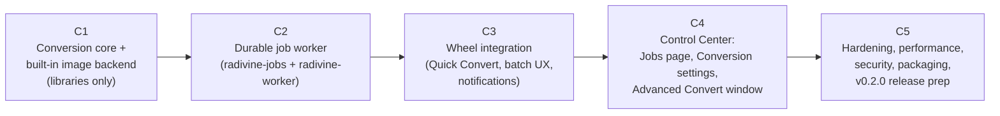

# Radivine v0.2.0 — Implementation Plan

Status: **Architecture Approved (`ADR-027`–`ADR-044`, `D1`–`D9`) — Milestone C1 Authorized ONLY (`C2`–`C5` Not Yet Authorized)** · Prepared: 2026-10-24
Related: [IMPLEMENTATION_HANDOFF](IMPLEMENTATION_HANDOFF.md) · [ARCHITECTURE_DECISIONS](ARCHITECTURE_DECISIONS.md)

> [!IMPORTANT]
> Per `AGENTS.md` §3, each milestone requires **explicit owner authorization**. Completing one milestone does not authorize the next. Each milestone is a hard scope boundary.

---

## 1. Evaluation of the proposed C1–C4 sequence

The owner's draft:
- C1: core + job architecture;
- C2: image conversion + quick conversions + batch + **wheel integration**;
- C3: persistent jobs + progress + cancel + retry + Jobs page + Advanced UI;
- C4: hardening and release.

**Problem:** C2 would wire the wheel to conversions *before* a durable worker exists. Batch conversion would then have to run somewhere temporary: either inside the daemon's `Dispatcher`, which violates approved requirement 4.8 and the lifetime requirement, or in a throwaway non-durable executor. Either way the integration would be rewritten in C3. That rework is exactly what the brief asks to avoid.

**Proposed re-sequencing (owner decision D1):** five milestones, each independently verifiable:

C1 and C2 have no UI and no daemon changes. Users see nothing until C3. After C3, Quick Convert is fully usable from the wheel (results visible through notifications and the `radivine-worker` CLI). C4 adds the graphical surfaces. C5 releases.

## 2. Global Definition of Done (every milestone)

- `cargo fmt --all --check`, `cargo clippy --workspace --all-targets -- -D warnings`, and `cargo test --workspace -- --test-threads=1` (CI style, `DISPLAY=""`) pass.
- `cargo deny check` and `cargo audit` pass, or exceptions are justified in `deny.toml` with comments (new CI job introduced in C1).
- New crates use `#![forbid(unsafe_code)]`. The only permitted `unsafe` is inside the dependency wrapper chosen for libwebp (third-party crate, or a dedicated `radivine-webp` wrapper crate reviewed in C1).
- New public items have rustdoc. No `unwrap/expect` on fallible runtime paths.
- New dependencies are recorded in `docs/TECH_STACK.md`. Licences are added to `THIRD_PARTY_NOTICES.md` (and to `packaging/debian/copyright` when shipped).
- Incremental Conventional Commits (`AGENTS.md` §1). Test report `docs/test-reports/C<n>.md`. Commit history summarized in the milestone completion report.
- **Invariants:**
  - `radivine-wheel`, `radivine-render`, `radivine-platform` are unchanged except E5 (icons);
  - branding assets are untouched;
  - `input.passthrough` default remains `false`;
  - text-file wheel layout is unchanged;
  - v0.1.1 configs load unchanged.

---

## C1 — Conversion Core and Built-in Image Backend

**Objective:** a reusable, desktop-independent conversion library that converts PNG/JPEG/WebP safely and correctly, with no UI, daemon, or worker integration.

**Scope:**
1. **Verification gate (first, time-boxed):** spikes P1–P9 (CONVERSION_BACKENDS §10) in `spikes/convert-*` (excluded from the workspace, like `spikes/xdnd-overlay`). Results go to `docs/planning/v0.2.0/spikes/C1-spikes.md`. If a spike invalidates a decision, **stop and report** before continuing (e.g. no viable lossy WebP wrapper).
2. `crates/radivine-convert`: formats/sniffing, `FeatureSet`, `BackendDescriptor`, `Availability`, `probe_all` (with a fake-program test), `CapabilityCatalog` + routing, options/intents/presets + `validate`, `ConvertSettings` (TOML load/validate/resolve), `ConversionEngine` (`plan`, `inspect`, `convert_item`), `output` module (commit ladder, journal hooks, fault-injection seam), error model.
3. `crates/radivine-convert-image`: `descriptor()`, `ImageBackend` (decode with limits, orientation, alpha flatten, resize, encode PNG/JPEG/WebP-lossless/WebP-lossy, ICC/EXIF handling, animation detection, header inspection).
4. `tools/convert-cli` (dev tool, not packaged): `convert-cli [--to webp] [--preset …] [--quality …] FILES` and `convert-cli bench …` for manual testing and benchmarks.
5. Test corpus generator `tools/convert-corpus` (deterministic synthetic images; malformed and bomb cases), plus a small committed malformed-seed set (< 1 MB total).
6. Fuzz targets in `fuzz/`: `sniff_format`, `inspect`, `convert_small`, `exif_orientation_reset`, `webp_riff_mux` (if in-house), `convert_toml_parse`.
7. CI: add `cargo deny` / `cargo audit`. Ensure the C toolchain is present for libwebp.

**Deliverables:** two crates, dev CLI, corpus generator, fuzz targets, spike report, benchmark baseline in `docs/BENCHMARKS.md` (labelled with machine and date), `docs/test-reports/C1.md`.

**Dependencies:** owner approval of this architecture and of D2 (libwebp linkage). C1 authorization.

**Acceptance criteria:**
- AC-C1.1 All 6 cross-format conversions (PNG↔JPEG↔WebP) succeed on the corpus. Output decodes correctly with an independent decoder (round trip via `image` plus `dwebp`/`djpeg`/`pngcheck` where available in CI). Same-format re-encode works when resize or quality is set.
- AC-C1.2 Lossy WebP honours quality (file size monotonic in q on 3 reference images). Lossless WebP is pixel-exact versus the source (RGBA compare).
- AC-C1.3 Transparent PNG/WebP → JPEG flattens onto the configured background (pixel test at α = 0, 128, 255). Opaque alpha produces no warning.
- AC-C1.4 EXIF orientations 1–8 are auto-oriented correctly (pixel tests). With `ExifPolicy::Preserve` the output EXIF orientation = 1. With `Strip` there is no EXIF block in the output.
- AC-C1.5 ICC preserved byte-exact for PNG→JPEG, JPEG→PNG, JPEG→WebP (lossless and lossy), or a documented `IccNotPreserved` warning where P2 failed.
- AC-C1.6 Resize modes: Width/Height/Fit preserve aspect (±1 px). No upscaling unless allowed. Warning emitted when kept.
- AC-C1.7 Limits: headers above `max_pixels`/`max_dimension`/`max_file_mb` are rejected **before allocation** (peak RSS < 50 MB in the test). The bomb corpus never exceeds the reservation.
- AC-C1.8 Malformed corpus: every file yields a typed `ConversionError` (no panic escapes `convert_item`; panics are caught by the test harness and counted as failures). Animated sources are rejected with `UnsupportedFeature(Animation)`.
- AC-C1.9 **INV-SRC, INV-NOOVERWRITE, INV-NOTEMP** property tests pass (≥ 500 cases) with fault injection at every stage (ENOSPC, EIO, EINVAL-no-NOREPLACE, EPERM-no-link, cancel, panic), plus `T-VALIDATE-RDWR` verifying that `PendingOutput` is opened `O_RDWR` and post-write header corruption is caught at Step 9 before `begin_commit`.
- AC-C1.10 Commit ladder Rung A (`RENAME_NOREPLACE` → `fsync(stage_dir)` → `fsync(dest_dir)`) and Rung B (`linkat` → `fsync(dest_dir)` → `unlinkat` → `fsync(stage_dir)`) each exercised via the fault-injection seam (`T-STAGE-DIR-FSYNC`); when both return `ENOSYS`/`EOPNOTSUPP`/`EXDEV`, `commit_no_replace` fails cleanly with `ConversionError::FilesystemUnsupported` and leaves zero partial or 0-byte target files (`T-COMMIT-NO-PARTIAL`). P8 errno table recorded for real filesystems available on the dev machine.
- AC-C1.11 Symlink/race and private staging directory tests ([`SECURITY_AND_FILE_SAFETY.md`](SECURITY_AND_FILE_SAFETY.md) §3.6 & §6: `T-TEMP-INODE-RACE` and `T-STAGE-SHARED-DIR` verifying `.rvstage-<job>-<rand16>` `0700` namespace exclusivity, `StageIntent` → `StageCreated` → `TempCreated` hook ordering, `fsync(stage_dir)` before journal clear, and `OrphanedTempPreserved` when `(dev, ino)` or mode/uid checks fail) pass.
- AC-C1.12 Option validation table tests (every invalid combination in CONVERSION_PRODUCT_SPEC produces the documented `OptionIssue`).
- AC-C1.13 Routing tests: available / requires-optional / unsupported / feature-unsupported / preference order / determinism.
- AC-C1.14 `radivine-convert` has no dependency on any Radivine crate, X11, egui, or D-Bus (`cargo tree` check).
- AC-C1.15 Benchmarks recorded (not pass/fail in C1): table in §6 with measured values.

**Testing approach:** unit + table tests, proptest invariants, corpus regression, fuzz smoke (60 s per target in CI nightly or locally), benchmark harness via `convert-cli bench` (criterion optional).

**Risks:** lossy WebP wrapper quality or maintenance (mitigation: dedicated minimal wrapper crate); lossy WebP metadata muxing (mitigation: img-parts or in-house muxer + fuzz); JPEG CMYK decode gaps (mitigation: clean `UnsupportedFeature`); build-time increase.

**Non-goals:** job persistence, IPC, the worker process, wheel actions, Control Center UI, optional backends, `fast_image_resize`, `O_TMPFILE`.

**Completion boundary:** libraries + dev tools + tests + docs committed. No changes to `apps/*`, `radivine-core`, `radivine-actions`, or packaging. Stop and report.

---

## C2 — Durable Job Worker

**Objective:** a general-purpose, crash-safe background job worker that executes conversion jobs independently of the daemon and the Control Center.

**Scope:**
1. `crates/radivine-dbus` (`E6`): extract `crates/radivine-actions/src/dbus.rs:1-492` into a standalone workspace crate (`#![forbid(unsafe_code)]`, depending only on `thiserror`), add `call_show_items(uris: &[String])`, and re-export `pub use radivine_dbus as dbus;` in `radivine-actions` so `radivine-worker` has zero dependency on `radivine-actions`, `radivine-core`, or `radivine-wheel`.
2. `crates/radivine-jobs`: `JobId`, states and transition validation, `JobSpec`, summaries/details, `WirePath`, protocol v1 types (`WorkerRequest`, `WorkerResponse`, `JobUpdate`), `JobsClient` (command + subscription), `WorkerLauncher` (systemd → spawn, env override), `RequestId`, `JobsSettings` (`config.toml [jobs]` schema).
3. `apps/radivine-worker`: single instance (flock + socket), IPC server (peer-cred check, unified frame/batch size caps), `JobStore` (rusqlite bundled, WAL, schema v1, migrations, retention), recovery procedure (`C0`–`C6`), scheduler (round-robin across jobs), resource governor (memory budget, exclusivity, disk precheck, fast-fail, watchdog + drain mode), `JobHandler` trait + `ConvertImageHandler`, notifier (`radivine-dbus`, `[jobs] notify`, `[notifications] enabled`), graceful SIGTERM, idle exit, CLI (`serve/status/list/show/cancel/retry/submit-convert`).
4. `packaging/radivine-worker.service` (static unit). Packaging *wiring* lands in C5, but the unit file is authored and lint-checked here.
5. Fault/crash test harness (`RADIVINE_WORKER_TEST_CRASH_AT`, test-only).

**Deliverables:** two crates (`radivine-dbus`, `radivine-jobs`) + app (`radivine-worker`) + unit file + tests + `docs/test-reports/C2.md` + protocol reference (generated examples).

**Dependencies:** C1 complete. C2 authorization.

**Acceptance criteria:**
- AC-C2.1 `submit-convert` of 1, 50, and 1,000 corpus images completes. Per-item results are persisted. Counters are correct. Skips are reported.
- AC-C2.2 Idempotency: duplicate `request_id` submit/retry returns the same job. Cancel is idempotent.
- AC-C2.3 State-machine tests: every valid transition accepted, every invalid one rejected (table-driven, ≥ 40 cases).
- AC-C2.4 **T-LIFE-1 (automated, spawn path):** kill the *client* process mid-job; the job completes.
- AC-C2.5 **T-LIFE-2 & T-CGROUP-DETACH (systemd & transient-unit paths):** `systemctl --user restart radivine.service` during a running job leaves the worker PID unchanged and the job completes, both when `radivine-worker.service` is installed and when `WorkerLauncher` falls back to `systemd-run --user --collect --unit=radivine-worker-transient`.
- AC-C2.6 **Crash recovery & durability ordering (`T-DURABILITY-ORDER`, `T-STAGE-CRASH-WINDOW`, `T-STAGE-DIR-FSYNC`):** `abort()` injected at every crash point (`C0a`, `C0b` before `mkdirat`, `C0b` after `mkdirat` before `StageCreated`, `C0c` after `StageCreated` before `openat(O_EXCL)`, `C1`, `C2`, `C3`, `C4`, `C5`, `C6` in [`JOB_SYSTEM_DESIGN.md`](JOB_SYSTEM_DESIGN.md) §5) → restart → recovery outcomes match §5 (`Interrupted`, `OrphanedTempPreserved` on unverified `C0b` non-empty dirs and unjournaled `C1` files without filename-pattern deletion, `Succeeded` on `C4` only when the `Committing` row was flushed under `PRAGMA synchronous = FULL` and `dest_dir/final_name` matches `(temp_dev, temp_ino)`, and `C5`/`C6` cleanup via `WHERE state IN ('pending', 'running') OR stage_dir_name IS NOT NULL OR temp_name IS NOT NULL`). Both `fsync(stage_dir_fd)` and `fsync(dest_dir_fd)` are verified to execute before `Succeeded` is persisted or `temp_name`/`stage_dir_name` journal columns are cleared. `INV-SRC` and `INV-NOOVERWRITE` hold, and journaled `item-<idx>-<rand16>.part` temp files are cleaned via `cleanup_temp_safely`.
- AC-C2.7 SIGTERM during a job → items/jobs Interrupted within ≤ 6 s. Queued → Interrupted. `clean_shutdown` and `PRAGMA wal_checkpoint(TRUNCATE)` recorded. Next start does not run them.
- AC-C2.8 A queued job survives a crash (same boot) and runs after restart. A different `boot_id` (simulated) → Interrupted.
- AC-C2.9 Cancel: acknowledgement (state Cancelling persisted and broadcast) p95 < 100 ms. No new items start after the acknowledgement. Committed outputs are kept.
- AC-C2.10 Retry creates a new linked job with only the eligible items and the same `jobs.resolved` settings snapshot. `options_override.output.location` works.
- AC-C2.11 Fairness: a 1-item job submitted during a 1,000-item job finishes before the batch has processed ≤ `max_parallel` + 2 further items.
- AC-C2.12 **Governor & watchdog commit fencing (`T-WATCHDOG-FENCE`, `T-WATCHDOG-LOCK-NONBLOCKING`, `T-WATCHDOG-COLLISION-FENCE`):** with `memory_budget_mb = 256`, concurrent large items never exceed the budget estimate (instrumented reservation log); an over-budget item within `ConversionLimits` runs exclusively in FIFO order with `image::Limits.max_alloc = Some(estimate.memory_bytes)`; an over-limit item fails without decode. A hung item in `PreCommit` or `JournalingCommit` (including when SQLite I/O inside `record_committing_sync_full` is stalled indefinitely — `T-WATCHDOG-LOCK-NONBLOCKING`) is fenced by O(1) `Mutex<ItemPhase>` (`begin_commit` returns `Err(TimedOut)` without holding `Mutex<ItemPhase>` across I/O), wakes threads waiting in `governor.reserve()`, drains responsive threads in ≤ 5 s without `join()`ing the stuck thread, and exits `75` holding `worker.lock` until kernel process termination; the replacement worker cleans up the temp file (`C5`/`C2`) and completes remaining `Queued` items. A hung item in `InCommit` sets `timeout_observed = true` and `timed_out_in_commit = 1`: if the in-flight `attempt` fails with `EEXIST` (`T-WATCHDOG-COLLISION-FENCE`), `begin_commit(attempt + 1)` rejects the collision retry with `Err(TimedOut)` so no new candidate is journaled or published; otherwise replacement-worker startup reconciles the single in-flight `final_name` (`C3` vs `C4`) by `(temp_dev, temp_ino)`.
- AC-C2.13 Subscription: events delivered in order with coalescing ≤ 10 Hz. Re-sync after a worker restart via `worker_instance`. A slow subscriber is disconnected without stalling the worker.
- AC-C2.14 Idle exit after `idle_exit_s` unlinks `worker.sock` and runs a final non-blocking `accept()` drain while holding `worker.lock`. Relaunch on the next client request works (spawn path).
- AC-C2.15 Peer-cred rejection test (where possible) and IPC bounds rejection (`16 MiB` max `submit` frame, `64 KiB` max non-`submit` frame, `1..=10,000` paths per job each `≤ 4,096` bytes, returning `"code":"frame_too_large"` without worker OOM).
- AC-C2.16 Protocol and path codec fuzz targets (`worker_protocol_parse`, `wirepath_roundtrip`) added. Non-UTF-8 file names convert correctly end to end.
- AC-C2.17 `cargo tree -p radivine-worker` confirms zero dependency on `radivine-actions`, `radivine-core`, `radivine-wheel`, `radivine-render`, `radivine-platform`, or `eframe`.

**Testing approach:** unit (store, transitions, codec), integration (spawn the worker binary against temp `XDG_*` dirs), crash harness, manual systemd lifecycle checklist.

**Risks:** systemd cgroup independence (P10); SQLite durability cost under large batches (mitigation: batching); thread-starvation edge cases (mitigation: deterministic scheduler tests with a fake handler).

**Non-goals:** wheel actions, Control Center UI, packaging integration, optional backends, notification actions.

**Completion boundary:** the worker can be driven fully from its CLI. Daemon and Control Center are unchanged. Stop and report.

---

## C3 — Wheel Integration (Quick Convert) and Batch UX

**Objective:** users convert images from the radial wheel with Quick Convert, including batches and mixed selections, with clear feedback.

**Scope:**
1. `radivine-core` extensions E1 (`description_for`), E2 (`FileFacts::is_uninspected`), and E8 (lossless RFC 8089 percent-encoding in `local_path_to_file_uri`, `normalize_cli_arg_to_uri`, and `Commands::Invoke { paths: Vec<OsString>, at: Option<String> }`), with tests. Backwards compatible.
2. `radivine-actions::convert`: `ConvertMenuContext`, `ConvertAction` (×3 targets), `AdvancedConvertAction` (spawns `radivine-control convert --stdin`; until C4 lands, it shows a notification "Advanced Convert arrives with the Control Center update". **Decision:** register Advanced only when the `radivine-control` binary supports `convert`. Simplest approach: register it in C4, not C3), `default_menu()` update (E4), `register_builtins_with_options` (E3), icon SVGs (E5).
3. Daemon wiring (`apps/radivine`): build `ConvertMenuContext` at startup (built-in catalog; **daemon reads zero `convert.toml` config**), background probe thread (no-op for v0.2.0 descriptors), pass it to registry construction and reload.
4. Submission error handling and notification texts. The worker's completion notifications are verified on the desktop.
5. Invoke-mode (`radivine invoke` / Nemo action) parity, including lossless non-UTF-8 path preservation (`E8`).

**Deliverables:** code + tests + updated `ACTION_SYSTEM.md` (new section "Durable job actions") + `docs/test-reports/C3.md` with manual desktop checklist results (owner-run on Mint 22).

**Dependencies:** C2 complete. C3 authorization.

**Acceptance criteria:**
- AC-C3.1 Image selections show `Convert ▸ Image ▸ targets` per CONVERSION_UX §1. Text selections produce a root wheel **identical** to v0.1.1 (existing M4 acceptance tests unchanged and passing, plus a snapshot test of the `MenuTree`).
- AC-C3.2 Visibility/enablement table tests: single, multi, mixed, unsupported-only, wrong extension, >64 items, progressive enablement (64-item batch enables as soon as the first enriched item confirms ≥ 1 image while items 1..64 are still `Pending`), unreadable, already-target, directory.
- AC-C3.3 `description_for` captions are correct for counts, mixed same-format (`"Convert 2 of 3 images to WebP · 1 already WebP"`), and mixed unsupported selections (`"Convert 3 of 5 files to WebP · 2 not supported"`). The description does not change during a session.
- AC-C3.4 No I/O in `is_visible`/`description_for` (test with an inspector that panics on filesystem access, plus code review).
- AC-C3.5 [TARGET] Trigger → first frame p95 regression ≤ +1 ms versus the v0.1.1 baseline (existing span instrumentation). Convert visibility for 10,000 items ≤ 0.5 ms p95.
- AC-C3.6 Drop on WebP → the wheel dismisses exactly as for other actions. The job is accepted (worker running) p95 < 50 ms, or cold launch p95 < 1 s [TARGET, measured]. The UI thread is never blocked beyond the existing 20 ms window.
- AC-C3.7 Daemon restart during a 500-image Quick batch: the batch completes (manual desktop test with `systemctl --user restart radivine.service`).
- AC-C3.8 Submission failure (worker binary missing) → a clear error notification. The daemon stays healthy.
- AC-C3.9 Mixed selection: skipped files are reported in the notification and by `radivine-worker show`.
- AC-C3.10 Daemon idle RSS increase < 1 MB. Daemon binary size delta ≤ +300 KiB (Q-A), or the fallback in ADR-C02 is applied.
- AC-C3.11 Manual desktop checklist (owner): flows 1, 3, 5, 8 of CONVERSION_UX on Nemo with Drag+Shift and Invoke mode. Source files verified unchanged (SHA-256 before/after).

**Testing approach:** unit + registry table tests, `m4_actions_acceptance`-style integration tests with a mock platform and the worker in spawn mode (temp XDG dirs, `RADIVINE_SUPPRESS_DESKTOP_NOTIFY=1`), manual desktop checklist.

**Risks:** UX of the 3-level path (D4); the Dispatcher fast-effect window combined with cold worker launches (mitigation: measured, non-blocking by design); icon rendering at small radii.

**Non-goals:** Jobs page, Advanced window, settings UI, optional backends.

**Completion boundary:** Quick Convert works end to end from the wheel. No Control Center changes. Stop and report.

---

## C4 — Control Center: Jobs, Conversion Settings, Advanced Convert

**Objective:** graphical monitoring and control of background jobs, conversion settings management, and the Advanced Convert workflow.

**Scope:**
1. Refactor `apps/radivine-control/src/ui.rs` minimally: extract `BrandPalette`, `section_card`, `kv_cell` into `ui/theme.rs` (no behaviour change, separate `refactor(control)` commit).
2. `ControlPage::{Conversion, Jobs}` (E7), sidebar, `--page jobs|conversion`, screenshot export entries.
3. `radivine-control-jobs` background thread (`JobsClient` subscription + commands), the Jobs page per CONVERSION_UX §4 (active, history, filters, details paging, cancel, retry, retry-to-folder, open folder via `ShowItems` (E6), clear history, concurrency preference, maintenance cleanup).
4. Conversion settings page per CONVERSION_UX §6, with `convert.toml` and `config.toml [jobs]` persistence (extend `persistence.rs` patterns: `toml_edit`, validation, conflict detection) and `reload_settings`.
5. Advanced Convert window: `radivine-control convert [--stdin] [PATHS…]` (bypassing `ControlInstanceLock::acquire_or_notify_existing()` in `apps/radivine-control/src/single_instance.rs:39-42` so multiple Advanced Convert windows can coexist with the main Settings/Jobs window; `--stdin` bounded to `≤ 10,000` lines, `≤ 16 KiB` per line, and `≤ 16 MiB` total stdin bytes; "Open Jobs" / "Show progress" spawns `radivine-control --page jobs`), CONVERSION_UX §5 (header-only inspection, live validation, destination checks, presets, submit).
6. `AdvancedConvertAction` registered in the daemon (`Convert ▸ Image ▸ Advanced…`, spawned in a transient user cgroup scope when `systemd --user` is active).

**Dependencies:** C3 complete. C4 authorization. **Recommended:** GitHub issue #1 resolved beforehand as a separate fix (owner decision D8).

**Acceptance criteria:**
- AC-C4.1 Reopening the Control Center restores full job visibility (history and live state) from the worker. Closing it does not affect running jobs.
- AC-C4.2 Progress updates appear in < 250 ms p95 (event → repaint) [TARGET]. The UI thread never blocks: an instrumented frame-time test asserts no frame > 50 ms caused by job operations, including a 10,000-item job list.
- AC-C4.3 Cancel/Retry/Retry-to-folder/Clear/Open-folder work as specified in flows 7, 9, 10.
- AC-C4.4 Settings round-trip: edits persist with comments preserved. External-modification conflicts are detected. Invalid values are blocked with field messages. The worker applies changes after `reload_settings`.
- AC-C4.5 Advanced window: opens from the wheel with the selection. No pixel decode occurs (instrumented: decode functions are never called in the CC process). Validation messages match the spec table. Start submits a correct inline-options job. Cold start time recorded (Q-C).
- AC-C4.6 Worker-unavailable banner, empty state, and newer-DB read-only state are rendered (screenshot tests in headless export).
- AC-C4.7 Existing Control Center acceptance tests (`v0_1_1_acceptance.rs`) pass unchanged.
- AC-C4.8 Manual desktop checklist (owner): flows 2, 4, 6 (fake backend descriptor via a test build or a documented env flag), 7, 9, 10.

**Testing approach:** unit tests for view-model reducers (pure: events → page state), persistence tests, headless screenshot export, manual checklist.

**Risks:** `ui.rs` size and coupling (mitigation: new pages in separate modules); clipboard issue #1; egui list performance on huge histories (mitigation: paging and virtualized rows `show_rows`).

**Non-goals:** a native folder picker, notification actions, thumbnails, optional backends, any wheel visual change.

**Completion boundary:** all UI surfaces complete. Packaging unchanged. Stop and report.

---

## C5 — Integration, Hardening, Packaging, and v0.2.0 Release Preparation

**Objective:** a production-quality, packaged, documented v0.2.0 ready for the owner's release decision.

**Scope:**
1. Performance: run the benchmark suite (§6), compare against the targets, optimize where missed (candidates: `fast_image_resize`, JPEG encoder swap, governor factor, DB batching). Record the results in `docs/BENCHMARKS.md`.
2. Security: fuzzing ≥ 1 h per target (recorded), security checklist sign-off (SECURITY_AND_FILE_SAFETY), evaluation of systemd hardening options (Q-B, enable only what is verified), `cargo audit`/`deny` clean.
3. Reliability: 1-hour soak (mixed Quick/Advanced batches, cancels, daemon restarts, worker kills, using the M6 soak harness pattern), memory leak checks (worker RSS returns to baseline after each job; idle exit works).
4. Packaging:
   - `build-deb.sh` builds and installs `radivine-worker` and installs `/usr/lib/systemd/user/radivine-worker.service` (static);
   - update `debian/control` (description, `Depends` per D2; `Suggests: libvips-tools` only if D3);
   - update `debian/copyright` and `THIRD_PARTY_NOTICES.md` (libwebp BSD-3, SQLite, new crates);
   - update `prerm`/`postrm` (stop the worker unit on remove, keep user data);
   - lintian clean.
   - Upgrade test from the installed v0.1.1 `.deb` (configs preserved; daemon restarted by the user or the Control Center; no job DB until first use).
5. CI: dependency-graph check script (X7), the C compiler toolchain, an artifact-size report.
6. Documentation: promote approved ADRs into `docs/DECISIONS.md` (renumbered), update `ARCHITECTURE.md`, `ACTION_SYSTEM.md`, `CONTROL_CENTER_DESIGN.md`, `TESTING_STRATEGY.md`, `README.md`, `CHANGELOG.md`, `RELEASE_NOTES_v0.2.0.md`, and fix the discrepancies X1–X13 that touch documents being edited anyway. Version bump to `0.2.0` in the workspace.
7. Optional (only if D3 approves): `external.vips` backend.

**Acceptance criteria:**
- AC-C5.1 All [TARGET] budgets in §6 are measured. Each is either met or documented with an owner-accepted deviation.
- AC-C5.2 Fuzzing ≥ 1 h per target with no unresolved crashes. Malformed corpus clean.
- AC-C5.3 Soak: 0 source modifications (checksums), 0 overwrites, 0 leftover temp files after non-crash runs, 0 worker leaks (RSS back to baseline ±5 MB), all interrupted jobs recover correctly.
- AC-C5.4 `.deb` installs on a clean Mint 22 / Ubuntu 24.04 (VM or container for the install test). Quick Convert works immediately after install without extra packages. Upgrade from v0.1.1 preserves configs. Removal leaves user data. lintian clean.
- AC-C5.5 Full workspace verification (`AGENTS.md` §1.6). Release notes drafted. **No tag, no publish, no push** without explicit owner instruction.
- AC-C5.6 Owner desktop verification of all 10 flows plus logout/login and reboot behaviour (Interrupted + Retry).

**Risks:** missed performance targets on very large images (mitigation: documented limits, optional vips path for v0.2.x); packaging upgrade edge cases (worker running during upgrade: `prerm` stops it gracefully, and running jobs become Interrupted and are retryable).

**Non-goals:** new features, audio/video/documents, the concentric layout, a tray icon, Wayland drag mode.

**Completion boundary:** a release candidate prepared and verified. The release itself awaits the owner.

---

## 3. Testing strategy additions

| Layer | v0.2.0 additions |
|-------|------------------|
| Unit / table | Formats, sniffing, routing, option validation, preset resolution, naming, collision loop, state transitions, WirePath, protocol serde, visibility/enablement/captions |
| Property | INV-SRC / INV-NOOVERWRITE / INV-NOTEMP with fault injection, resize aspect, quality monotonicity (sampled) |
| Corpus regression | Generated corpus (sizes, alpha, 16-bit, grayscale, palette, progressive JPEG, EXIF 1–8, ICC P3/sRGB, CMYK, animated) plus malformed seeds |
| Fuzz | 8 targets (SECURITY_AND_FILE_SAFETY §6) |
| Integration | Worker binary in spawn mode against temp XDG dirs. Daemon with mock platform + worker. CC view-model reducers. |
| Crash / lifecycle | Abort-at-stage harness, SIGTERM, idle exit, relaunch, boot-id simulation. systemd lifecycle (manual). |
| Manual desktop | Per-milestone checklists in `docs/test-reports/C3–C5.md` (owner-run on Mint 22 Cinnamon X11) |

## 4. Test datasets

Generated by `tools/convert-corpus --seed 1` (deterministic, not committed except tiny seeds):

| Set | Contents |
|-----|----------|
| `basic` | 640×480 PNG RGB/RGBA/palette+tRNS/grey/16-bit, JPEG baseline/progressive/4:4:4/4:2:0, WebP lossy/lossless/alpha |
| `photo` | Smooth-gradient + noise "photographic" images at 2, 12, 24, 50, 100 MP (JPEG q90 sources) |
| `meta` | EXIF orientation 1–8 (with an asymmetric pattern), GPS-tagged EXIF, Display P3 and sRGB ICC, XMP |
| `edge` | 1×1, 1×65000, 16383×16383 WebP limit, CMYK/YCCK JPEG (generated via `convert`-free encoder paths or committed seed) |
| `malformed` | Truncated files at 10 offsets, bad CRC, zero dims, 65535×65535 headers, PNG bomb (20000×20000 zero-filled, highly compressed), polyglots, wrong extensions, animated APNG/WebP |
| `batch` | 1,000 small mixed images + 10 unsupported files. A 10,000-entry path list (symlinks to a small pool) for prepare/list stress. |
| `fs` | Read-only directory, pre-existing output names (1–20 collisions), symlink at the output name, FIFO masquerading as `.png` |

Real-world photographs are optional and should come from licence-clear sources. They are not required for pass/fail.

## 5. Benchmark method

- Reference machine: the owner's Mint 22.3 desktop (record CPU, RAM, storage, kernel). CI numbers are informational only.
- Tool: `convert-cli bench` (wall time per item, peak RSS via `/proc/self/status` `VmHWM` sampled per item in a child process), worker-level benches via `radivine-worker submit-convert` + timestamps from the DB, daemon spans via the existing `RADIVINE_TRACE_TIMINGS=1` instrumentation.
- Each measurement: 3 warm-up runs + 10 measured runs, reporting median and p95. Record exact commit, build profile (`release`, strip), and settings.
- **No benchmark is reported as passed before implementation and measurement.** C1 records baselines; C5 compares against the targets.

## 6. Performance budgets [TARGET — not measurements]

| Metric | Target | Rationale | Measured in |
|--------|--------|-----------|-------------|
| Built-in capability catalog construction (daemon) | < 1 ms | Static data | C3 |
| External backend probe (future) | Off the UI thread; ≤ 2 s timeout per probe | Never affects the first frame | C3 |
| Convert visibility + captions, 10,000 items | ≤ 0.5 ms p95 | One extension lookup per item | C3 |
| Trigger → first frame regression | ≤ +1 ms p95 vs v0.1.1 | Existing budget p95 < 50 ms must hold | C3 |
| Submit → job accepted (worker running) | p95 < 50 ms | Single SQLite transaction + socket round trip | C2/C3 |
| Worker cold start → accepting (systemd or spawn) | p95 < 750 ms | `systemctl` + process start + recovery on a small DB | C2 |
| Single image 12 MP JPEG → WebP q80 (method 4) | ≤ 1.5 s | libwebp encode dominates [VERIFY P7] | C1/C5 |
| Single image 12 MP PNG → JPEG q82 | ≤ 1.0 s | | C1/C5 |
| Peak worker RSS for one 50 MP item | ≤ 2.2 × decoded bytes + 30 MB (≈ 470 MB) | Governor factor | C1/C5 |
| Batch throughput (1,000 × 2 MP, `max_parallel = 4`) | ≥ 0.75 × 4 × single-item throughput | Scaling efficiency, I/O overlap | C5 |
| Cancel acknowledgement | p95 < 100 ms | Persist + broadcast | C2 |
| In-flight item stop after cancel | ≤ duration of the current stage. For 12 MP ≤ 1 s. | Checkpoints between stages | C2/C5 |
| Progress event → CC repaint | p95 < 250 ms | 10 Hz coalescing | C4 |
| Worker idle | 0 % CPU; exit after 60 s | On-demand model | C2 |
| Daemon overhead with no conversions running | idle RSS +< 1 MB, 0 additional wakeups | Only catalog + action objects | C3 |
| Advanced window cold start | < 600 ms to first frame | eframe init, header inspection async | C4 |

## 7. Existing known issue (#1) and its interaction

GitHub issue #1 (clipboard interoperability in Custom Actions text fields) is **not** part of C1–C5. The Advanced Convert window and the Jobs page add text fields and a "Copy error details" action that rely on the same eframe/egui clipboard integration. Finding X11 (CONVERSION_ARCHITECTURE §1.3): `eframe`'s `clipboard` feature is disabled by the workspace's `default-features = false`. It is recommended that the owner schedule issue #1 as a separate, independently verified fix **before C4** (decision D8). Conversion commits must not include clipboard changes.

## 8. Risk register (v0.2.0)

| ID | Risk | Likelihood | Impact | Mitigation | Owner milestone |
|----|------|-----------|--------|-----------|-----------------|
| R-V1 | No maintained safe libwebp wrapper | M | H | Dedicated minimal wrapper crate over `libwebp-sys`, reviewed + fuzzed | C1 |
| R-V2 | Worker killed with daemon (cgroup) | L (with design) | H | Static unit in its own cgroup + `systemd-run --user` transient fallback (`B4`). P10 spike. `T-LIFE-2` & `T-CGROUP-DETACH`. | C1/C2 |
| R-V3 | Filesystem lacks NOREPLACE and hard links | M (exFAT USB) | M | Two-rung atomic ladder (Rung A `RENAME_NOREPLACE` → Rung B `linkat`) + clean `ConversionError::FilesystemUnsupported` (no partial-file copy fallback). Errno table (P8). | C1 |
| R-V4 | Large images exceed memory | M | M | Limits, FIFO governor, exclusivity (`max_alloc = Some(estimate.memory_bytes)`). Optional vips later. | C1/C2 |
| R-V5 | Hung decoder thread or stalled I/O | L | M | Watchdog + `Mutex<ItemPhase>` commit fence (`CommitPermit`) + bounded ≤ 5 s drain + `exit(75)` holding `worker.lock` (`T-WATCHDOG-FENCE`). | C2 |
| R-V6 | UX friction of the 3-level path | M | L | D4. Users can reorder/hide. Measured during owner testing in C3. | C3 |
| R-V7 | Control Center `ui.rs` complexity | M | M | Module extraction, reducer tests | C4 |
| R-V8 | Package size growth | M | L | Measure. Worker has no eframe. Strip. | C5 |
| R-V9 | Metadata promises not met by lossy WebP | M | M | Explicit warnings, P2 spike | C1 |
| R-V10 | Clipboard issue #1 affects new forms | H | L | D8 separate fix | before C4 |
