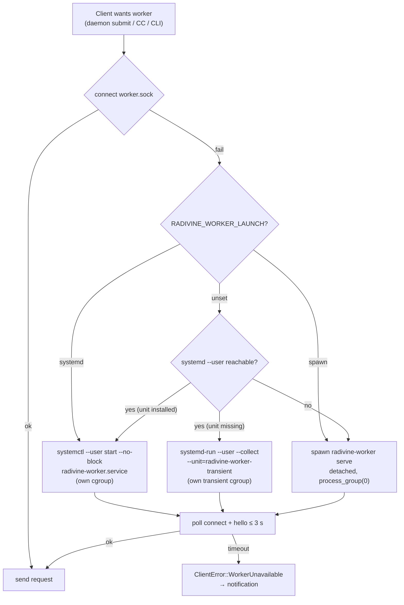
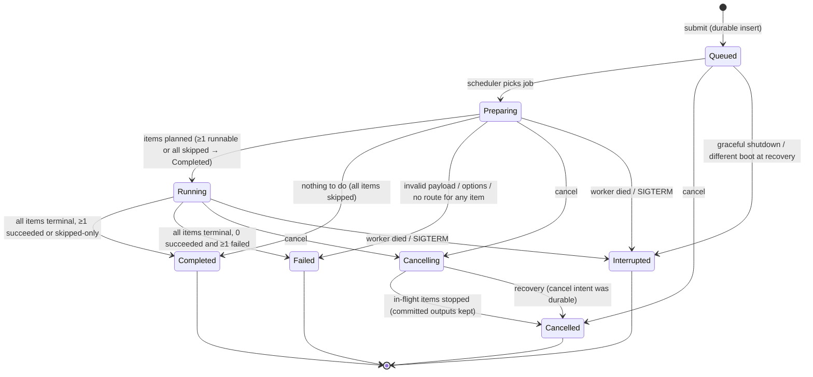

# Radivine v0.2.0 — Background Job System Design

Status: **Proposed — pending owner review** · Prepared: 2026-10-24
Related: [CONVERSION_ARCHITECTURE](CONVERSION_ARCHITECTURE.md) · [SECURITY_AND_FILE_SAFETY](SECURITY_AND_FILE_SAFETY.md) · [CONVERSION_UX](CONVERSION_UX.md)

The job system is a **general-purpose durable execution foundation**. Image conversion is its first client (job kind `radivine.convert.image`). Nothing in the job model, store, protocol, or scheduler is conversion-specific.

---

## 1. Requirements recap [APPROVED]

Queue, start, track progress, cancel, retry, record results and per-item failures, concurrency and resource limits, history, UI status updates, safe recovery after unexpected termination. **Restarting the wheel daemon or closing the Control Center must not terminate running jobs.**

## 2. Process architecture

### 2.1 Alternatives

| Option | Lifecycle independence | Idle cost | Complexity | Verdict |
|--------|----------------------|-----------|------------|---------|
| A. In-daemon threads (existing `Dispatcher`) | ✗ Daemon restart kills jobs. Decoder memory inflates daemon RSS (target < 25 MB). A crash takes down the wheel. | none | low | **Rejected** (violates 4.8) |
| B. Long-lived user service (`radivine-worker.service`, enabled at login) | ✓ | one idle process per session | medium: second enable/autostart path, Control Center must manage two services | Rejected as the default (an always-on process with nothing to do) |
| C. **On-demand worker** (single instance, started when needed, exits when idle) | ✓ if launched outside the daemon's cgroup | **none when idle** | medium | **Selected** |
| D. Process-per-job (or per-item) supervised children | ✓ (with C) | none | high (supervision, IPC fan-out) | Deferred. Item-level isolation is not needed while all untrusted parsing is memory-safe Rust (CONVERSION_BACKENDS §4). Future external backends are child processes anyway. |

### 2.2 The cgroup trap (why "just spawn a detached child" is not enough)

`radivine.service` runs the daemon in its own systemd cgroup. `systemctl --user restart|stop radivine.service` uses the default `KillMode=control-group`, which kills **every process in that cgroup**, including children that called `setsid()`/`process_group(0)`. A worker spawned directly by the daemon would therefore die whenever the daemon is restarted, which breaks the core lifetime requirement. (`KillMode=process` would avoid this, but systemd discourages it and it leaves stray processes in a stopped unit's cgroup.)

### 2.3 Selected design [PROPOSED — ADR-C06]

- **Binary:** `radivine-worker` (new app `apps/radivine-worker`).
- **Single instance:** `flock(LOCK_EX|LOCK_NB)` on `$XDG_RUNTIME_DIR/radivine/worker.lock` (opened with `O_CLOEXEC`), then bind `$XDG_RUNTIME_DIR/radivine/worker.sock` (dir 0700, socket 0600). Holding `worker.lock` across recovery and serving removes stale-socket races and guarantees single-writer access to `jobs.sqlite3`.
- **Launch (by `WorkerLauncher` in `radivine-jobs`), first match wins:**
  1. `RADIVINE_WORKER_LAUNCH=systemd|spawn` override (tests, development).
  2. **systemd static unit path:** if the user manager is reachable (`$XDG_RUNTIME_DIR/systemd/private` exists) and `radivine-worker.service` is installed, run `systemctl --user start --no-block radivine-worker.service`. The worker runs in **its own cgroup**, independent of `radivine.service`.
  3. **systemd transient unit fallback (when `systemd --user` is active but `radivine-worker.service` is not installed):** if step 2 fails because the static unit file is absent (e.g. an unpackaged developer build), run `systemd-run --user --collect --unit=radivine-worker-transient --property=Restart=on-failure --property=RestartSec=1 <worker_bin> serve`. This still places the worker in its own transient systemd unit/cgroup outside `radivine.service`.
  4. **spawn path (non-systemd sessions or tests):** only when `systemd --user` is unreachable (or `RADIVINE_WORKER_LAUNCH=spawn` is set, and the caller is not inside `radivine.service`'s cgroup), spawn `radivine-worker serve` detached (`process_group(0)`, stdin `/dev/null`, stdout/stderr → `$XDG_STATE_HOME/radivine/worker.log` with 2 MiB rotation, same as the Control Center fallback). Binary resolution follows `resolve_viewer_binary()` (`builtins.rs:173`): env override → sibling of `current_exe` → `PATH`.
  
  After launching, the client polls `connect()` + `hello` handshake every 25 ms for up to 3 s (treating `ENOENT` and `ECONNREFUSED` as "not ready yet").
- **Unit file** `/usr/lib/systemd/user/radivine-worker.service` is **static** (no `[Install]` section), so nothing is enabled at login and it starts only on demand:

```ini
[Unit]
Description=Radivine background job worker
Documentation=https://github.com/marawan6569/Radivine
After=dbus.socket
# no [Install]: started on demand by radivine / radivine-control

[Service]
Type=exec
ExecStart=/usr/bin/radivine-worker serve
Restart=on-failure
RestartSec=1
Nice=10
IOSchedulingClass=best-effort
IOSchedulingPriority=7
CPUSchedulingPolicy=batch
NoNewPrivileges=yes
# Hardening candidates evaluated in C5 (must not break startup on Mint 22 / noble user managers) [VERIFY]:
# MemoryHigh= / MemoryMax= (needs memory controller delegation), RestrictAddressFamilies=AF_UNIX,
# SystemCallFilter=@system-service, LockPersonality=yes, RestrictRealtime=yes
TimeoutStopSec=10
```

- **Idle exit:** the worker exits cleanly after `idle_exit_s` (default 60 s) with no queued/running jobs and no active connections/subscribers. Before exiting on idle timeout, the worker first `unlink`s `worker.sock` while holding `worker.lock`, performs one final non-blocking `accept()` check on the listener fd (resuming serving if a client connected right before `unlink`), and then releases `worker.lock` and exits. A Control Center subscription keeps it alive while the Jobs page is open.
- **Who launches:** `radivine` (on submit, in `ConvertAction::run` on a `Dispatcher` thread), `radivine-control` (Jobs page open, Advanced Start), and `radivine-worker <cli-cmd>` (diagnostics).
- **Verification:** spike P10 (CONVERSION_BACKENDS §10) proves that the worker PID survives `systemctl --user restart radivine.service`. Test T-LIFE-2 in IMPLEMENTATION_PLAN automates both the static-unit path and the missing-unit `systemd-run --user` fallback.



## 3. Job model

### 3.1 Entities

| Entity | Key fields |
|--------|-----------|
| **Job** | `id` (u64, monotonic), `request_id` (unique, idempotency), `kind`, `title`, `state`, `origin` (Wheel/Advanced/Cli/Retry{of}), `payload` (JSON as submitted), `resolved` (JSON snapshot after Preparing, e.g. validated `ConversionOptions` resolved from `convert.toml`), counters, timestamps, `boot_id`, `error` (job-level), `retry_of` |
| **Item** | `(job_id, idx)`, `source` (WirePath), `state`, `stage`, `output` (WirePath), `bytes_in`, `bytes_out`, `warnings` (JSON), `error_code`, `error_message`, `error_detail`, `retryable`, `dest_dir` (WirePath), `stage_dir_name`, `stage_dev`, `stage_ino`, `temp_name`, `temp_dev`, `temp_ino`, `final_name`, `timed_out_in_commit`, timestamps |

### 3.2 Job state machine



Terminal states: `Completed`, `Failed`, `Cancelled`, `Interrupted`. Terminal jobs are immutable except for deletion by history pruning or `clear_history`.

UI-derived labels (not states): "Completed with N errors" (`Completed` ∧ `failed > 0`), "Nothing to convert" (`Completed` ∧ `succeeded = 0`).

### 3.3 Item state machine

`Pending → Running → {Succeeded | Failed | Skipped | Cancelled | Interrupted}`, plus `Pending → {Skipped (Preparing) | Cancelled | Interrupted}`. Within `Running`, `stage` advances through `Opening → Inspecting → Decoding → Transforming → Encoding → Writing → Verifying → Committing`. Stage is informational and persisted only at `Committing` (for recovery), otherwise kept in memory and streamed.

### 3.4 Valid transitions and idempotency rules

| Command | From | Result | Idempotency |
|---------|------|--------|-------------|
| `submit(spec)` | — | new job `Queued` | Same `request_id` returns the existing job (unique index). Clients generate `request_id` from 128 random bits read from `/dev/urandom` (no new crate; non-Unix platforms use the OS RNG through a small cfg module). |
| `cancel(id)` | Queued | Cancelled | Cancel on a terminal job is a no-op returning the current summary. Cancel on Cancelling is a no-op. |
| `cancel(id)` | Preparing/Running | Cancelling → Cancelled | The cancel intent is persisted immediately (state Cancelling), so it survives a crash. |
| `retry(id, scope)` | terminal with retryable items | **new job** (`origin=Retry{of:id}`, `retry_of=id`) | Same `request_id` returns the same new job. Retrying a non-terminal job is rejected (`NotRetryable: job still running`). |
| `clear_history(q)` | terminal jobs | deleted | Deleting already-deleted jobs counts 0 |

**Retry creates a new attempt, never a transition of the old job.** Rationale: history stays immutable and auditable, item results of the first attempt remain visible, recovery logic never has to "un-terminate" a job, and idempotency is trivial.
- Scope `Failed` (default) includes items in `Failed ∧ retryable`, `Interrupted`, `Cancelled`.
- Scope `All` re-runs every item, including succeeded ones. That produces numbered duplicates; the UI warns "will create new copies".
- The retry reuses the original `resolved` options snapshot (reproducible), unless the client sends `options_override` (Advanced "Retry to another folder" changes only `output.location`).

**Restart vs. resume:** v0.2.0 never resumes an item mid-file. An interrupted item is restarted from scratch in a retry job. No backend offers resumable encoding, and the output is always written to a fresh temp file.

## 4. Persistence

### 4.1 Options

| Option | Pros | Cons | Verdict |
|--------|------|------|---------|
| **SQLite (rusqlite, `bundled`)** | Atomic multi-row transactions, WAL crash safety, indexed queries (filter by state, page items), pruning, concurrent readers, inspectable with `sqlite3` | +~1 MB binary [VERIFY P9], C code (trusted input only) | **Selected** (ADR-C07) |
| redb (pure Rust KV) | No C, ACID | No SQL queries/indexes, everything hand-rolled, less tooling | Viable fallback |
| Atomic JSON files (one per job) + JSONL item log | No dependency | Hand-rolled indexing, pruning, and compaction. O(n) rewrites. Many fsyncs. Concurrency handled manually. | Rejected |

`bundled` vs system `libsqlite3-0`: bundled is preferred for version determinism across platforms. The database is a private, trusted file, so distro patching matters less than for an image decoder.

### 4.2 Location and pragmas

- `$XDG_STATE_HOME/radivine/jobs.sqlite3` (default `~/.local/state/radivine/`), directory 0700, file 0600.
- `PRAGMA journal_mode=WAL; synchronous=NORMAL; foreign_keys=ON; busy_timeout=2000;`
- **Single writer:** only `radivine-worker` opens the database, serialized by `flock(worker.lock, LOCK_EX)` (`O_CLOEXEC`). Other processes use IPC. This avoids cross-process schema coupling and lock contention.
- WAL + `synchronous=NORMAL` makes committed transactions survive **process crashes** (`SIGKILL`, `abort()`, `exit(75)`). However, an OS kernel panic or sudden power loss before a WAL checkpoint/`fsync` can roll back transactions committed under `synchronous=NORMAL` (including `StageIntent`, `StageCreated`, and `TempCreated` if written under `synchronous=NORMAL`) even if `mkdirat` or `openat(O_EXCL)` already reached disk.
- **Explicit C2 WAL Durability Requirement for Pre-Commit Journals (`StageIntent`, `StageCreated`, `TempCreated`):** C2 must **not** silently claim power-loss durability for `StageIntent`, `StageCreated`, or `TempCreated` if they are committed under `PRAGMA synchronous=NORMAL`. In C2, `JobStore` must either (a) evaluate running `StageIntent`/`StageCreated`/`TempCreated` under `PRAGMA synchronous=FULL` (or connection-wide `synchronous=FULL` since terminal writes are batched) or (b) explicitly document that sudden power loss before a WAL `fsync` can roll back `StageIntent`/`StageCreated`/`TempCreated` into the unjournaled `C0a`/`C0b`/`C1` orphan preservation path (leaving at most an empty `0700` `.rvstage-*` directory or `0600` `item-*.part` file on disk, while **never** overwriting, modifying, or deleting user files because `Committing` always uses `PRAGMA synchronous=FULL`).
- **Durable `Committing` journal (lock-free I/O):** `Committing` journal entries (written inside `ItemControl::begin_commit` during `ItemPhase::JournalingCommit` **without** holding `Mutex<ItemPhase>`, before `CommitPermit` is minted and before `commit_no_replace` is permitted to run) are committed under `PRAGMA synchronous=FULL` (either by setting `PRAGMA synchronous=FULL` around the `Committing` transaction or keeping `synchronous=FULL` on the worker connection, since terminal item result transactions are already coalesced at ≤ 4 Hz). Note: `wal_checkpoint(PASSIVE)` does not `fsync` newly appended WAL frames under `synchronous=NORMAL` and must not be used as a substitute for `synchronous=FULL`.
- **Both `stage_dir` and `dest_dir` durability before `Succeeded` or journal clear:** Output publication and cleanup mutate directory entries in **both** `stage_dir` and `dest_dir`. The engine and scheduler execute `fsync(stage_dir_fd)` and `fsync(dest_dir_fd)` (Rung A: `renameat2` → `fsync(stage_dir_fd)` → `fsync(dest_dir_fd)`; Rung B: `linkat` → `fsync(dest_dir_fd)` → `unlinkat` → `fsync(stage_dir_fd)`; staging dir removal: `unlinkat(AT_REMOVEDIR)` → `fsync(dest_dir_fd)`) **before** committing the SQLite transaction that marks items `Succeeded` or clears `temp_name`/`stage_dir_name` recovery columns (SECURITY_AND_FILE_SAFETY §3.3, §3.5).
- **WAL checkpoint hygiene:** The worker runs `PRAGMA wal_checkpoint(TRUNCATE);` on startup (after recovery and pruning) and right before graceful idle exit so `jobs.sqlite3-wal` does not grow unboundedly.

### 4.3 Schema (v1)

```sql
CREATE TABLE meta (key TEXT PRIMARY KEY, value TEXT NOT NULL);       -- schema_version=1, clean_shutdown=0|1
CREATE TABLE jobs (
  id            INTEGER PRIMARY KEY AUTOINCREMENT,
  request_id    TEXT NOT NULL UNIQUE,
  kind          TEXT NOT NULL,
  title         TEXT NOT NULL,
  origin        TEXT NOT NULL,                 -- JSON
  retry_of      INTEGER REFERENCES jobs(id) ON DELETE SET NULL,
  state         TEXT NOT NULL,                 -- queued|preparing|running|cancelling|completed|failed|cancelled|interrupted
  payload       TEXT NOT NULL,                 -- JSON as submitted
  resolved      TEXT,                          -- JSON snapshot after Preparing (authoritative resolved ConversionOptions)
  total_items   INTEGER NOT NULL,
  succeeded     INTEGER NOT NULL DEFAULT 0,
  failed        INTEGER NOT NULL DEFAULT 0,
  skipped       INTEGER NOT NULL DEFAULT 0,
  cancelled     INTEGER NOT NULL DEFAULT 0,
  bytes_total   INTEGER,
  bytes_done    INTEGER NOT NULL DEFAULT 0,
  error_code    TEXT, error_message TEXT,
  boot_id       TEXT NOT NULL,
  created_at    INTEGER NOT NULL, started_at INTEGER, finished_at INTEGER   -- unix ms
);
CREATE INDEX jobs_state ON jobs(state);
CREATE INDEX jobs_finished ON jobs(finished_at);
CREATE INDEX jobs_retry_of ON jobs(retry_of) WHERE retry_of IS NOT NULL;

CREATE TABLE items (
  job_id              INTEGER NOT NULL REFERENCES jobs(id) ON DELETE CASCADE,
  idx                 INTEGER NOT NULL,
  source              TEXT NOT NULL,           -- WirePath (percent-encoded OS bytes)
  state               TEXT NOT NULL,           -- pending|running|succeeded|failed|skipped|cancelled|interrupted
  output              TEXT,                    -- WirePath once committed
  bytes_in            INTEGER, bytes_out INTEGER,
  warnings            TEXT,                    -- JSON array
  error_code          TEXT, error_message TEXT, error_detail TEXT, retryable INTEGER,
  dest_dir            TEXT,                    -- WirePath of destination directory
  stage_dir_name      TEXT,                    -- ".rvstage-<job>-<rand16>"
  stage_dev           INTEGER, stage_ino INTEGER,
  temp_name           TEXT,                    -- "item-<idx>-<rand16>.part"
  temp_dev            INTEGER, temp_ino INTEGER,
  final_name          TEXT,                    -- candidate output filename set at Committing
  timed_out_in_commit INTEGER NOT NULL DEFAULT 0,
  started_at          INTEGER, finished_at INTEGER,
  PRIMARY KEY (job_id, idx)
);
CREATE INDEX items_state ON items(job_id, state);
```

Migrations: `meta.schema_version`, forward-only migration functions in the worker, run inside one transaction at startup. An unknown newer version (a downgraded worker) makes the worker refuse to write. It logs and serves read-only status with the error "Job history was created by a newer Radivine".

### 4.4 Retention

Prune at worker start and every 24 h of uptime: delete terminal jobs whose `finished_at` is older than `history_days`, then keep only the newest `history_max_jobs` terminal jobs. Non-terminal jobs are never pruned. `VACUUM` is never run automatically. `PRAGMA wal_checkpoint(TRUNCATE);` is executed after startup pruning and on idle exit.

## 5. Recovery procedure (worker startup)

Executed while holding `flock(worker.lock, LOCK_EX)` and **before** `worker.sock` accepts requests:

1. Read the current `boot_id` (`/proc/sys/kernel/random/boot_id`; on non-Linux, a per-boot surrogate) and read `meta.clean_shutdown` (then immediately set `meta.clean_shutdown = 0`).
2. Select all items requiring state reconciliation, temporary-file cleanup, or staging-directory cleanup (`SELECT ... FROM items WHERE state IN ('pending', 'running') OR stage_dir_name IS NOT NULL OR temp_name IS NOT NULL`) so that non-terminal items, terminal `failed(timed_out)` items with retained temp journals (`C5`), and terminal `succeeded` items with un-cleaned Rung B temp links or staging dirs (`C6`) are reconciled using the exact crash-point table below:

| Crash / Exit Point | Persisted DB State at Recovery | Filesystem State at Recovery | Recovery Action & Final Authoritative Item State |
|--------------------|--------------------------------|------------------------------|--------------------------------------------------|
| **C0a: Before Step 4a (`StageIntent` journal)** | `pending` or `running`, `stage_dir_name IS NULL`, `temp_name IS NULL` | No staging dir or temp file created by this item | Mark item `interrupted` (or keep `pending` if parent job remains `queued`). |
| **C0b: After Step 4a (`StageIntent` journal), before Step 4b (`StageCreated` journal)** | `running`, `stage_dir_name IS NOT NULL`, `stage_dev IS NULL`, `temp_name IS NULL` | Crash occurred either **before** `mkdirat` (`stage_dir_name` absent in `dest_dir`) or **after** `mkdirat` before `(stage_dev, stage_ino)` was journaled | Open `dest_dir_fd` (`O_RDONLY\|O_DIRECTORY\|O_NOFOLLOW\|O_CLOEXEC`), validate `stage_dir_name` against `^\.rvstage-[0-9]+-[0-9a-f]{16}$`, and check `fstatat(dest_dir_fd, stage_dir_name, AT_SYMLINK_NOFOLLOW)`:<br/>• If `ENOENT`: `fsync(dest_dir_fd)`, clear `stage_dir_name = NULL`, mark item `interrupted`.<br/>• If entry exists: because `(stage_dev, stage_ino)` was **not** journaled, recovery **never invents an ownership guarantee and never unlinks any file inside `stage_dir_name`**. If `S_ISDIR(st_mode)`, `st_uid == geteuid()`, and `(st_mode & 0o022) == 0` (or private user mount), attempt `unlinkat(dest_dir_fd, stage_dir_name, AT_REMOVEDIR)` (kernel-enforced to remove **only** an empty directory): if it succeeds, call **`fsync(dest_dir_fd)`**, clear `stage_dir_name = NULL`, and mark item `interrupted`. If `ENOTEMPTY` or mode/uid/type check fails, preserve untouched, record `OrphanedTempPreserved`, clear `stage_dir_name = NULL` after persisting the warning, and mark item `interrupted`. |
| **C0c: After Step 4b (`StageCreated` journal), before Step 5 (`openat(O_EXCL)`)** | `running`, `stage_dir_name IS NOT NULL`, `stage_dev IS NOT NULL`, `temp_name IS NULL` | Verified empty `.rvstage-<job>-<rand16>` directory matching `(stage_dev, stage_ino)` | Mark item `interrupted`. In Step 3 below, verify `stage_dir` against `(stage_dev, stage_ino)` + `0700` + `st_uid == geteuid()`, call `unlinkat(dest_dir_fd, stage_dir_name, AT_REMOVEDIR)`, call **`fsync(dest_dir_fd)`**, and clear `stage_dir_name = NULL, stage_dev = NULL, stage_ino = NULL`. |
| **C1: Between Step 5 (`openat(O_EXCL)`) and Step 6 (`TempCreated` journal)** | `running`, `stage_dir_name IS NOT NULL`, `stage_dev IS NOT NULL`, `temp_name IS NULL` | Unjournaled `0600` `item-<idx>-<rand16>.part` inside verified `.rvstage-<job>-<rand16>` | Because `(temp_name, temp_dev, temp_ino)` was never durably recorded, ownership of the unjournaled file **cannot** be established by inode identity. Recovery **must NOT** delete unjournaled files merely because their names match `item-*.part`. When `unlinkat(dest_dir_fd, stage_dir_name, AT_REMOVEDIR)` in Step 3 returns `ENOTEMPTY`, preserve both `.rvstage-<job>-<rand16>` and the unjournaled file untouched, record `OrphanedTempPreserved`, clear `stage_dir_name = NULL, stage_dev = NULL, stage_ino = NULL` after persisting the warning, and mark item `interrupted`. |
| **C2: After Step 6 (`TempCreated`), before Step 12 (`Committing`)** | `running`, `temp_name IS NOT NULL`, `final_name IS NULL` | `item-<idx>-<rand16>.part` exists in `stage_dir`; `final_name` was never created by this item | Run `cleanup_temp_safely` ([`SECURITY_AND_FILE_SAFETY.md`](SECURITY_AND_FILE_SAFETY.md) §3.6: verify `stage_dir` `(stage_dev, stage_ino)` + `0700` + `st_uid == geteuid()` and `temp_name` `(temp_dev, temp_ino)` + `S_ISREG` before `unlinkat`, then call **`fsync(stage_dir_fd)`**; if verification fails, preserve and record `OrphanedTempPreserved`). Clear `temp_name = NULL, temp_dev = NULL, temp_ino = NULL` only **after** `fsync(stage_dir_fd)` succeeds, and mark item `interrupted`. |
| **C3: After Step 12 (`Committing` journaled), before `commit_no_replace` completes** | `running`, `final_name IS NOT NULL`, `temp_dev/temp_ino` set (`timed_out_in_commit` `0` or `1`) | `final_name` either does not exist in `dest_dir` or has `(st_dev, st_ino) != (temp_dev, temp_ino)` (pre-existing foreign file, e.g. `EEXIST` collision) | **Never touch `final_name`.** Clean up `temp_name` in `stage_dir` via `cleanup_temp_safely` (§3.6), call **`fsync(stage_dir_fd)`**, and only then clear `temp_name = NULL, temp_dev = NULL, temp_ino = NULL`. If `timed_out_in_commit == 1`, mark item `failed` (`code = "timed_out"`, `retryable = 1`); otherwise mark item `interrupted`. |
| **C4: After `commit_no_replace` (`renameat2` or `linkat`) succeeded, before directory `fsync`s + `Succeeded` DB commit** | `running`, `final_name IS NOT NULL`, `temp_dev/temp_ino` set (`timed_out_in_commit` `0` or `1`) | `fstatat(dest_dir, final_name, AT_SYMLINK_NOFOLLOW)` succeeds and **`(st_dev, st_ino) == (temp_dev, temp_ino)`** (and `S_ISREG`, `st_size > 0`) | The atomic publication of our verified inode succeeded before exit! Open `dest_dir/final_name` (`O_RDONLY\|O_CLOEXEC\|O_NOFOLLOW`), verify `fstat` matches `(temp_dev, temp_ino)`, and call `fsync(file_fd)`, then call **`fsync(dest_dir_fd)`**. If `temp_name` still exists in `stage_dir` with `(temp_dev, temp_ino)` (Rung B crash between `linkat` and `unlinkat`), remove `temp_name` via `cleanup_temp_safely` and call **`fsync(stage_dir_fd)`**; otherwise call **`fsync(stage_dir_fd)`** directly to ensure Rung A's `temp_name` removal is durable. Only **after both `fsync(dest_dir_fd)` and `fsync(stage_dir_fd)` complete**, clear `temp_name = NULL, temp_dev = NULL, temp_ino = NULL` and mark item **`succeeded`** (`output = dest_dir/final_name`, warning `RecoveredAfterInterruption`). |
| **C5: Terminal `PreCommit`/`JournalingCommit` watchdog timeout (`state = 'failed'`, `error_code = 'timed_out'`, `temp_name IS NOT NULL`)** | `failed` (`error_code = 'timed_out'`), `temp_name IS NOT NULL` | `item-<idx>-<rand16>.part` left in `stage_dir` while old process drained and exited (`exit(75)`) | Run `cleanup_temp_safely` (§3.6: verify `(stage_dev, stage_ino)` and `(temp_dev, temp_ino)`, unlink `temp_name`, and call **`fsync(stage_dir_fd)`**; or preserve and record `OrphanedTempPreserved`). Keep `state = 'failed'` (`error_code = 'timed_out'`) and clear `temp_name = NULL, temp_dev = NULL, temp_ino = NULL` only **after** `fsync(stage_dir_fd)` completes. |
| **C6: Post-`Succeeded` leftover Rung B temp link or staging dir (`state = 'succeeded'`, `temp_name IS NOT NULL` or `stage_dir_name IS NOT NULL`)** | `succeeded`, `temp_name IS NOT NULL` or `stage_dir_name IS NOT NULL` | `dest_dir/final_name` is already durably published, but crash occurred before Rung B `unlinkat(temp_name)` + `fsync(stage_dir_fd)` or before `unlinkat(stage_dir_name, AT_REMOVEDIR)` + `fsync(dest_dir_fd)` | If `temp_name IS NOT NULL`, run `cleanup_temp_safely` + **`fsync(stage_dir_fd)`** and clear `temp_name = NULL, temp_dev = NULL, temp_ino = NULL`. Then remove empty `stage_dir_name` in Step 3 (`AT_REMOVEDIR` + **`fsync(dest_dir_fd)`**) before clearing `stage_dir_name = NULL, stage_dev = NULL, stage_ino = NULL`. |

3. After processing all items above for a job, for each remaining recorded `stage_dir_name` with non-`NULL` `(stage_dev, stage_ino)`, verify `stage_dir_fd` against `(stage_dev, stage_ino)` + `0700` + `st_uid == geteuid()`, close `stage_dir_fd`, call `unlinkat(dest_dir_fd, stage_dir_name, AT_REMOVEDIR)`, call **`fsync(dest_dir_fd)`**, and **only after `fsync(dest_dir_fd)` succeeds** clear `stage_dir_name = NULL, stage_dev = NULL, stage_ino = NULL` in SQLite (if `AT_REMOVEDIR` returns `ENOTEMPTY` due to an unjournaled `C1` file or preserved orphan, preserve the directory, record `OrphanedTempPreserved`, and clear `stage_dir_name = NULL, stage_dev = NULL, stage_ino = NULL` after persisting the warning).
4. Reconcile jobs:
   - `Preparing | Running` → recompute counters from items; if all items are `succeeded` or `skipped` (e.g. the last item recovered via C4), mark job `Completed`, otherwise mark job `Interrupted`.
   - `Cancelling` → `Cancelled`.
   - `Queued` with the **same** `boot_id` and `meta.clean_shutdown == 0` (crash or watchdog exit 75 → restart) → stays `Queued` and runs.
   - `Queued` otherwise (different `boot_id`, or `meta.clean_shutdown == 1` after a graceful `SIGTERM` shutdown) → `Interrupted` with message "Session ended before the job started". The user can Retry. **Jobs never auto-start after logout or reboot** (owner decision D9).
5. Prune history (§4.4) and run `PRAGMA wal_checkpoint(TRUNCATE)`. Then bind/listen on `worker.sock` and start serving.

Graceful termination (`SIGTERM` from logout/shutdown/`systemctl stop`):
1. Stop accepting submits.
2. Set the cancel flag (`AbortedBeforeCommit(Interrupted)`) on in-flight `PreCommit` items with reason "session ending" and wake all threads blocked in `ResourceGovernor::reserve()`.
3. Wait up to 5 s for in-flight items.
4. Reconcile any item that finished during the 5 s window (`fsync(dest_dir)` before `Succeeded`); mark remaining in-flight items (cleaning up verified `PreCommit` temps) and jobs `Interrupted`, and mark `Queued` jobs `Interrupted`.
5. Write `meta.clean_shutdown=1`, run `PRAGMA wal_checkpoint(TRUNCATE)`, and exit 0.

## 6. IPC protocol (worker protocol v1) [PROPOSED — ADR-C09]

Transport: JSON lines over `worker.sock`. Every message carries `"v":1`. Unknown fields are ignored. A different major version returns `{"v":1,"status":"error","code":"protocol_version","message":"…"}`.

**Authoritative IPC & Stdin Bounds Contract:**

| Bound | Limit | Enforcement & Safe Rejection Behavior |
|-------|-------|---------------------------------------|
| **Max `submit` request frame** | **`16 MiB`** (`16_777_216` bytes per `\n`-terminated line) | Bounded reader (`Read::take(16 MiB + 1)`). If exceeded before `\n`, stop reading immediately, respond `{"v":1,"status":"error","code":"frame_too_large","message":"request frame exceeds 16 MiB limit"}`, and close connection without further allocation. |
| **Max non-`submit` request frame** (`hello`, `cancel`, `retry`, `list`, `get`, `clear_history`, `status`, `reload_settings`, `subscribe`) | **`64 KiB`** (`65_536` bytes per `\n`-terminated line) | Non-`submit` requests exceeding `64 KiB` are rejected with `{"v":1,"status":"error","code":"frame_too_large","message":"command frame exceeds 64 KiB limit"}` and the connection is closed. |
| **Max command response frame** | **`4 MiB`** (`4_194_304` bytes per `\n`-terminated line) | `list` (`limit ≤ 256`) and `get` (`items.limit ≤ 200`) are paged so responses stay well below `4 MiB`; `JobsClient` bounds its response reader at `4 MiB`. |
| **Max subscription event frame** (`JobUpdate`) | **`64 KiB`** (`65_536` bytes per `\n`-terminated line) | Single-item or single-job summary update; `JobsClient` bounds its subscription line reader at `64 KiB`. |
| **Max paths per `submit` request / per job** | **`1..=10,000` items**, each decoded OS path **`≤ 4,096` bytes** (`PATH_MAX`) and absolute (starts with `/`) | Empty item list, `> 10,000` items, relative path, NUL byte, or decoded path `> 4,096` bytes is rejected with `{"v":1,"status":"error","code":"invalid_spec","message":"…"}`. |
| **Queue capacity limits** | **`≤ 256` non-terminal jobs**, **`≤ 50,000` pending/running items** total | Exceeding either limit is rejected with `{"v":1,"status":"error","code":"queue_full","message":"…"}`. |
| **Advanced Convert (`radivine-control convert --stdin`)** | **`≤ 10,000` lines**, **`≤ 16 KiB` per line**, **`≤ 16 MiB` total stdin bytes** | Bounded `Read::take(16 MiB + 1)` and per-line cap; overflow stops reading immediately and displays an inline validation error without OOM. |

**Peer check:** `SO_PEERCRED` uid must equal the worker uid (via rustix). This is defense in depth on top of directory mode 0700.

Connection types:
- **Command connection:** one request, one response, close (same as the daemon's IPC).
- **Subscription connection:** a `subscribe` request, then a stream of `JobUpdate` lines until the client closes. Heartbeat `{"event":"heartbeat"}` every 15 s. Progress events are coalesced to ≤ 10 Hz per subscriber. State-change events are never dropped. If a subscriber's socket buffer is full for more than 2 s, it is disconnected and it re-syncs with `list` + `subscribe{since}`.

Requests (`op`):

```json
{"v":1,"op":"hello"}
{"v":1,"op":"submit","job":{"request_id":"9f1c…","kind":"radivine.convert.image","title":"Convert 3 images to WebP",
   "origin":{"type":"wheel"},"payload":{"target":"webp","preset":{"type":"quick_default"}},
   "items":["/home/u/Pictures/a.png","/home/u/Pictures/caf%E9.png"]}}
{"v":1,"op":"cancel","job_id":42}
{"v":1,"op":"retry","job_id":42,"request_id":"77ab…","scope":"failed","options_override":{"output":{"location":{"folder":"/home/u/Out"}}}}
{"v":1,"op":"list","filter":{"states":["queued","running"]},"limit":50,"before_id":null}
{"v":1,"op":"get","job_id":42,"items":{"offset":0,"limit":200,"states":["failed"]}}
{"v":1,"op":"clear_history","states":["completed","cancelled","interrupted","failed"],"older_than_ms":null}
{"v":1,"op":"status"}
{"v":1,"op":"reload_settings"}
{"v":1,"op":"subscribe","since_seq":1234}
```

Responses: `{"v":1,"status":"ok", …}` or `{"v":1,"status":"error","code":"frame_too_large"|"queue_full"|"invalid_spec"|"not_found"|"not_retryable"|"protocol_version"|"internal","message":"…"}`.

Events on the subscription stream:

```json
{"v":1,"seq":1235,"event":"job","job":{"id":42,"state":"running","title":"…","total":3,"succeeded":1,"failed":0,"skipped":1,"bytes_done":123,"bytes_total":456}}
{"v":1,"seq":1236,"event":"item","job_id":42,"idx":2,"state":"running","stage":"encoding","source_name":"c.png"}
{"v":1,"seq":1237,"event":"item","job_id":42,"idx":2,"state":"succeeded","output_name":"c.webp","warnings":["alpha_flattened"]}
{"v":1,"seq":1238,"event":"job","job":{"id":42,"state":"completed", …}}
```

`seq` is a monotonic in-memory counter per worker process (it resets on restart). `hello` returns a `worker_instance` UUID, so clients detect restarts and re-sync with `list`.

Path encoding (`WirePath`): on Unix, the raw bytes of the `OsStr`, with `%`, bytes < 0x20, 0x7F, and invalid-UTF-8 sequences percent-encoded. Decoding is exact. (Note: in v0.1.1, `radivine_core::local_path_to_file_uri` used `to_string_lossy()`; extension `E8` in C3 also updates `local_path_to_file_uri` to lossless percent-encoding, while `WirePath` remains the dedicated path type in `radivine-jobs` so `radivine-jobs` has zero dependency on `radivine-core`.)

Alternatives considered: synchronous polling only (simpler, but adds latency and wasted wakeups; rejected for the Jobs page), D-Bus service (heavier, not portable; rejected by the ADR-017 precedent), gRPC (unneeded dependency).

## 7. Scheduler, handlers, and resource management

### 7.1 Handler contract (generic)

```rust
/// Implemented once per job kind inside radivine-worker. Conversion is the first implementation.
pub trait JobHandler: Send + Sync + 'static {
    fn kind(&self) -> &'static str;                                   // "radivine.convert.image"
    /// Validate payload, resolve presets/settings, classify items (cheap per-item I/O allowed: stat/sniff/header).
    fn prepare(&self, job: &JobRecord, items: &mut [ItemRecord], ctl: &PrepareControl) -> Result<Resolved, JobError>;
    /// Estimate resources for one item before it starts (used by the governor).
    fn estimate(&self, resolved: &Resolved, item: &ItemRecord) -> ResourceEstimate;
    /// Execute one item to completion on the calling thread.
    fn run_item(&self, resolved: &Resolved, item: &ItemRecord, ctl: &ItemControlImpl) -> ItemOutcome;
}
pub struct ResourceEstimate { pub memory_bytes: u64, pub exclusive: bool }
pub enum ItemOutcome { Succeeded { output: PathBuf, bytes_out: u64, warnings: Vec<Warning> },
                       Failed { code: &'static str, message: String, detail: String, retryable: bool },
                       Skipped { reason: String }, Cancelled }
```

`ConvertImageHandler`:
- `prepare` runs `ConvertSettings::resolve` (making `radivine-worker` the sole runtime resolver of `convert.toml` for Quick Convert `PresetRef::QuickDefault`, presets, and custom options) + `ConversionEngine::plan`, snapshots the resolved `ConversionOptions` into `jobs.resolved` so retries and execution are immune to subsequent config edits, and then runs per-item lightweight checks (`symlink_metadata`, regular file, readable, sniff). Skips (including `SameFormatPolicy::Skip` for Quick Convert) are recorded at this point. Header inspection is deferred to execution so that Preparing stays fast for 10,000 items. Preparing reports progress ("Preparing 1,234 / 10,000") and is cancellable.
- `run_item` calls `ConversionEngine::convert_item` with `ItemControlImpl`, which bridges cancel flags, stage events, governor reservations, and `CommitJournal` / commit-fencing (`begin_commit` → `CommitPermit`) → DB writes.

**Prevalidation trade-off (brief §16.9):** a hybrid approach.
- Cheap prevalidation in Preparing gives accurate totals, early skip reporting, and fast failure for obviously invalid input.
- Authoritative validation happens per item at execution time (TOCTOU-safe, on the opened fd).
- Full decode-prevalidation of a whole batch is rejected: it doubles the I/O and memory, and it is stale by execution time anyway.

### 7.2 Scheduling

- `max_parallel` item threads (default `clamp(available_parallelism/2, 1, 4)`, user-configurable 1–8).
- Fairness: items are picked **round-robin across active jobs** (at most 4 jobs active at once; FIFO by job creation beyond that). A one-image Quick Convert submitted during a 5,000-image batch starts as soon as one thread frees up, not after the batch.
- One scheduler thread owns the state. Item threads report back over `mpsc`. DB writes are batched by the scheduler thread: item terminal results are coalesced into one transaction every ≤ 250 ms or 32 items (only **after** `fsync(dest_dir)` has completed for each `Succeeded` item — see [`SECURITY_AND_FILE_SAFETY.md`](SECURITY_AND_FILE_SAFETY.md) §3.5), while `TempCreated` and `Committing` journal entries are written synchronously at their respective barriers.

### 7.3 Resource governor

| Resource | Control |
|----------|---------|
| CPU | `max_parallel` threads. `Nice=10` + `CPUSchedulingPolicy=batch` (systemd) or `setpriority(PRIO_PROCESS, 0, 10)` via rustix (spawn path). Single-threaded codecs per item. |
| Memory | A FIFO budget semaphore (`memory_budget_mb`, default `0` = Auto `clamp(25% MemTotal, 256 MiB, 1024 MiB)`, user-configurable `256..=8192 MiB`; see authoritative table in [`CONVERSION_PRODUCT_SPEC.md`](CONVERSION_PRODUCT_SPEC.md) §9.4). Each item reserves `estimate.memory_bytes` (`w × h × bpp_decoded × 2.2 + 16 MiB`) **before decode**. If an item needs more than the free budget, it waits in FIFO order so exclusive reservations cannot be starved by smaller items. If `estimate.memory_bytes > memory_budget_mb` **and** `width × height ≤ limits.max_pixels` (default `100 MP`, configurable `1..=500 MP`, hard ceiling `500 MP`), it runs **exclusively** (waits for `in_use == 0` and blocks subsequent acquisitions until dropped). Items above `[limits]` (`max_pixels`, `max_dimension`, `max_file_mb`) fail immediately with `LimitExceeded` before allocation. `image::Limits.max_alloc` is set per item to `Some(estimate.memory_bytes)` (never clamped to `memory_budget_mb`, so valid exclusive items decode without false `InsufficientMemory` errors). |
| I/O | Sequential reads/writes per item. 64 KiB buffers. `IOSchedulingClass=best-effort`, priority 7. fsync policy per [`SECURITY_AND_FILE_SAFETY.md`](SECURITY_AND_FILE_SAFETY.md) §3.5. |
| Queue size | ≤ 256 non-terminal jobs. ≤ 10,000 items per job. ≤ 50,000 pending items total. Beyond that, `queue_full` error. |
| Disk | Precheck `fstatvfs(dest_dir)` free ≥ `max(16 MiB, 2 × source size)` before each item (allowing conversion when free space is tight while preserving headroom). Fast-fail after 3 consecutive `NoSpace` failures per destination. |
| Time | Per-item watchdog: `timeout = 30 s + 2 s per MP` (cap 15 min) [TARGET, calibrate in C1]. Enforced via the **Watchdog & Commit Fencing Protocol** (§7.5) with bounded 5 s drain mode and process exit code `75`. |

### 7.4 Concurrency safety

- Two jobs writing to the same directory and stem cannot overwrite each other. Name allocation is resolved by the kernel's no-replace commit, not by in-memory bookkeeping. The scheduler additionally keeps an in-process "reserved names" set to reduce `EEXIST` retries (an optimization, not a correctness mechanism).
- The same source in two concurrent jobs is allowed: reads are shared and outputs are numbered.

### 7.5 Watchdog & commit fencing protocol

Because native C codecs (`libwebp`) or kernel filesystem/SQLite operations (`fsync` on a stalled network/FUSE mount or SQLite WAL flush) cannot be preemptively aborted from safe Rust without terminating the process, the worker enforces a strict, **lock-free-I/O** state-machine fence (`Mutex<ItemPhase>`) inside `ItemControlImpl` that coordinates the item execution thread, the watchdog timer, SQLite journaling, collision retry, and replacement-worker recovery **without ever holding `Mutex<ItemPhase>` across any SQLite or filesystem I/O**:

```rust
pub enum ItemPhase {
    /// Reading, decoding, transforming, encoding, fsync(temp_fd), or O_RDWR header validation.
    PreCommit,
    /// Item thread is writing the synchronous SQLite `Committing` row (`PRAGMA synchronous=FULL`)
    /// WITHOUT holding `Mutex<ItemPhase>`. No `CommitPermit` has been minted for `attempt` yet.
    JournalingCommit {
        attempt: u32,
        candidate: OsString,
    },
    /// Watchdog expired, job cancelled, or SIGTERM arrived before `InCommit` was reached
    /// (or after `InCommit` returned `EEXIST` when `timeout_observed == true`).
    /// Terminal fence: `begin_commit()` returns `Err` and never mints a `CommitPermit`.
    AbortedBeforeCommit(AbortReason), // TimedOut | Cancelled | Interrupted
    /// Durable `Committing` row has been flushed to SQLite and `CommitPermit` has been minted
    /// for `(attempt, candidate)`. If the watchdog fires while in `InCommit`, it sets
    /// `timeout_observed = true` in O(1) without blocking, which fences any subsequent
    /// collision retry (`attempt + 1`) after `EEXIST`.
    InCommit {
        attempt: u32,
        candidate: OsString,
        temp_dev: u64,
        temp_ino: u64,
        timeout_observed: bool,
    },
    /// `commit_no_replace()`, `fsync(stage_dir)`, and `fsync(dest_dir)` completed on the item thread.
    Committed {
        output: PathBuf,
    },
}

// Worker-side implementation of `radivine_convert::ItemControl::begin_commit`:
impl ItemControl for ItemControlImpl {
    fn begin_commit<'a>(
        &self,
        req: radivine_convert::CommitRequest<'a>,
    ) -> Result<radivine_convert::CommitPermit<'a>, ConversionError> {
        // Step A: Short O(1) lock #1 — check phase and enter `JournalingCommit` (ZERO I/O under lock).
        {
            let mut phase = self.phase.lock().unwrap_or_else(|e| e.into_inner());
            match *phase {
                ItemPhase::AbortedBeforeCommit(AbortReason::TimedOut) => {
                    return Err(ConversionError::TimedOut);
                }
                ItemPhase::AbortedBeforeCommit(AbortReason::Cancelled | AbortReason::Interrupted) => {
                    return Err(ConversionError::Cancelled);
                }
                ItemPhase::InCommit { timeout_observed: true, .. } => {
                    // Collision retry after `EEXIST`, but a watchdog timeout was observed during the
                    // previous attempt's `InCommit` window. Refuse to journal or authorize any NEW
                    // candidate attempt so `final_name` in SQLite is not overwritten and no new
                    // publication can start after timeout.
                    *phase = ItemPhase::AbortedBeforeCommit(AbortReason::TimedOut);
                    return Err(ConversionError::TimedOut);
                }
                ItemPhase::PreCommit | ItemPhase::InCommit { timeout_observed: false, .. } => {
                    *phase = ItemPhase::JournalingCommit {
                        attempt: req.attempt(),
                        candidate: req.candidate().to_os_string(),
                    };
                }
                ItemPhase::JournalingCommit { .. } | ItemPhase::Committed { .. } => {
                    return Err(ConversionError::Internal("invalid commit phase transition".into()));
                }
            }
        } // <-- `Mutex<ItemPhase>` is RELEASED here before any SQLite I/O!

        // Step B: Synchronous SQLite `Committing` journal (`PRAGMA synchronous=FULL`) WITHOUT holding `Mutex<ItemPhase>`.
        if let Err(err) = self.store.record_committing_sync_full(
            self.job_id,
            self.item_idx,
            req.candidate(),
            req.temp_dev(),
            req.temp_ino(),
        ) {
            let mut phase = self.phase.lock().unwrap_or_else(|e| e.into_inner());
            if matches!(*phase, ItemPhase::JournalingCommit { .. }) {
                *phase = ItemPhase::AbortedBeforeCommit(AbortReason::Interrupted);
            }
            return Err(err);
        }

        // Step C: Short O(1) lock #2 — re-check that watchdog/cancel did not abort while Step B was in flight.
        let mut phase = self.phase.lock().unwrap_or_else(|e| e.into_inner());
        match *phase {
            ItemPhase::JournalingCommit { attempt, .. } if attempt == req.attempt() => {
                if self.is_cancelled() {
                    *phase = ItemPhase::AbortedBeforeCommit(AbortReason::Cancelled);
                    return Err(ConversionError::Cancelled);
                }
                *phase = ItemPhase::InCommit {
                    attempt,
                    candidate: req.candidate().to_os_string(),
                    temp_dev: req.temp_dev(),
                    temp_ino: req.temp_ino(),
                    timeout_observed: false,
                };
                Ok(req.authorize())
            }
            ItemPhase::AbortedBeforeCommit(AbortReason::TimedOut) => Err(ConversionError::TimedOut),
            ItemPhase::AbortedBeforeCommit(AbortReason::Cancelled | AbortReason::Interrupted) => {
                Err(ConversionError::Cancelled)
            }
            _ => Err(ConversionError::Internal("unexpected commit phase after journal".into())),
        }
    }
    // ...
}
```

1. **Two-step lock-free-I/O commit authorization (`PreCommit`/`InCommit` → `JournalingCommit` → `InCommit`):**
   - `Mutex<ItemPhase>` is a pure in-memory state lock held for nanoseconds only. **No SQLite query, `fsync`, or filesystem syscall is ever executed while holding `Mutex<ItemPhase>`.**
   - `CommitRequest<'a>` can only be constructed inside `radivine_convert::output` (`pub(crate) fn new(attempt, candidate, temp_dev, temp_ino)`), and `CommitPermit<'a>` can only be constructed by consuming a `CommitRequest<'a>` via `CommitRequest::authorize(self)` (`CONVERSION_ARCHITECTURE` §5.4). `commit_no_replace` is `pub(crate)` inside `radivine_convert::output` and requires `&CommitPermit<'_>`.
   - In **Step A**, `begin_commit` locks `Mutex<ItemPhase>` in O(1), verifies the item has not been aborted and (on a collision retry after `EEXIST`) has not observed a timeout during the previous `InCommit` attempt, transitions to `JournalingCommit { attempt, candidate }`, and **releases the lock**.
   - In **Step B**, `begin_commit` executes `record_committing_sync_full` (`PRAGMA synchronous = FULL`) **without** holding `Mutex<ItemPhase>`. If SQLite or disk I/O blocks indefinitely during Step B, the watchdog thread acquires `Mutex<ItemPhase>` immediately without blocking, sees `JournalingCommit`, transitions it to `AbortedBeforeCommit(TimedOut)`, and begins the bounded ≤ 5 s drain!
   - In **Step C**, after `record_committing_sync_full` returns `Ok(())`, `begin_commit` re-acquires `Mutex<ItemPhase>` in O(1). Only if the phase is still `JournalingCommit { attempt }` (meaning neither the watchdog nor cancellation intervened during Step B) does it transition to `InCommit { attempt, candidate, temp_dev, temp_ino, timeout_observed: false }` and call `Ok(req.authorize())`. Therefore, **every authorized `CommitPermit` is guaranteed to have its `Committing(candidate)` row durably on disk before `commit_no_replace` is called**, while `Mutex<ItemPhase>` is never held across I/O.

2. **Timeout before publication (`ItemPhase::PreCommit` or `ItemPhase::JournalingCommit`):**
   - When the per-item watchdog expires, the scheduler locks `Mutex<ItemPhase>` (guaranteed O(1) non-blocking).
   - If the state is `PreCommit` or `JournalingCommit { .. }`, no `CommitPermit` for the current attempt has been issued yet (and if `attempt > 0`, `attempt - 1` already returned `EEXIST` without publishing). The watchdog transitions `*phase = ItemPhase::AbortedBeforeCommit(AbortReason::TimedOut)` and releases `Mutex<ItemPhase>`.
   - Because `Step C` of `begin_commit` checks `*phase`, the item thread is guaranteed **never** to receive a `CommitPermit` and **never** to invoke `renameat2` or `linkat`, even if it unblocks from a stalled decode or SQLite flush milliseconds later.
   - Using a bounded SQLite busy timeout (`≤ 500 ms` so a wedged DB writer cannot delay drain), the watchdog records `state = 'failed'`, `error_code = 'timed_out'` while **preserving** `(dest_dir, stage_dir_name, stage_dev, stage_ino, temp_name, temp_dev, temp_ino)` in SQLite so the replacement worker's startup recovery (`C5` in §5, or `C2`/`C3` if the bounded DB write timed out on a wedged DB) cleans up `item-<idx>-<rand16>.part` and `.rvstage-<job>-<rand16>` after process exit.

3. **Timeout during `InCommit` and collision-retry fencing (`timeout_observed = true`):**
   - If the watchdog locks `Mutex<ItemPhase>` and finds `InCommit { attempt, candidate, temp_dev, temp_ino, ref mut timeout_observed }`, the item thread has already received a `CommitPermit` for `(attempt, candidate)` and may be inside or immediately around `commit_no_replace`, `fsync(stage_dir)`, or `fsync(dest_dir)`.
   - The watchdog sets **`*timeout_observed = true`** in O(1), releases `Mutex<ItemPhase>`, sets `timed_out_in_commit = 1` in SQLite (bounded `≤ 500 ms` busy timeout, leaving `state = 'running'` and `final_name = candidate` intact), and enters drain mode:
     - **Case 3a — Current `attempt` returns `EEXIST` (collision) after `timeout_observed = true`:** Because `commit_no_replace` returned `EEXIST`, `candidate` was a pre-existing foreign file (`(st_dev, st_ino) != (temp_dev, temp_ino)`) and our inode was **not** published. When the collision loop advances to `attempt + 1` (`stem (k).ext`) and calls `ctl.begin_commit(next_req)`, **Step A** sees `ItemPhase::InCommit { timeout_observed: true, .. }`, immediately transitions `*phase = ItemPhase::AbortedBeforeCommit(AbortReason::TimedOut)`, and returns `Err(ConversionError::TimedOut)` **before** Step B. Thus:
       1. **No new commit attempt (`attempt + 1`) is ever journaled or executed after a timeout is observed during `InCommit`.**
       2. `final_name` in SQLite remains set to `attempt`'s `candidate` (whose inode is the foreign file != `(temp_dev, temp_ino)`), so replacement-worker recovery (`C3`) leaves the foreign file untouched, cleans up `item-<idx>-<rand16>.part` via `cleanup_temp_safely` + `fsync(stage_dir_fd)`, and marks the item **`Failed(timed_out)`**.
     - **Case 3b — Current `attempt` was already in flight in the kernel (`renameat2` / `linkat`):** After the worker process exits (after the ≤ 5 s drain), the replacement worker's startup recovery (§5, `C3` vs. `C4`) inspects `dest_dir/final_name`:
       - If `fstatat(dest_dir_fd, final_name, AT_SYMLINK_NOFOLLOW)` matches `(temp_dev, temp_ino)`, the authorized publication for `attempt` succeeded before process termination: recovery syncs `dest_dir_fd` and `stage_dir_fd` (cleaning up any leftover Rung B temp link), and marks the item **`Succeeded`** (`C4`).
       - Otherwise, no output was published: recovery removes `temp_name` via `cleanup_temp_safely` + `fsync(stage_dir_fd)` and marks the item **`Failed(timed_out)`** (`C3`).

4. **Handling threads hung in decode/I/O, bounded drain, and singleton handoff:**
   - Upon any watchdog expiry (`PreCommit`, `JournalingCommit`, or `InCommit`), the scheduler enters **drain mode**:
     1. Stops dispatching new items.
     2. Calls `ResourceGovernor::begin_drain()`, which sets `draining = true` and calls `Condvar::notify_all()` so any other item threads waiting in `governor.reserve()` wake immediately and abort cleanly back to `Queued` instead of deadlocking behind the stuck thread's memory reservation.
     3. Waits up to **at most `5 s`** (`DRAIN_TIMEOUT`) for responsive in-flight item threads to finish their current item and flush their terminal results to SQLite. The scheduler **never** calls `JoinHandle::join()` on the timed-out thread and **never** blocks beyond the `5 s` deadline on a wedged SQLite lock.
     4. If other in-flight items are still running after `5 s`, they remain in `state = 'running'` with their journal metadata intact so startup recovery reconciles them cleanly.
     5. Closes the SQLite connection (if not wedged) and calls `std::process::exit(75)` (`EX_TEMPFAIL`).
   - **No overlapping writers across restart (and honest OS `D`-state boundary for C2):** The dying worker holds `flock(worker.lock, LOCK_EX)` (opened with `O_CLOEXEC`) until the kernel destroys the process on `exit(75)`. When `systemd` (`Restart=on-failure`) or a client launches the replacement `radivine-worker`, the new process blocks on `flock(worker.lock, LOCK_EX)` until the old process and all its threads have completely terminated in the kernel, then opens `jobs.sqlite3`, runs startup recovery (§5), and resumes `Queued` jobs. **Explicit OS limit (C2 note):** If a thread is stuck in uninterruptible kernel sleep (`TASK_UNINTERRUPTIBLE` / `D` state, such as an uninterruptible `read`/`write`/`fsync` on a hung hard-mounted NFS or FUSE driver), the Linux kernel cannot complete process exit (`exit(75)` or `SIGKILL`) or release kernel-held file descriptors (`worker.lock`) until the kernel filesystem driver times out or the mount recovers. Radivine's user-space watchdog fences any further user-space commit and initiates process exit within ≤ 5 s, but does not claim to preempt kernel `D`-state I/O.

## 8. Failure scenario matrix

| Scenario | What happens | User-visible result |
|----------|--------------|---------------------|
| Control Center closes | The subscription drops; the worker continues; idle exit only when no work remains | Reopening the CC lists jobs from the DB through the worker (launched on demand) |
| Wheel daemon restarts | The worker is in a separate cgroup/process and is unaffected. A submission in flight when the daemon dies is either durably accepted (job runs) or not (no job). There are no half-states thanks to the single-transaction insert. | Running conversions continue. Notifications still arrive (sent by the worker). |
| Worker crashes (panic outside items, abort on OOM, SIGKILL) | In-flight items stop. Named temp files (`item-<idx>-<rand16>.part`) or staging dirs (`.rvstage-<job>-<rand16>`) may remain. | systemd restarts the worker (`Restart=on-failure`); otherwise the next client launches it. Recovery (§5, `C0a`–`C6`): reconciles `StageIntent`/`StageCreated`/`TempCreated`/`Committing` by `(stage_dev, stage_ino)` and `(temp_dev, temp_ino)`, runs `fsync(stage_dir_fd)` and `fsync(dest_dir_fd)` before clearing journals or marking `Succeeded`, and resumes `Queued` jobs. |
| Hung decoder, stalled filesystem I/O, or stalled SQLite flush (per-item watchdog expiry) | Watchdog fences `ItemPhase` in O(1) without holding `Mutex<ItemPhase>` across I/O (§7.5): `PreCommit`/`JournalingCommit` items transition to `AbortedBeforeCommit(TimedOut)`; `InCommit` items set `timeout_observed = true` (preventing any collision retry after `EEXIST`) and `timed_out_in_commit = 1`. Governor wakes waiting threads; worker drains responsive items for ≤ 5 s, then exits with code `75` while holding `worker.lock`. | Replacement worker acquires `worker.lock` after old process exit, reconciles `C2`/`C3`/`C4`/`C5` by `(temp_dev, temp_ino)` identity, cleans up journaled `item-<idx>-<rand16>.part` files and `.rvstage-<job>-<rand16>` dirs with `fsync(stage_dir_fd)` + `fsync(dest_dir_fd)`, and automatically continues remaining `Queued` items/jobs. |
| User logs out | The user manager sends SIGTERM to the worker → graceful termination (§5) | After login: jobs show as Interrupted ("Session ended"). Retry is available. |
| Machine reboots | Same as logout (SIGTERM). Without SIGTERM (crash), the boot-id mismatch at recovery | Interrupted. Retry. |
| Power loss during output creation | The temp file (`item-<idx>-<rand16>.part`) may be partially written inside `.rvstage-<job>-<rand16>`. The final name never appears until the fsynced temp is atomically committed. `StageIntent` is recorded before `mkdirat`, `StageCreated` before `openat(O_EXCL)`, `Committing` rows use `PRAGMA synchronous = FULL`, and `Succeeded` / journal cleanup is only recorded after **both** `fsync(stage_dir_fd)` and `fsync(dest_dir_fd)`. | Recovery (§5, `C0a`–`C6`) verifies `Committing` items by `(temp_dev, temp_ino)` and removes journaled temp files/staging dirs via `cleanup_temp_safely` + directory `fsync`s. If power failed during `C0b` (non-empty unverified dir) or `C1` (before `TempCreated` was durable), or if namespace/inode checks fail, the leftover `.rvstage-*` entry is preserved untouched (`OrphanedTempPreserved`, never deleted by pattern). **Never an overwrite, never a corrupt final output, never an unverified deletion.** |
| Job finishes while no UI is connected | Results are persisted. The notification is sent by the worker. | CC history shows it later |
| Disk full mid-batch | Item fails `NoSpace`, temp removed via `cleanup_temp_safely`, fast-fail for that destination | "Not enough disk space in Pictures". Retry after freeing space. |
| Source deleted between submit and run | Preparing or execution: `SourceNotFound` | Item failed "File not found" |
| Two Control Centers / CLI cancel simultaneously | Cancel is idempotent | Consistent state |

## 9. Progress model (honest)

| Signal | Source | Displayed as |
|--------|--------|--------------|
| Items done / total, succeeded / failed / skipped counters | Scheduler | "7 of 12 · 1 failed" |
| Overall fraction | `Σ bytes_in(done items) / Σ bytes_in(all items)` (input-size weighted). Falls back to an item count when sizes are unknown. | Progress bar labelled "approximately" in the tooltip |
| Current item and stage | Engine `Stage` events | "Encoding c.png" |
| Bytes processed | Item `bytes_in` at completion. No intra-item byte progress. | Tooltip |
| Per-item percentage | **Not shown.** The `image` decode/encode calls give no callbacks. A spinner indicates activity. (libwebp's progress hook may provide encode percentages later [VERIFY].) | Indeterminate stripe |
| Cancellation status | Job state `Cancelling` | "Cancelling… (finishing current file)" |
| ETA | **Not shown in v0.2.0** (unreliable with heterogeneous images) | — |

## 10. Control Center integration

- A new thread `radivine-control-jobs` owns a `JobsClient`. On Jobs page entry (or at CC startup if the page is open), it sends `list`, then opens a `subscribe` connection, and reconnects with backoff (0.5 s → 5 s) on errors. Events become `UiJobsEvent` messages over `mpsc` plus `ctx.request_repaint()`. Commands (cancel/retry/clear/get details/reload) travel over a command channel. The egui thread never blocks.
- If the worker is not running, opening the Jobs page launches it (it serves history and idles out 60 s after the CC closes or leaves the page).
- After a restart (`hello.worker_instance` changed), the client re-syncs via `list`.
- The Control Center never opens `jobs.sqlite3` directly.

## 11. CLI (`radivine-worker`)

```
radivine-worker serve                         # used by the unit / spawn path
radivine-worker status [--json]
radivine-worker list [--state running,queued] [--json]
radivine-worker show <id> [--failed] [--json]
radivine-worker cancel <id>
radivine-worker retry <id> [--all]
radivine-worker submit-convert --to webp [--preset NAME] <paths…>     # development / headless acceptance tests
```

These commands are clients of the same protocol (launching the worker if necessary, except for `status`).

## 12. Testing hooks

- The `JobStore` sits behind a trait for an in-memory test store. Recovery is tested on real SQLite files in `tempdir`.
- Fault injection: `ItemControlImpl` and the engine's filesystem seam (`output::Fs` trait in test builds) can inject `ENOSPC`, `EIO`, `EINVAL` (no NOREPLACE), and panics at each stage.
- Crash tests: spawn `radivine-worker serve` with `RADIVINE_WORKER_TEST_CRASH_AT=<stage>:<n>` (test-only env), which calls `std::process::abort()` at the given point. A new worker is then started and the recovery outcomes are asserted.
- The lifecycle test for the systemd path is manual/desktop (C5 checklist). The spawn-path lifecycle is automated.
